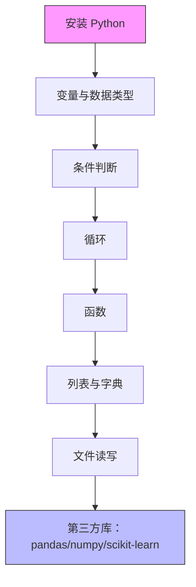

# 附录A Python基础语法速查表

本附录是一份面向零基础初学者的 Python 基础语法速查。如果你从来没写过 Python，或者久违了想快速回忆一下怎么写循环、怎么定义函数，就翻这里。

> **Mermaid 图表：Python 学习路线图**



---

## A.1 安装 Python 与 Hello World

### 1. 怎么安装 Python

Python 是一门需要安装到你电脑里才能运行的语言。

- **Windows**：去 [python.org](https://www.python.org) 下载安装包，安装时记得勾选 **"Add Python to PATH"**，不然命令行找不到 python 命令。
- **macOS**：系统自带旧版 Python，建议用 [Homebrew](https://brew.sh) 安装新版：`brew install python`。
- **Linux**：大多数发行版自带 Python，直接用即可。

安装完后，打开命令行（Windows 里是 PowerShell 或 cmd，Mac/Linux 里是 Terminal），输入：

```bash
python --version
```

如果看到类似 `Python 3.11.x` 的输出，就说明安装成功。

> 💡 **小窍门**：有些电脑上 `python` 命令不认，但 `py` 能用（Windows 常见），或者得用 `python3`。试几个就知道哪个管用了。

### 2. 写第一行代码

不需要安装任何编辑器，你可以先用 Python 自带的交互式环境。在命令行输入 `python`（或 `python3`），回车，你会看到类似 `>>>` 的提示符。这时候可以直接敲代码：

```python
print("你好，Kaggle！")
```

回车后，屏幕会打印出：

```
你好，Kaggle！
```

这就是 Python 最简单的程序：`print()` 把括号里的内容显示在屏幕上。

退出交互式环境，输入 `exit()` 回车，或者按 `Ctrl+Z`（Windows）/`Ctrl+D`（Mac/Linux）再回车。

---

## A.2 变量与数据类型

### 1. 什么是变量

变量就像一个**贴了标签的盒子**，里面装着数据，你通过标签名就能拿到里面的东西。

```python
name = "小明"        # 字符串，用引号括起来
age = 25             # 整数
score = 88.5         # 浮点数（小数）
is_student = True    # 布尔值，True 或 False
```

注意几点：

- 变量名可以用中文、英文、数字和下划线，但不能以数字开头。
- 推荐用**小写加下划线**的风格，比如 `student_name`，`total_score`。
- `=` 是**赋值**，不是数学里的“相等”。意思是“把右边的值存到左边的变量里”。

```python
x = 5
x = x + 1   # 把 x 的旧值加 1，再存回 x。这时候 x 变成 6
print(x)    # 输出：6
```

如果你读一下这句话：“把 x 加 1 之后，又存回给 x”，就很好理解了。

### 2. 常见数据类型

Python 常用的数据类型就这几种，掌握它们就够应付大部分 Kaggle 比赛了：

| 类型 | 例子 | 说明 |
|------|------|------|
| `int`（整数） | `1`, `100`, `-3` | 没有小数的数 |
| `float`（浮点数/小数） | `3.14`, `0.5`, `-2.0` | 有小数的数 |
| `str`（字符串） | `"你好"`, `'Kaggle'`, `"123"` | 文本，必须用引号 |
| `bool`（布尔） | `True`, `False` | 对/错，只有两个值 |
| `list`（列表） | `[1, 2, 3]`, `["a", "b"]` | 有序的集合，可以重复 |
| `dict`（字典） | `{"姓名": "小明", "年龄": 25}` | 键值对，用 key 找 value |
| `tuple`（元组） | `(1, 2, 3)` | 和列表很像，但一旦创建不能修改 |
| `set`（集合） | `{1, 2, 3}` | 不重复的元素，无序 |

下面看几个最常用的：

**字符串：**

```python
greeting = "你好"
name = "小明"

# 把两个字符串拼在一起
message = greeting + "，" + name + "！"
print(message)   # 输出：你好，小明！

# 字符串长度
print(len(name))  # 输出：2

# 取第几个字符（从0开始数）
print(name[0])    # 输出：小
print(name[1])    # 输出：明
```

**列表：**

```python
scores = [85, 92, 78, 90]

print(scores[0])    # 第一个元素：85
print(scores[-1])   # 最后一个元素：90

scores.append(88)   # 在末尾加一个元素
print(scores)       # [85, 92, 78, 90, 88]

scores[1] = 95      # 修改第二个元素
print(scores)       # [85, 95, 78, 90, 88]

print(len(scores))  # 列表长度：5
```

**字典：**

```python
student = {
    "姓名": "小明",
    "年龄": 20,
    "成绩": 88
}

print(student["姓名"])   # 输出：小明
print(student.get("年龄"))  # 输出：20，用 get 更安全，找不到不会报错

student["班级"] = "三年级二班"   # 新增一个键值对
student["年龄"] = 21             # 修改已有的值

print(student)   # {'姓名': '小明', '年龄': 21, '成绩': 88, '班级': '三年级二班'}
```

> 💡 **小窍门**：字典里用 `student["姓名"]` 取值，如果 key 不存在会报错；用 `student.get("姓名")` 找不到会返回 `None`，不报错，新手建议优先用 `get`。

---

## A.3 条件判断：if / elif / else

条件判断就是“如果……那么……否则……”的逻辑。

```python
score = 85

if score >= 90:
    print("优秀")
elif score >= 80:
    print("良好")
elif score >= 60:
    print("及格")
else:
    print("不及格")
```

执行顺序：

1. 先看 `score >= 90` 是否成立。如果成立，打印“优秀”，整个 if 块结束，后面的都不看了。
2. 如果第一个不成立，看 `score >= 80`。
3. 以此类推，直到某个条件成立，或者全部不成立就执行 `else`。

条件里常用的比较运算符：

| 运算符 | 含义 | 例子 | 结果 |
|--------|------|------|------|
| `==` | 相等 | `5 == 5` | `True` |
| `!=` | 不相等 | `5 != 3` | `True` |
| `>` | 大于 | `5 > 3` | `True` |
| `<` | 小于 | `5 < 3` | `False` |
| `>=` | 大于等于 | `5 >= 5` | `True` |
| `<=` | 小于等于 | `3 <= 5` | `True` |

逻辑运算符（把多个条件组合在一起）：

| 运算符 | 含义 | 例子 | 结果 |
|--------|------|------|------|
| `and` | 且，两个都成立才为真 | `True and False` | `False` |
| `or` | 或，有一个成立就为真 | `True or False` | `True` |
| `not` | 非，取反 | `not True` | `False` |

```python
age = 20
has_id = True

if age >= 18 and has_id:
    print("可以进网吧")
else:
    print("进不去")
```

---

## A.4 循环：for 和 while

### 1. for 循环：遍历列表、字典、字符串

`for` 循环的意思是“对集合里的每一个元素，都做一次某件事”。

```python
fruits = ["苹果", "香蕉", "橘子"]

for fruit in fruits:
    print("我喜欢吃", fruit)
```

输出：

```
我喜欢吃 苹果
我喜欢吃 香蕉
我喜欢吃 橘子
```

`fruit` 是循环变量，每次循环它会依次变成列表里的一个元素。

也可以用 `range()` 生成数字序列：

```python
# 打印 0 到 4
for i in range(5):
    print(i)

# 打印 1 到 5
for i in range(1, 6):
    print(i)

# 打印 1, 3, 5（步长为2）
for i in range(1, 6, 2):
    print(i)
```

遍历字典：

```python
student = {"姓名": "小明", "年龄": 20, "成绩": 88}

for key in student:
    print(key, ":", student[key])

# 或者同时拿 key 和 value
for key, value in student.items():
    print(key, "=", value)
```

### 2. while 循环：只要条件成立就一直循环

```python
count = 0
while count < 3:
    print("第", count, "次")
    count = count + 1   # 别忘了修改 count，不然会死循环！
```

输出：

```
第 0 次
第 1 次
第 2 次
```

⚠️ **死循环陷阱**：如果 `while` 里面的条件永远成立，程序就会一直跑下去不停下来。比如忘记写 `count = count + 1`，`count < 3` 永远为真，这就是死循环。遇到死循环，按 `Ctrl+C` 强制停止。

### 3. break 和 continue

- `break`：立刻跳出整个循环，后面的循环都不执行了。
- `continue`：跳过本次循环剩下的代码，直接开始下一次循环。

```python
for i in range(1, 6):
    if i == 3:
        break   # i 等于 3 时，直接结束循环
    print(i)

# 输出：1, 2
```

```python
for i in range(1, 6):
    if i == 3:
        continue   # i 等于 3 时，跳过打印，直接下一次
    print(i)

# 输出：1, 2, 4, 5
```

---

## A.5 函数：定义与调用

函数就是把一段可以重复使用的代码包起来，起个名字，需要的时候调用一下就行。

### 1. 定义函数

```python
def 问候(名字):
    print("你好，", 名字)

# 调用函数
问候("小明")
问候("小红")
```

输出：

```
你好， 小明
你好， 小红
```

`def` 是定义函数的关键字，`问候` 是函数名，`名字` 是参数（函数外部传进来的数据）。

### 2. 返回值：return

有些函数不只是打印，还要把结果“返回”给调用者，这样你可以把结果存起来继续用。

```python
def 加法(a, b):
    return a + b

结果 = 加法(3, 5)
print(结果)   # 输出：8
```

`return` 后面跟什么，调用这个函数就会得到什么。如果没有 `return`，函数默认返回 `None`（表示空）。

```python
def 只打印不返回(a, b):
    print(a + b)

结果 = 只打印不返回(3, 5)
print(结果)   # 输出：None
```

### 3. 参数默认值

```python
def 打招呼(名字="朋友"):
    print("你好，", 名字)

打招呼()        # 输出：你好， 朋友
打招呼("小明")  # 输出：你好， 小明
```

如果调用时不传参数，就用默认值 `"朋友"`。

> 💡 **小窍门**：在 Kaggle 和机器学习里，你会经常自己写函数来做数据清洗、模型训练、预测等，把重复的代码封装成函数可以让脚本短很多，也很不容易出错。

---

## A.6 列表推导式：一行代码生成列表

列表推导式是 Python 的“糖衣语法”，用极少的代码就能生成一个新列表。

```python
# 普通写法：生成 0 到 9 的平方
squares = []
for i in range(10):
    squares.append(i * i)

# 列表推导式写法：一行搞定
squares = [i * i for i in range(10)]
print(squares)   # [0, 1, 4, 9, 16, 25, 36, 49, 64, 81]
```

还可以加条件：

```python
# 只保留偶数的平方
even_squares = [i * i for i in range(10) if i % 2 == 0]
print(even_squares)   # [0, 4, 16, 36, 64]
```

`i % 2 == 0` 的意思是“除以 2 余数为 0”，也就是偶数。

---

## A.7 文件读写

### 1. 读写文本文件

```python
# 写入文件（会覆盖原有内容）
with open("output.txt", "w", encoding="utf-8") as f:
    f.write("第一行内容\n")
    f.write("第二行内容\n")

# 读取文件
with open("output.txt", "r", encoding="utf-8") as f:
    内容 = f.read()
    print(内容)
```

`with open(...) as f:` 是 Python 推荐的写法，好处是不用手动关闭文件，程序退出 `with` 块后文件会自动关闭，不会泄漏资源。

- `"w"`：写入模式，如果文件不存在会创建，存在会覆盖。
- `"r"`：读取模式。
- `"a"`：追加模式，在文件末尾加内容，不覆盖。
- `encoding="utf-8"`：必须加，不然中文可能会乱码。

### 2. 读写 CSV 文件（用 pandas）

在 Kaggle 里，几乎都用 `pandas` 读 CSV，比原生的 `open` 方便多了：

```python
import pandas as pd

# 读取 CSV
df = pd.read_csv("train.csv")

# 查看前 5 行
print(df.head())

# 查看基本信息
print(df.info())

# 保存为新的 CSV
df.to_csv("output.csv", index=False)
```

`index=False` 表示不要把行号也写进 CSV 文件里，Kaggle 提交时通常需要这个。

---

## A.8 模块与包：import 其他代码

Python 的强大之处在于有大量现成的库（别人写好的代码），你只需要 `import` 进来就能用。

```python
import math

print(math.sqrt(16))   # 4.0，开平方根
print(math.pi)         # 3.141592653589793，圆周率
```

也可以只导入某个函数：

```python
from math import sqrt, pi

print(sqrt(16))   # 4.0
print(pi)         # 3.141592653589793
```

或者给库起个短别名（pandas 和 numpy 几乎都这么用）：

```python
import pandas as pd
import numpy as np
```

这样之后就用 `pd.read_csv()`、`np.array()` 之类的，不用每次都写全称。

---

## A.9 错误处理：try / except

新手写代码最常遇到的就是报错。`try / except` 可以让程序遇到错误时不崩溃，而是执行你指定的“备用方案”。

```python
try:
    x = 10 / 0   # 除以零会报错
except ZeroDivisionError:
    print("不能除以零！")
```

输出：

```
不能除以零！
```

更通用的写法，捕获所有错误：

```python
try:
    这里可能会出错的代码
except Exception as e:
    print("出错了，原因是:", e)
```

`e` 会拿到错误的具体信息，方便你排查。

---

## A.10 类与对象（简单了解即可）

做 Kaggle 比赛，大部分时候只用函数和脚本，很少需要写类。但了解一点基础概念不会有坏处。

类是对象的“模板”，对象是根据类“制造”出来的具体实例。

```python
class 学生:
    def __init__(self, 名字, 年龄):
        self.名字 = 名字
        self.年龄 = 年龄

    def 打招呼(self):
        print("你好，我是", self.名字)

# 创建对象
s1 = 学生("小明", 20)
s2 = 学生("小红", 19)

s1.打招呼()   # 输出：你好，我是 小明
s2.打招呼()   # 输出：你好，我是 小红
```

- `__init__` 是构造方法，创建对象时自动调用，用于初始化数据。
- `self` 代表对象本身，`self.名字` 就是“这个对象的名字”。

---

## A.11 常见错误速查

| 报错信息 | 意思 | 常见原因 |
|----------|------|----------|
| `SyntaxError` | 语法错误 | 括号没闭合、冒号忘了写、缩进不对 |
| `NameError` | 变量未定义 | 用了没定义过的变量，或者变量名拼写错了 |
| `TypeError` | 类型错误 | 把字符串和数字相加、对不可调用对象调用等 |
| `IndexError` | 索引越界 | 访问列表不存在的下标，比如列表只有3个元素却访问第4个 |
| `KeyError` | 字典键不存在 | 访问字典里不存在的 key |
| `FileNotFoundError` | 文件不存在 | 路径写错了，或者文件不在那个目录下 |
| `IndentationError` | 缩进错误 | Python 对缩进非常敏感，同一代码块里缩进必须一致 |

> 💡 **缩进提醒**：Python 用缩进（通常是4个空格）来表示代码块归属，不像其他语言用花括号 `{}`。`if`、`for`、`while`、`def`、`class` 后面必须换行并缩进。

---

## A.12 小结

本附录快速过了一遍 Python 最常用的基础语法：

1. **变量与数据类型**：`int`, `float`, `str`, `bool`, `list`, `dict`。
2. **条件判断**：`if / elif / else`。
3. **循环**：`for`、`while`，配合 `break` / `continue`。
4. **函数**：`def` 定义，`return` 返回值，支持默认参数。
5. **列表推导式**：一行代码生成列表。
6. **文件读写**：`with open(...)` 和 `pandas.read_csv()`。
7. **模块导入**：`import`，常用 `pd`、`np` 别名。
8. **错误处理**：`try / except`。
9. **类与对象**：简单了解即可，Kaggle 里不常用。

如果你在写比赛代码时忘了某个语法怎么写，回来翻这张速查表就行。更多深入内容，可以参考 Python 官方文档或《Python 编程：从入门到实践》。

---

> **下一步建议**：掌握这些基础后，建议继续阅读附录B（NumPy 快速入门）和附录C（pandas 数据处理），它们是 Kaggle 表格数据比赛的两大核心工具。