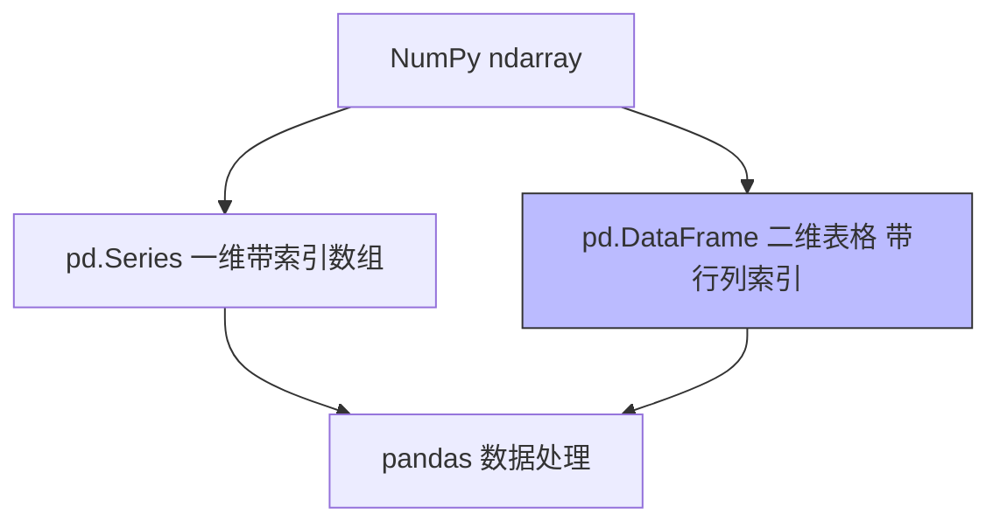

# 附录B pandas快速参考

pandas 是 Python 里处理表格数据的“神器”。Kaggle 上的绝大多数比赛（尤其是表格类比赛）都离不开它：读 CSV、看数据、清洗缺失值、筛选行列、分组统计、合并表格……这些 pandas 都能几行代码搞定。

本附录面向零基础初学者，用大白话讲清楚 pandas 两个最核心的对象：**Series（一维）**和 **DataFrame（二维表格）**，以及日常数据处理中最常用的操作。

> **Mermaid 图表：pandas 核心数据结构**



---

## B.1 读写数据

### 安装与导入

```bash
pip install pandas
```

Kaggle Notebooks 里 pandas 已经预装，直接导入，约定成俗起别名 `pd`：

```python
import pandas as pd
```

### 常用读写函数

```python
# 读取
df = pd.read_csv('train.csv')           # 读取 CSV
df = pd.read_excel('data.xlsx')         # 读取 Excel
df = pd.read_json('data.json')          # 读取 JSON
df = pd.read_sql('SELECT * FROM table', conn)  # 读取数据库
df = pd.read_parquet('data.parquet')    # 读取 Parquet
df = pd.read_html('page.html')          # 读取网页表格

# 写回
df.to_csv('submission.csv', index=False)   # 写 CSV（index=False 不要把行号写进文件）
df.to_excel('output.xlsx', index=False)    # 写 Excel
df.to_json('output.json')                  # 写 JSON
df.to_parquet('output.parquet')            # 写 Parquet
```

> 💡 **小窍门**：Kaggle 提交文件通常用 `to_csv(..., index=False)` 生成，不要把行索引写进文件，否则会多出一列 `Unnamed: 0` 导致格式不匹配。

`read_csv` 常用参数：

| 参数 | 说明 | 例子 |
|------|------|------|
| `encoding` | 文件编码，中文文件常用 `utf-8` 或 `gbk` | `encoding="utf-8"` |
| `index_col` | 把哪一列当作行索引 | `index_col="Id"` |
| `usecols` | 只读取哪些列 | `usecols=["姓名", "成绩"]` |
| `nrows` | 只读取前多少行（快速预览） | `nrows=100` |

---

## B.2 Series 与 DataFrame 创建

### 1. Series：带索引的一维数组

你可以把 Series 理解为“带标签的列表”，每个元素都有自己的索引（标签）。

```python
s = pd.Series([85, 92, 78, 90], name="成绩")

print(s)
# 0    85
# 1    92
# 2    78
# 3    90
# Name: 成绩, dtype: int64

print(s.values)   # [85 92 78 90]   底层是 NumPy 数组
print(s.index)    # RangeIndex(0, 1, 2, 3)  索引
print(s.name)     # 成绩   系列名字
```

默认索引是从 0 开始的整数，也可以自定义索引：

```python
s = pd.Series([85, 92, 78], index=["小明", "小红", "小强"], name="成绩")

print(s)
# 小明    85
# 小红    92
# 小强    78
# Name: 成绩, dtype: int64

print(s["小明"])   # 85   用索引名取值
```

### 2. DataFrame：带行列索引的二维表格

DataFrame 最像 Excel 表格，有行索引和列名。它是 Kaggle 数据处理里用得最多的对象。

```python
df = pd.DataFrame({
    "姓名": ["小明", "小红", "小强"],
    "年龄": [20, 19, 21],
    "成绩": [85, 92, 78]
})

print(df)
#    姓名  年龄  成绩
# 0  小明   20   85
# 1  小红   19   92
# 2  小强   21   78
```

每一列本身就是一个 Series：

```python
print(df["姓名"])   # 取出“姓名”这一列，得到一个 Series
print(type(df["姓名"]))   # <class 'pandas.core.series.Series'>
```

---

## B.3 属性与基本操作

```python
# 查看数据基本信息
df.info()              # 列名、非空个数、数据类型、内存占用
print(df.shape)        # (行数, 列数)
print(df.columns)      # 所有列名
print(df.index)        # 行索引
print(df.dtypes)       # 每列的数据类型

# 查看前几行 / 后几行
print(df.head())       # 前 5 行
print(df.head(10))     # 前 10 行
print(df.tail())       # 后 5 行

# 统计摘要（数值列）
print(df.describe())   # 均值、标准差、最小/最大值、分位数等

# 唯一值与计数
print(df["性别"].unique())           # 唯一值
print(df["性别"].nunique())          # 唯一值个数
print(df["性别"].value_counts())     # 每个值出现的次数

# 基本操作
df = df.rename(columns={"成绩": "分数"})   # 改列名
df.columns = ["姓名", "年龄", "分数"]      # 直接改全部列名
df = df.reset_index(drop=True)           # 重置行索引
```

---

## B.4 索引与筛选

### 1. 选取列

```python
# 选单列（返回 Series）
series = df["年龄"]

# 选多列（返回 DataFrame）
sub = df[["姓名", "成绩"]]
```

### 2. loc / iloc：选取行和列

这是 pandas 最重要也最容易混淆的两个索引方法：

- **`loc`**：基于**标签**（索引名）选取，包含起止两端。
- **`iloc`**：基于**位置**（整数位置，从 0 开始），前包含后不含（像 Python 列表切片）。

```python
# 假设 df 的行索引是 0, 1, 2, ...

# loc：按索引名
row = df.loc[0]        # 第一行（索引为 0 的那一行）
rows = df.loc[0:2]     # 索引 0、1、2 三行（包含 2）

# iloc：按位置
row = df.iloc[0]       # 第一行
rows = df.iloc[0:3]    # 前 3 行（位置 0、1、2，不含 3）

# 同时指定行和列
value = df.loc[0, "姓名"]        # 索引 0 行的“姓名”列
sub = df.loc[0:2, ["姓名", "成绩"]]  # 前 3 行的“姓名”和“成绩”列
sub = df.iloc[0:3, 0:2]          # 前 3 行前 2 列
```

> 💡 **记住区别**：`loc` 看“名字”，`iloc` 看“位置”。如果你的行索引就是 0,1,2,...，两者效果差不多，但边界处理不同（`loc[0:2]` 包含第 2 行，`iloc[0:2]` 不包含第 2 行）。

### 3. 布尔索引：按条件筛选行

```python
# 找出成绩大于 85 的所有行
high_scores = df[df["成绩"] > 85]

# 找出年龄等于 20 且成绩大于 80 的行
mask = (df["年龄"] == 20) & (df["成绩"] > 80)
result = df[mask]

# 找出姓名是“小明”或“小红”的行
mask = df["姓名"].isin(["小明", "小红"])
result = df[mask]

# 查询语法
result = df.query('年龄 > 20 and 成绩 > 80')
```

> ⚠️ 注意：pandas 里做“且”或“或”要用 `&` 和 `|`，不能用 `and` 和 `or`；每个条件都要加括号。

### 4. 其他常用筛选方法

```python
# between：判断是否在某个范围内
df[df["年龄"].between(18, 25)]

# nlargest / nsmallest：取最大/最小的 N 行
df.nlargest(5, "成绩")   # 成绩最高的 5 行
df.nsmallest(3, "年龄")  # 年龄最小的 3 行

# filter：按列名过滤
df.filter(items=["姓名", "成绩"])      # 保留指定列
df.filter(like="名")                   # 保留列名包含“名”的列
df.filter(regex="^[A-Z]")              # 保留列名匹配正则的列
```

---

## B.5 分组与聚合

`groupby` 是数据分析里最强大的工具之一，意思是“按某列分组，然后对每组做统计”。

```python
# 按“性别”分组，看每组“成绩”的平均值
result = df.groupby("性别")["成绩"].mean()

# 按“性别”分组，看多个统计量
result = df.groupby("性别")["成绩"].agg(["mean", "max", "min", "count"])

# 按多列分组
result = df.groupby(["性别", "年级"])["成绩"].mean()

# 分组后恢复成普通列（不再作为索引）
result = df.groupby("性别")["成绩"].mean().reset_index()
```

常用的聚合函数：

| 方法 | 说明 |
|------|------|
| `mean()` | 平均值 |
| `sum()` | 求和 |
| `max()` / `min()` | 最大值 / 最小值 |
| `count()` | 非空个数 |
| `std()` | 标准差 |
| `median()` | 中位数 |
| `nunique()` | 唯一值个数 |
| `size()` | 每组行数（含缺失） |
| `first()` / `last()` / `nth()` | 取第一个 / 最后一个 / 第 N 个 |

```python
# 自定义聚合
result = df.groupby("性别").agg({
    "成绩": ["mean", "max"],
    "年龄": "mean"
})

# transform：返回与原数据同长度的结果（如填充组内均值）
df["年龄填充"] = df.groupby("性别")["年龄"].transform(lambda x: x.fillna(x.mean()))

# filter：过滤整个组（如只保留人数大于 2 的组）
result = df.groupby("性别").filter(lambda x: len(x) > 2)
```

---

## B.6 合并与连接

### 1. merge：像数据库连表一样按 key 合并

```python
# 两个表按“学生ID”列合并
merged = pd.merge(df1, df2, on="学生ID")

# 按不同名的列合并：df1 的 "id" 对应 df2 的 "student_id"
merged = pd.merge(df1, df2, left_on="id", right_on="student_id")

# 连接方式：inner（只保留两边都有的）、left（保留左表全部）、right、outer（保留全部）
merged = pd.merge(df1, df2, on="学生ID", how="left")
```

### 2. join：基于索引合并

```python
df1.join(df2, on="key")   # 把 df2 按 key 列连到 df1 上
```

### 3. concat：上下或左右直接拼接

```python
# 上下拼接（行增加）
df_all = pd.concat([df1, df2], axis=0)

# 左右拼接（列增加）
df_all = pd.concat([df1, df2], axis=1)

# 忽略原索引，重新生成 0, 1, 2...
df_all = pd.concat([df1, df2], axis=0, ignore_index=True)
```

---

## B.7 字符串操作

对文本列用 `.str` 访问器做查找、替换、切分、大小写转换等操作。

```python
# 包含
df["email"].str.contains("@")

# 替换
df["姓名"].str.replace("小明", "小强")

# 切分
df["姓名"].str.split(" ", expand=True)   # expand=True 切成多列

# 判断开头/结尾
df["代码"].str.startswith("A")
df["代码"].str.endswith("Z")

# 长度、大小写、去空格
df["姓名"].str.len()
df["姓名"].str.lower()
df["姓名"].str.upper()
df["姓名"].str.strip()

# 提取（正则）
df["代码"].str.extract(r"(\d+)")   # 提取数字部分
df["代码"].str.extractall(r"(\d+)")  # 提取所有匹配
```

---

## B.8 日期与时间

```python
# 把字符串日期转成 pandas 能识别的日期类型
df["日期"] = pd.to_datetime(df["日期"])

# 生成日期序列
dates = pd.date_range("2020-01-01", periods=10, freq="D")

# 常用日期属性
df["年份"] = df["日期"].dt.year
df["月份"] = df["日期"].dt.month
df["日"] = df["日期"].dt.day
df["星期"] = df["日期"].dt.dayofweek   # 0=周一, 6=周日
df["小时"] = df["日期"].dt.hour
df["是否月末"] = df["日期"].dt.is_month_end

# 时间序列操作
df.set_index("日期").resample("M").mean()   # 按月重采样，求平均
df["日期"].shift(1)   # 向后移动 1 位（得到前一天的值）
df["日期"].rolling(7).mean()   # 7 天滚动平均
df["日期"].expanding().mean()  # 累积平均
```

---

## B.9 缺失值与重复

### 1. 缺失值处理

pandas 用 `NaN`（Not a Number）表示缺失值。

```python
# 查看缺失值
print(df.isnull().sum())   # 每列缺失值个数
print(df.notnull().sum())  # 每列非空值个数
print(df.isnull().sum().sum())  # 总缺失值个数

# 删除含缺失值的行
df_drop = df.dropna()                 # 删除任何含缺失值的行
df_drop = df.dropna(how="all")        # 只删除所有值都缺失的行
df_drop = df.dropna(subset=["姓名"])  # 只看“姓名”列，缺失就删

# 填充缺失值
df_fill = df.fillna(0)                              # 全部填 0
df_fill = df.fillna(df["年龄"].mean())              # 用该列平均值填充
df["年龄"] = df["年龄"].fillna(df["年龄"].median())  # 用中位数填充
df["城市"] = df["城市"].fillna("未知")               # 类别型填“未知”

# 插值填充（适合时间序列）
df = df.interpolate()   # 线性插值
```

> 💡 **大白话**：缺失值怎么处理没有标准答案。数值型常用平均值/中位数填充；类别型常用众数（出现最多的值）填充，或者直接填一个“未知”类别；也可以直接把缺失值多的行或列删掉。具体看数据情况。

### 2. 重复值处理

```python
# 查看重复行
print(df.duplicated().sum())   # 重复行个数

# 删除重复行
df = df.drop_duplicates()
df = df.drop_duplicates(subset=["姓名", "年龄"])  # 按指定列判断重复
df = df.drop_duplicates(keep="last")   # 保留最后一行重复项
```

---

## B.10 小结

本附录快速过了一遍 pandas 最常用的操作：

1. **读写数据**：`pd.read_csv()`、`df.to_csv(..., index=False)`，常用 `encoding`、`index_col`、`usecols`。
2. **核心对象**：`Series`（一维）、`DataFrame`（二维表格）。
3. **属性与基本操作**：`info()`、`shape`、`columns`、`dtypes`、`head()`、`tail()`、`describe()`、`value_counts()`、`rename()`、`reset_index()`。
4. **索引与筛选**：`df["列"]` 选列；`loc` 按标签选行/列；`iloc` 按位置选行/列；布尔索引 `df[条件]` 筛选行；`query()`、`between()`、`nlargest()`、`nsmallest()`、`filter()`。
5. **分组与聚合**：`groupby(...).agg(...)`，常用 `mean`/`sum`/`max`/`min`/`count`/`std`/`median`/`nunique`；`transform()` 和 `filter()` 进阶用法。
6. **合并与连接**：`merge()` 按 key 连表；`join()` 基于索引合并；`concat()` 上下/左右拼接。
7. **字符串操作**：`.str.contains/replace/split/startswith/endswith/len/lower/upper/strip/extract/`。
8. **日期与时间**：`pd.to_datetime()`、`date_range()`、`.dt.year/month/day/hour/dayofweek/`、`resample()`、`shift()`、`rolling()`、`expanding()`。
9. **缺失值**：`isnull().sum()` 查看；`dropna()` 删除；`fillna()` 填充；`interpolate()` 插值。
10. **重复值**：`duplicated()` 查看；`drop_duplicates()` 删除。

掌握这些，你就能处理 Kaggle 上绝大多数表格数据的读取、清洗和特征工程了。

---

> **下一步建议**：数据处理完之后，就是建模和评估。建议继续阅读附录 D（scikit-learn 快速参考）和正文第 20 章《模型评估与验证》，学习如何用 scikit-learn 训练模型并评估效果。