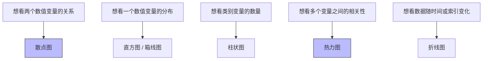

# 附录C matplotlib快速参考

matplotlib 是 Python 里最基础的绘图库，seaborn 是在它之上封装的统计绘图库，画出来的图更好看、代码更简洁。做数据分析和 Kaggle 比赛，看不懂数据就很难建好模型。可视化就是把数据“画出来”，让你一眼看出哪些特征有用、哪些数据异常、目标变量长什么样。

本附录面向零基础初学者，用大白话讲清楚怎么画折线图、散点图、直方图、柱状图、箱线图、热力图等常见图表，以及怎么设置标题、坐标轴、图例、颜色，最后怎么保存图片。

> **Mermaid 图表：常见图表适用场景**



---

## C.1 图形基础

### 安装与导入

```bash
pip install matplotlib seaborn
```

Kaggle Notebooks 里两个库都预装了，直接导入，约定成俗起别名 `plt` 和 `sns`：

```python
import matplotlib.pyplot as plt
import seaborn as sns
```

### 在 Notebook 里直接显示图表

如果你在 Jupyter Notebook 或 Kaggle Notebooks 里写代码，加上这一行，图表会直接在单元格下方显示：

```python
%matplotlib inline
```

如果你在普通的 Python 脚本里运行，图表会弹出一个独立窗口。脚本结束后窗口可能会自动关闭，这时候可以在脚本最后加上 `plt.show()` 强制显示。

### 画第一张图：折线图

```python
import matplotlib.pyplot as plt

x = [1, 2, 3, 4, 5]
y = [2, 4, 1, 5, 3]

plt.plot(x, y)                    # 画折线
plt.title("示例折线图")           # 标题
plt.xlabel("X轴")                 # X 轴标签
plt.ylabel("Y轴")                 # Y 轴标签
plt.show()                        # 显示图表（脚本模式下需要）
```

### 中文显示（重要）

matplotlib 默认不支持中文，画出来的图中文会变成方框。解决办法是指定一个支持中文的字体。

Windows 系统通常自带 "SimHei"（黑体）或 "Microsoft YaHei"（微软雅黑）：

```python
plt.rcParams["font.sans-serif"] = ["SimHei"]   # 指定默认字体为黑体
plt.rcParams["axes.unicode_minus"] = False     # 解决负号显示为方框的问题
```

Mac 系统可以用 "Arial Unicode MS" 或 "Heiti TC"：

```python
plt.rcParams["font.sans-serif"] = ["Arial Unicode MS"]
plt.rcParams["axes.unicode_minus"] = False
```

加上这两行之后，后面画的图里中文标题、标签、图例都能正常显示了。

---

## C.2 常见图表

### 1. 折线图：看趋势

适合看数据随某个变量（比如时间、索引）的变化趋势。

```python
plt.plot(x, y, color="red", linestyle="--", marker="o")
plt.title("随时间变化的趋势")
plt.xlabel("时间")
plt.ylabel("数值")
plt.grid(True)
plt.show()
```

### 2. 散点图：看两个数值变量的关系

适合看两个数值列之间是否有相关性。

```python
# matplotlib
plt.scatter(df["面积"], df["房价"])
plt.title("房屋面积 vs 房价")
plt.xlabel("面积")
plt.ylabel("房价")
plt.show()

# seaborn（更好看，自带网格线）
sns.scatterplot(data=df, x="面积", y="房价", alpha=0.6)
plt.title("房屋面积 vs 房价")
plt.show()
```

`alpha=0.6` 让散点半透明，点多时不容易遮挡。

> 💡 **大白话**：散点图上，如果点从左下往右上排成一条线，说明两个变量正相关（一个大另一个也大）；如果点散得很开，说明关系不大。

### 3. 直方图：看一个数值变量的分布

把数据分成很多个“桶”，看每个桶里有多少个数据，能看出数据集中在哪个区间，有没有异常值。

```python
# matplotlib
plt.hist(df["年龄"], bins=20, color="skyblue", edgecolor="black")
plt.title("年龄分布直方图")
plt.xlabel("年龄")
plt.ylabel("人数")
plt.show()

# seaborn（可加一条核密度估计曲线 KDE）
sns.histplot(df["年龄"], bins=20, kde=True, color="skyblue")
plt.title("年龄分布（带 KDE 曲线）")
plt.show()
```

- `bins`：分多少个桶，默认 10 个，可以根据数据调整。
- `color`：柱子颜色。
- `edgecolor`：柱子边框颜色，加上边框看起来更清晰。
- `kde=True`：加一条平滑的密度估计曲线。

### 4. 柱状图：看类别变量的数量

适合看每个类别有多少个样本。

```python
# matplotlib
counts = df["性别"].value_counts()
plt.bar(counts.index, counts.values, color="salmon")
plt.title("性别分布")
plt.xlabel("性别")
plt.ylabel("人数")
plt.show()

# seaborn（更简单，直接传列名）
sns.countplot(data=df, x="性别", palette="Set2")
plt.title("性别分布")
plt.show()
```

如果类别很多，可以把柱子画横过来，标签不容易重叠：

```python
sns.countplot(data=df, y="城市", order=df["城市"].value_counts().index)
plt.title("城市分布")
plt.show()
```

### 5. 箱线图：看分布和异常值

能一眼看出数据的中位数、四分位数，以及哪些是异常值（离群点）。常用来看“某个数值列按类别分组后的分布差异”。

```python
sns.boxplot(data=df, x="性别", y="年龄", palette="Set3")
plt.title("不同性别的年龄分布箱线图")
plt.show()
```

箱线图的各部分含义：

- 箱子的底边和顶边：下四分位数（Q1）和上四分位数（Q3）。
- 箱子中间的线：中位数。
- 伸出来的“胡须”：正常范围内的最大值和最小值。
- 超出胡须的单独圆点：异常值/离群点。

### 6. 热力图：看变量之间的相关性

做特征工程前，经常要看哪些特征和目标变量强相关，哪些特征之间高度重复（多重共线性）。

```python
# 只选数值型列，算相关系数
corr = df.select_dtypes(include=["number"]).corr()

# 画热力图
plt.figure(figsize=(10, 8))           # 设置图片大小
sns.heatmap(corr, annot=True, cmap="coolwarm", center=0, fmt=".2f")
plt.title("特征相关系数热力图")
plt.show()
```

- `annot=True`：在每个格子里显示具体的相关系数数值。
- `cmap`：颜色方案，`coolwarm` 是冷暖色，正相关偏红，负相关偏蓝。
- `center=0`：把颜色中心对准 0，正负对称。
- `fmt=".2f"`：数值保留两位小数。

> 💡 **小窍门**：如果两个特征的相关系数接近 1（或 -1），说明它们几乎重复，建模时只需要保留一个即可，另一个可以删掉，避免多重共线性。

---

## C.3 坐标轴与刻度

```python
# 调整刻度标签
plt.xticks(rotation=45)      # X 轴刻度倾斜 45 度，避免文字重叠
plt.yticks([0, 50, 100, 150])  # 自定义 Y 轴刻度

# 调整刻度样式
plt.tick_params(axis='both', which='major', labelsize=12)

# 坐标轴边框（spines）
ax = plt.gca()
ax.spines['top'].set_visible(False)   # 隐藏上边框
ax.spines['right'].set_visible(False) # 隐藏右边框

# 双坐标轴
ax1 = plt.gca()
ax2 = ax1.twinx()                     # 创建共享 X 轴的第二个 Y 轴
ax2.plot(x, z, color='red')           # 在第二个 Y 轴上画线
ax2.set_ylabel('另一变量', color='red')

# 在图上标注文字和箭头
plt.annotate('最高点', xy=(x_max, y_max), xytext=(x_max, y_max+5),
             arrowprops=dict(facecolor='black', shrink=0.05))
plt.text(0.5, 0.5, '注释文字', transform=plt.gca().transAxes)
```

---

## C.4 子图与布局

在一个画布里画多个小图，调整它们之间的间距。

```python
# 创建 2 行 2 列的子图
fig, axes = plt.subplots(2, 2, figsize=(10, 8))

axes[0, 0].plot(x, y)
axes[0, 0].set_title("左上图")

axes[0, 1].scatter(x, y)
axes[0, 1].set_title("右上图")

axes[1, 0].hist(y)
axes[1, 0].set_title("左下图")

axes[1, 1].bar(x, y)
axes[1, 1].set_title("右下图")

plt.tight_layout()   # 自动调整间距，避免标签重叠
plt.show()
```

也可以用 `GridSpec` 做更复杂的布局：

```python
from matplotlib import gridspec

fig = plt.figure(figsize=(10, 6))
gs = gridspec.GridSpec(2, 3, figure=fig)

ax1 = fig.add_subplot(gs[0, :])   # 第一行占据全部 3 列
ax2 = fig.add_subplot(gs[1, :2])  # 第二行前 2 列
ax3 = fig.add_subplot(gs[1, 2])   # 第二行最后 1 列
```

`plt.subplots_adjust(left=0.1, right=0.9, top=0.9, bottom=0.1)` 可以手动调整子图之间的间距。

---

## C.5 样式与颜色

```python
# 设置线条颜色、样式、点的形状、透明度
plt.plot(x, y, color='red', linestyle='--', marker='o', 
         linewidth=2, markersize=6, alpha=0.7)

# 颜色条
sc = plt.scatter(x, y, c=z, cmap='viridis')
plt.colorbar(sc)   # 显示颜色条，说明颜色对应的数值

# 使用内置样式
plt.style.use('seaborn-v0_8')   # 或 'ggplot', 'bmh', 'dark_background' 等

# 设置全局参数
plt.rcParams['figure.figsize'] = (10, 6)   # 默认图片大小
plt.rcParams['font.size'] = 12             # 默认字体大小
plt.rcParams['axes.grid'] = True           # 默认显示网格
```

常见颜色和样式：

| 参数 | 常用值 | 说明 |
|------|--------|------|
| `color` | `'red'`, `'blue'`, `'green'`, `'#FF5733'` | 线条或点的颜色 |
| `linestyle` | `'-'`, `'--'', '-.'`, `':'` | 线条样式 |
| `marker` | `'o'`, `'s'`, `'^'`, `'D'`, `'*'` | 点的形状 |
| `linewidth` | `1`, `2`, `3` | 线条粗细 |
| `markersize` | `4`, `6`, `8` | 点的大小 |
| `alpha` | `0.1` ~ `1.0` | 透明度，越小越透明 |
| `cmap` | `'viridis'`, `'coolwarm'`, `'plasma'` | 颜色映射表 |

---

## C.6 图例与注释

```python
# 加图例，说明每条线代表什么
plt.plot(x, y1, label='训练集')
plt.plot(x, y2, label='验证集')
plt.legend(loc='best')   # loc='best' 自动选最佳位置

# 加注释，解释图中的关键点
plt.annotate('峰值', xy=(3, 8), xytext=(3.5, 9),
             arrowprops=dict(facecolor='black', arrowstyle='->'))
plt.text(1, 5, '这里是注释文字', fontsize=10)

# 坐标轴标签和标题
plt.xlabel('X 轴')
plt.ylabel('Y 轴')
plt.title('图表标题')
```

`legend()` 的常用参数：

| 参数 | 说明 | 例子 |
|------|------|------|
| `loc` | 图例位置 | `'best'`, `'upper right'`, `'lower left'`, `'center'` |
| `ncol` | 图例列数 | `ncol=2` 分两列显示 |
| `frameon` | 是否显示边框 | `frameon=False` 不显示边框 |
| `fontsize` | 字体大小 | `fontsize=10` |

---

## C.7 保存与显示

```python
plt.figure(figsize=(8, 6))
sns.scatterplot(data=df, x="面积", y="房价")
plt.title("房屋面积 vs 房价")

# 保存为图片文件
plt.savefig("scatter_plot.png", dpi=300, bbox_inches="tight")

# 显示图表
plt.show()

# 关闭图表，释放内存
plt.close()
```

- `savefig` 要放在 `show()` 之前调用，否则可能保存的是空白图。
- `dpi`：图片清晰度，300 足够打印用，150 屏幕显示够用。
- `bbox_inches="tight"`：自动裁剪空白边缘。
- `format`：保存格式，`'png'`, `'jpg'`, `'pdf'`, `'svg'` 等。
- `transparent`：背景是否透明，`transparent=True` 背景透明。

> ⚠️ **注意**：`savefig` 要放在 `show()` 之前调用，否则可能保存的是空白图。

---

## C.8 小结

本附录快速过了一遍 matplotlib 最常用的操作：

1. **基础折线图**：`plt.plot()`，看趋势。
2. **中文显示**：设置 `font.sans-serif` 和 `axes.unicode_minus`。
3. **散点图**：`plt.scatter()` 或 `sns.scatterplot()`，看两个数值变量的关系。
4. **直方图**：`plt.hist()` 或 `sns.histplot(kde=True)`，看单个变量的分布。
5. **柱状图**：`plt.bar()` 或 `sns.countplot()`，看类别数量。
6. **箱线图**：`sns.boxplot()`，看分组分布和异常值。
7. **热力图**：`sns.heatmap()`，看相关系数。
8. **坐标轴与刻度**：`plt.xticks()`、`plt.yticks()`、`plt.tick_params()`、`ax.spines`、`plt.twinx()`。
9. **子图与布局**：`plt.subplots()`、`plt.GridSpec()`、`plt.tight_layout()`、`plt.subplots_adjust()`。
10. **样式与颜色**：`color`、`linestyle`、`marker`、`linewidth`、`markersize`、`alpha`、`cmap`、`plt.style.use()`、`plt.rcParams`。
11. **图例与注释**：`plt.legend()`、`plt.annotate()`、`plt.text()`。
12. **保存与显示**：`plt.savefig(..., dpi=300, bbox_inches="tight")`、`plt.show()`、`plt.close()`。

可视化不是“画好看的图就完事了”，核心目的是**帮你理解数据**。建议在建模前，先用几张图把数据看个遍，再决定怎么做特征工程和选模型。

---

> **下一步建议**：看完数据可视化，建议继续阅读附录 D（scikit-learn 快速参考）和正文第 20 章《模型评估与验证》，学习如何用交叉验证、混淆矩阵、ROC 曲线等方法评估模型效果。