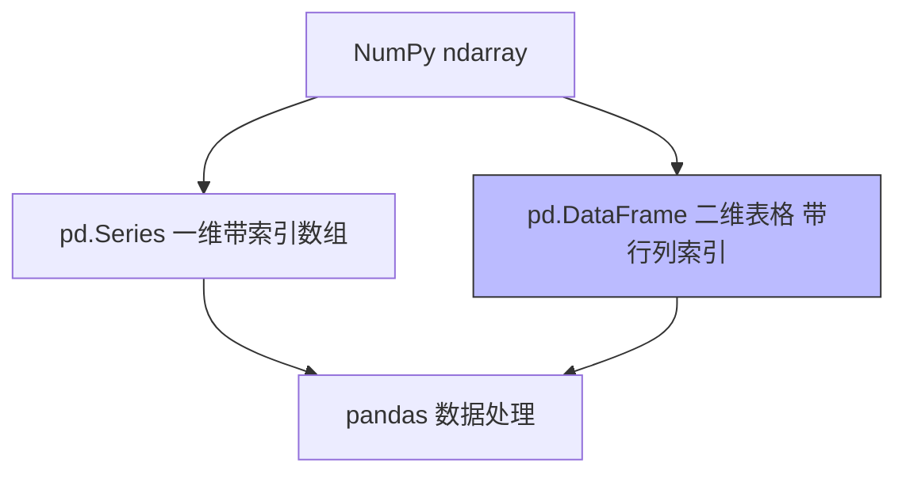

# 附录C pandas 数据处理快速入门

pandas 是 Python 里处理表格数据的“神器”。Kaggle 上的绝大多数比赛（尤其是表格类比赛）都离不开它：读 CSV、看数据、清洗缺失值、筛选行列、分组统计、合并表格……这些 pandas 都能几行代码搞定。

本附录面向零基础初学者，用大白话讲清楚 pandas 两个最核心的对象：**Series（一维）**和 **DataFrame（二维表格）**，以及日常数据处理中最常用的操作。

> **Mermaid 图表：pandas 核心数据结构**



---

## C.1 安装与导入

```bash
pip install pandas
```

Kaggle Notebooks 里 pandas 已经预装，直接导入：

```python
import pandas as pd
```

约定成俗，pandas 起别名 `pd`。

---

## C.2 两个核心对象：Series 和 DataFrame

### 1. Series：带索引的一维数组

你可以把 Series 理解为“带标签的列表”，每个元素都有自己的索引（标签）。

```python
s = pd.Series([85, 92, 78, 90], name="成绩")

print(s)
# 0    85
# 1    92
# 2    78
# 3    90
# Name: 成绩, dtype: int64

print(s.values)   # [85 92 78 90]   底层是 NumPy 数组
print(s.index)    # RangeIndex(0, 1, 2, 3)  索引
print(s.name)     # 成绩   系列名字
```

默认索引是从 0 开始的整数，也可以自定义索引：

```python
s = pd.Series([85, 92, 78], index=["小明", "小红", "小强"], name="成绩")

print(s)
# 小明    85
# 小红    92
# 小强    78
# Name: 成绩, dtype: int64

print(s["小明"])   # 85   用索引名取值
```

### 2. DataFrame：带行列索引的二维表格

DataFrame 最像 Excel 表格，有行索引和列名。它是 Kaggle 数据处理里用得最多的对象。

```python
df = pd.DataFrame({
    "姓名": ["小明", "小红", "小强"],
    "年龄": [20, 19, 21],
    "成绩": [85, 92, 78]
})

print(df)
#    姓名  年龄  成绩
# 0  小明   20   85
# 1  小红   19   92
# 2  小强   21   78
```

每一列本身就是一个 Series：

```python
print(df["姓名"])   # 取出“姓名”这一列，得到一个 Series
print(type(df["姓名"]))   # <class 'pandas.core.series.Series'>
```

---

## C.3 读取数据

Kaggle 比赛数据通常是 CSV 格式，用 `pd.read_csv()` 读取：

```python
# 读取训练集
train = pd.read_csv("train.csv")

# 读取测试集
test = pd.read_csv("test.csv")

# 读取样例提交
sample_sub = pd.read_csv("sample_submission.csv")
```

常用参数：

| 参数 | 说明 | 例子 |
|------|------|------|
| `encoding` | 文件编码，中文文件常用 `utf-8` 或 `gbk` | `encoding="utf-8"` |
| `index_col` | 把哪一列当作行索引 | `index_col="Id"` |
| `usecols` | 只读取哪些列 | `usecols=["姓名", "成绩"]` |
| `nrows` | 只读取前多少行（快速预览） | `nrows=100` |

读取后先看看数据长什么样：

```python
print(df.head())        # 前5行
print(df.head(10))      # 前10行
print(df.tail())        # 后5行
print(df.shape)         # (行数, 列数)
print(df.columns)       # 所有列名
print(df.info())        # 数据类型、非空值数量、内存占用
print(df.describe())    # 数值列的统计信息（均值、标准差、最小/最大值等）
```

---

## C.4 查看与探索数据

```python
# 查看前几行
print(df.head())

# 查看数据基本信息（列名、非空个数、数据类型）
df.info()

# 查看数值列的统计摘要
df.describe()

# 查看某一列的唯一值及个数
print(df["性别"].value_counts())

# 查看缺失值情况
print(df.isnull().sum())   # 每列缺失值个数
print(df.isnull().sum().sum())  # 总缺失值个数

# 查看数据类型
print(df.dtypes)
```

---

## C.5 选取行和列

### 1. 选取列

```python
# 选单列（返回 Series）
series = df["年龄"]

# 选多列（返回 DataFrame）
sub = df[["姓名", "成绩"]]
```

### 2. 选取行：`loc` 和 `iloc`

这是 pandas 最重要也最容易混淆的两个索引方法：

- **`loc`**：基于**标签**（索引名）选取，包含起止两端。
- **`iloc`**：基于**位置**（整数位置，从0开始），前包含后不含（像 Python 列表切片）。

```python
# 假设 df 的行索引是 0, 1, 2, ...

# loc：按索引名
row = df.loc[0]        # 第一行（索引为0的那一行）
rows = df.loc[0:2]     # 索引0、1、2三行（包含2）

# iloc：按位置
row = df.iloc[0]       # 第一行
rows = df.iloc[0:3]    # 前3行（位置0、1、2，不含3）

# 同时指定行和列
value = df.loc[0, "姓名"]        # 索引0行的“姓名”列
sub = df.loc[0:2, ["姓名", "成绩"]]  # 前3行的“姓名”和“成绩”列
sub = df.iloc[0:3, 0:2]          # 前3行前2列
```

> 💡 **记住区别**：`loc` 看“名字”，`iloc` 看“位置”。如果你的行索引就是 0,1,2,...，两者效果差不多，但边界处理不同（`loc[0:2]` 包含第2行，`iloc[0:2]` 不包含第2行）。

### 3. 布尔索引：按条件筛选行

```python
# 找出成绩大于 85 的所有行
high_scores = df[df["成绩"] > 85]

# 找出年龄等于 20 且成绩大于 80 的行
mask = (df["年龄"] == 20) & (df["成绩"] > 80)
result = df[mask]

# 找出姓名是“小明”或“小红”的行
mask = df["姓名"].isin(["小明", "小红"])
result = df[mask]
```

> ⚠️ 注意：pandas 里做“且”或“或”要用 `&` 和 `|`，不能用 `and` 和 `or`；每个条件都要加括号。

---

## C.6 添加、修改、删除列

```python
# 新增一列
df["总分"] = df["成绩"] + 10

# 修改一列
df["年龄"] = df["年龄"] + 1

# 删除一列（axis=1 表示按列删除）
df = df.drop("总分", axis=1)

# 或者用 del
del df["总分"]

# 修改列名
df = df.rename(columns={"成绩": "分数"})
# 或者直接改
df.columns = ["姓名", "年龄", "分数"]
```

---

## C.7 处理缺失值

缺失值（NaN / NULL）是表格数据里最常见的问题。pandas 用 `NaN`（Not a Number）表示缺失。

```python
# 查看每列缺失值个数
print(df.isnull().sum())

# 删除含缺失值的行（how='all' 表示整行都缺失才删，默认 'any' 有一个缺失就删）
df_drop = df.dropna()           # 删除任何含缺失值的行
df_drop = df.dropna(how="all")  # 只删除所有值都缺失的行

# 填充缺失值
df_fill = df.fillna(0)                    # 全部填 0
df_fill = df.fillna(df["年龄"].mean())    # 用该列平均值填充
df_fill = df["年龄"].fillna(df["年龄"].median())  # 用中位数填充

# 只对某一列填充
df["年龄"] = df["年龄"].fillna(df["年龄"].mean())
```

> 💡 **大白话**：缺失值怎么处理没有标准答案。数值型常用平均值/中位数填充；类别型常用众数（出现最多的值）填充，或者直接填一个“未知”类别；也可以直接把缺失值多的行或列删掉。具体看数据情况。

---

## C.8 数据类型转换

```python
# 把某列转成整数
df["年龄"] = df["年龄"].astype("int")

# 把某列转成字符串
df["姓名"] = df["姓名"].astype("str")

# 把某列转成日期时间
df["日期"] = pd.to_datetime(df["日期"])
```

---

## C.9 分组统计：`groupby`

`groupby` 是数据分析里最强大的工具之一，意思是“按某列分组，然后对每组做统计”。

```python
# 按“性别”分组，看每组“成绩”的平均值
result = df.groupby("性别")["成绩"].mean()

# 按“性别”分组，看多个统计量
result = df.groupby("性别")["成绩"].agg(["mean", "max", "min", "count"])

# 按多列分组
result = df.groupby(["性别", "年级"])["成绩"].mean()

# 分组后恢复成普通列（不再作为索引）
result = df.groupby("性别")["成绩"].mean().reset_index()
```

常用的聚合函数：`mean()`（平均值）、`sum()`（求和）、`max()`、`min()`、`count()`（非空个数）、`std()`（标准差）、`median()`（中位数）、`nunique()`（唯一值个数）。

---

## C.10 排序：`sort_values`

```python
# 按“成绩”降序排列
df_sorted = df.sort_values("成绩", ascending=False)

# 按多列排序：先按“年龄”升序，再按“成绩”降序
df_sorted = df.sort_values(["年龄", "成绩"], ascending=[True, False])

# 排序后重置行索引（0,1,2...）
df_sorted = df_sorted.reset_index(drop=True)
```

`ascending=False` 表示降序（从大到小），默认 `True` 表示升序（从小到大）。

---

## C.11 合并表格：`merge` / `concat`

### 1. `merge`：像数据库连表一样按 key 合并

```python
# 两个表按“学生ID”列合并
merged = pd.merge(df1, df2, on="学生ID")

# 按不同名的列合并：df1 的 "id" 对应 df2 的 "student_id"
merged = pd.merge(df1, df2, left_on="id", right_on="student_id")

# 连接方式：inner（只保留两边都有的）、left（保留左表全部）、right、outer（保留全部）
merged = pd.merge(df1, df2, on="学生ID", how="left")
```

### 2. `concat`：上下或左右直接拼接

```python
# 上下拼接（行增加）
df_all = pd.concat([df1, df2], axis=0)

# 左右拼接（列增加）
df_all = pd.concat([df1, df2], axis=1)
```

---

## C.12 应用函数：`apply` / `map`

对某一列的每个元素应用一个自定义函数：

```python
# 定义函数：成绩转等级
def 成绩转等级(score):
    if score >= 90:
        return "A"
    elif score >= 80:
        return "B"
    elif score >= 70:
        return "C"
    else:
        return "D"

# 应用到“成绩”列，生成新列“等级"
df["等级"] = df["成绩"].apply(成绩转等级)
```

`apply` 适合复杂逻辑；简单的替换可以用 `map`：

```python
# 把“性别”列的“男”/“女”替换成 1/0
gender_map = {"男": 1, "女": 0}
df["性别"] = df["性别"].map(gender_map)
```

---

## C.13 保存结果

```python
# 保存为 CSV，index=False 表示不要把行索引写进文件
df.to_csv("output.csv", index=False)

# 保存为 Excel（需要安装 openpyxl：pip install openpyxl）
df.to_excel("output.xlsx", index=False)
```

Kaggle 提交文件通常就是用 `to_csv(..., index=False)` 生成的。

---

## C.14 小结

本附录快速过了一遍 pandas 最常用的操作：

1. **核心对象**：`Series`（一维）、`DataFrame`（二维表格）。
2. **读取数据**：`pd.read_csv()`，常用 `encoding`、`index_col`、`usecols`。
3. **查看数据**：`head()`、`tail()`、`shape`、`columns`、`info()`、`describe()`、`isnull().sum()`。
4. **选取数据**：`df["列"]` 选列；`loc` 按标签选行/列；`iloc` 按位置选行/列；布尔索引 `df[条件]` 筛选行。
5. **增删改列**：直接赋值新增/修改；`drop()` 或 `del` 删除；`rename()` 改列名。
6. **缺失值**：`isnull().sum()` 查看；`dropna()` 删除；`fillna()` 填充。
7. **类型转换**：`astype()`、`pd.to_datetime()`。
8. **分组统计**：`groupby(...).agg(...)`。
9. **排序**：`sort_values()`。
10. **合并**：`merge()` 按 key 连表；`concat()` 上下/左右拼接。
11. **应用函数**：`apply()` 套自定义函数；`map()` 做值替换。
12. **保存**：`to_csv(..., index=False)`。

掌握这些操作，你就能处理 Kaggle 上绝大多数表格数据的读取、清洗和特征工程了。

---

> **下一步建议**：数据处理完之后，就是建模和评估。建议继续阅读正文第20章《模型评估与验证》和第21章《模型调参与集成学习》，学习如何用 scikit-learn 训练模型并评估效果。