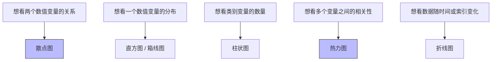

# 附录D 数据可视化快速入门

做数据分析和 Kaggle 比赛，看不懂数据就很难建好模型。可视化就是把数据“画出来”，让你一眼看出哪些特征有用、哪些数据异常、目标变量长什么样。

Python 里最常用的可视化库是 **matplotlib**（基础绘图）和 **seaborn**（基于 matplotlib，画统计图更漂亮、代码更简洁）。本附录面向零基础初学者，用大白话讲清楚怎么画折线图、散点图、直方图、柱状图、箱线图、热力图等常见图表。

> **Mermaid 图表：常见图表适用场景**



---

## D.1 安装与导入

```bash
pip install matplotlib seaborn
```

Kaggle Notebooks 里两个库都预装了，直接导入：

```python
import matplotlib.pyplot as plt
import seaborn as sns
import pandas as pd
import numpy as np
```

约定成俗，matplotlib 起别名 `plt`，seaborn 起别名 `sns`。

### 在 Notebook 里直接显示图表

如果你在 Jupyter Notebook 或 Kaggle Notebooks 里写代码，加上这一行，图表会直接在单元格下方显示：

```python
%matplotlib inline
```

如果你在普通的 Python 脚本里运行，图表会弹出一个独立窗口，脚本结束后窗口可能会自动关闭。这时候可以在脚本最后加上 `plt.show()` 强制显示，或者保存图片（见 D.9）。

---

## D.2 画第一张图：折线图

折线图适合看数据随某个变量（比如时间、索引）的变化趋势。

```python
import matplotlib.pyplot as plt

x = [1, 2, 3, 4, 5]
y = [2, 4, 1, 5, 3]

plt.plot(x, y)                    # 画折线
plt.title("示例折线图")           # 标题
plt.xlabel("X轴")                 # X轴标签
plt.ylabel("Y轴")                 # Y轴标签
plt.show()                        # 显示图表（脚本模式下需要）
```

在 Notebook 里，`plt.show()` 可以省略，图会自动显示。

---

## D.3 中文显示（重要）

matplotlib 默认不支持中文，画出来的图中文会变成方框。解决办法是指定一个支持中文的字体。

Windows 系统通常自带 "SimHei"（黑体）或 "Microsoft YaHei"（微软雅黑）：

```python
plt.rcParams["font.sans-serif"] = ["SimHei"]   # 指定默认字体为黑体
plt.rcParams["axes.unicode_minus"] = False     # 解决负号显示为方框的问题
```

Mac 系统可以用 "Arial Unicode MS" 或 "Heiti TC"：

```python
plt.rcParams["font.sans-serif"] = ["Arial Unicode MS"]
plt.rcParams["axes.unicode_minus"] = False
```

加上这两行之后，后面画的图里中文标题、标签、图例都能正常显示了。

---

## D.4 散点图：看两个数值变量的关系

散点图适合看两个数值列之间是否有相关性。比如“房屋面积”和“房价”通常正相关。

用 matplotlib：

```python
plt.scatter(df["面积"], df["房价"])
plt.title("房屋面积 vs 房价")
plt.xlabel("面积")
plt.ylabel("房价")
plt.show()
```

用 seaborn（更好看，自带网格线）：

```python
sns.scatterplot(data=df, x="面积", y="房价")
plt.title("房屋面积 vs 房价")
plt.show()
```

> 💡 **大白话**：散点图上，如果点从左下往右上排成一条线，说明两个变量正相关（一个大另一个也大）；如果点散得很开，说明关系不大。

---

## D.5 直方图：看一个数值变量的分布

直方图把数据分成很多个“桶”，看每个桶里有多少个数据，能看出数据集中在哪个区间，有没有异常值。

```python
plt.hist(df["年龄"], bins=20, color="skyblue", edgecolor="black")
plt.title("年龄分布直方图")
plt.xlabel("年龄")
plt.ylabel("人数")
plt.show()
```

- `bins`：分多少个桶，默认10个，可以根据数据调整。
- `color`：柱子颜色。
- `edgecolor`：柱子边框颜色，加上边框看起来更清晰。

seaborn 版本可以加一条核密度估计曲线（KDE），更平滑地展示分布形状：

```python
sns.histplot(df["年龄"], bins=20, kde=True, color="skyblue")
plt.title("年龄分布（带KDE曲线）")
plt.show()
```

---

## D.6 柱状图：看类别变量的数量

柱状图适合看每个类别有多少个样本。比如看不同“性别”各有多少人。

```python
# 先统计每个类别的个数
counts = df["性别"].value_counts()

# 画柱状图
plt.bar(counts.index, counts.values, color="salmon")
plt.title("性别分布")
plt.xlabel("性别")
plt.ylabel("人数")
plt.show()
```

seaborn 的 `countplot` 更简单，直接传列名就行：

```python
sns.countplot(data=df, x="性别", palette="Set2")
plt.title("性别分布")
plt.show()
```

如果类别很多，可以把柱子画横过来（`y` 放类别，`x` 放数量），标签不容易重叠：

```python
sns.countplot(data=df, y="城市", order=df["城市"].value_counts().index)
plt.title("城市分布")
plt.show()
```

---

## D.7 箱线图：看分布和异常值

箱线图能一眼看出数据的中位数、四分位数、以及哪些是异常值（离群点）。常用来看“某个数值列按类别分组后的分布差异”。

```python
sns.boxplot(data=df, x="性别", y="年龄", palette="Set3")
plt.title("不同性别的年龄分布箱线图")
plt.show()
```

箱线图的各部分含义：

- 箱子的底边和顶边：下四分位数（Q1）和上四分位数（Q3）。
- 箱子中间的线：中位数。
- 伸出来的“胡须”：正常范围内的最大值和最小值。
- 超出胡须的单独圆点：异常值/离群点。

---

## D.8 热力图：看变量之间的相关性

做特征工程前，经常要看哪些特征和目标变量强相关，哪些特征之间高度重复（多重共线性）。热力图把相关系数矩阵画成彩色方格，颜色越深表示相关性越强。

```python
# 只选数值型列，算相关系数
corr = df.select_dtypes(include=["number"]).corr()

# 画热力图
plt.figure(figsize=(10, 8))           # 设置图片大小
sns.heatmap(corr, annot=True, cmap="coolwarm", center=0, fmt=".2f")
plt.title("特征相关系数热力图")
plt.show()
```

- `annot=True`：在每个格子里显示具体的相关系数数值。
- `cmap`：颜色方案，`coolwarm` 是冷暖色，正相关偏红，负相关偏蓝。
- `center=0`：把颜色中心对准0，正负对称。
- `fmt=".2f"`：数值保留两位小数。

> 💡 **小窍门**：如果两个特征的相关系数接近 1（或 -1），说明它们几乎重复，建模时只需要保留一个即可，另一个可以删掉，避免多重共线性。

---

## D.9 保存图片

如果你不只是想看图，还想把图保存成图片文件放进报告或论文，用 `plt.savefig()`：

```python
plt.figure(figsize=(8, 6))
sns.scatterplot(data=df, x="面积", y="房价")
plt.title("房屋面积 vs 房价")

plt.savefig("scatter_plot.png", dpi=300, bbox_inches="tight")
```

- `dpi`：图片清晰度，300 足够打印用，150 屏幕显示够用。
- `bbox_inches="tight"`：自动裁剪空白边缘，保存出来的图不会有大片空白。

> ⚠️ **注意**：`savefig` 要放在 `show()` 之前调用，否则可能保存的是空白图。

---

## D.10 一个完整的探索性数据分析（EDA）示例

下面是一个把前面几种图串起来的完整示例，假设你有一个包含房屋数据的 DataFrame：

```python
import matplotlib.pyplot as plt
import seaborn as sns
import pandas as pd

# 中文显示
plt.rcParams["font.sans-serif"] = ["SimHei"]
plt.rcParams["axes.unicode_minus"] = False

# 读数据
df = pd.read_csv("house_prices.csv")

# 1. 看数值列的统计分布
df[["面积", "房价", "房龄"]].hist(bins=20, figsize=(12, 4))
plt.suptitle("各数值特征分布直方图")
plt.tight_layout()
plt.show()

# 2. 看面积和房价的关系
sns.scatterplot(data=df, x="面积", y="房价", alpha=0.6)
plt.title("面积 vs 房价")
plt.show()

# 3. 看不同房型的房价箱线图
sns.boxplot(data=df, x="房型", y="房价")
plt.title("不同房型的房价分布")
plt.xticks(rotation=45)
plt.show()

# 4. 看相关系数热力图
corr = df.select_dtypes(include=["number"]).corr()
sns.heatmap(corr, annot=True, cmap="coolwarm", center=0, fmt=".2f")
plt.title("特征相关系数热力图")
plt.show()
```

`alpha=0.6` 让散点半透明，点多时不容易遮挡；`rotation=45` 让 X 轴标签倾斜45度，避免文字重叠。

---

## D.11 常用图表速查表

| 想要看什么 | 推荐图表 | matplotlib 写法 | seaborn 写法 |
|------------|----------|-----------------|--------------|
| 数值随变量的趋势 | 折线图 | `plt.plot(x, y)` | `sns.lineplot(data=df, x=..., y=...)` |
| 两个数值变量的关系 | 散点图 | `plt.scatter(x, y)` | `sns.scatterplot(data=df, x=..., y=...)` |
| 一个数值变量的分布 | 直方图 | `plt.hist(x, bins=...)` | `sns.histplot(data=df, x=..., kde=True)` |
| 类别变量的数量 | 柱状图 | `plt.bar(...)` | `sns.countplot(data=df, x=...)` |
| 分组后的分布和异常值 | 箱线图 | 较复杂 | `sns.boxplot(data=df, x=..., y=...)` |
| 变量之间的相关性 | 热力图 | 较复杂 | `sns.heatmap(corr, annot=True)` |

---

## D.12 小结

本附录快速过了一遍数据可视化最常用的操作：

1. **基础折线图**：`plt.plot()`，看趋势。
2. **中文显示**：设置 `font.sans-serif` 和 `axes.unicode_minus`。
3. **散点图**：`plt.scatter()` 或 `sns.scatterplot()`，看两个数值变量的关系。
4. **直方图**：`plt.hist()` 或 `sns.histplot(kde=True)`，看单个变量的分布。
5. **柱状图**：`plt.bar()` 或 `sns.countplot()`，看类别数量。
6. **箱线图**：`sns.boxplot()`，看分组分布和异常值。
7. **热力图**：`sns.heatmap()`，看相关系数。
8. **保存图片**：`plt.savefig(..., dpi=300, bbox_inches="tight")`。

可视化不是“画好看的图就完事了”，核心目的是**帮你理解数据**。建议在建模前，先用几张图把数据看个遍，再决定怎么做特征工程和选模型。

---

> **下一步建议**：看完数据可视化，建议继续阅读正文第20章《模型评估与验证》，学习如何用交叉验证、混淆矩阵、ROC曲线等方法评估模型效果。