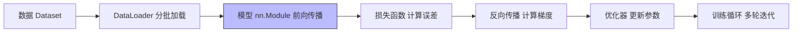

# 附录E PyTorch快速参考

PyTorch 是 Facebook（Meta）开发的深度学习框架，以动态计算图、Pythonic 的写法著称，学术界和工业界都很流行。在 Kaggle 上，图像分类、物体检测、文本分类、语音识别等深度学习比赛，PyTorch 是常用工具之一。

本附录面向零基础初学者，用大白话讲清楚 PyTorch 最核心的内容：Tensor 张量、张量运算、自动微分、神经网络模块、损失函数、优化器、学习率调度、数据加载、训练循环。

> **Mermaid 图表：PyTorch 训练流程**



---

## E.1 Tensor 基础

Tensor 是 PyTorch 里的多维数组，可以在 GPU 上运行，支持自动求导。你可以把它理解为“能跑在 GPU 上的 NumPy 数组”。

### 安装与导入

```bash
pip install torch torchvision torchaudio
```

Kaggle Notebooks 里 PyTorch 已经预装，直接导入：

```python
import torch
import torch.nn as nn
import torch.optim as optim
from torch.utils.data import Dataset, DataLoader
```

### 创建 Tensor

```python
# 从数据创建
x = torch.tensor([1.0, 2.0, 3.0])

# 全 0 / 全 1
torch.zeros(2, 3)      # 2 行 3 列全 0
torch.ones(2, 3)       # 2 行 3 列全 1

# 随机数
torch.rand(2, 3)       # 0 到 1 之间均匀分布
torch.randn(2, 3)      # 标准正态分布（均值 0，标准差 1）
torch.arange(5)        # [0, 1, 2, 3, 4]
torch.linspace(0, 1, 5)# 0 到 1 均匀取 5 个数
torch.eye(3)           # 3x3 单位矩阵
torch.identity(3)      # 和 eye 一样
torch.diag(torch.tensor([1, 2, 3]))  # 对角线为指定值的矩阵

# 从 NumPy 互转
import numpy as np
np_arr = np.array([1.0, 2.0, 3.0])
t = torch.from_numpy(np_arr)   # NumPy -> Tensor
np_arr2 = t.numpy()            # Tensor -> NumPy（需先 detach()）
```

### 常见属性

```python
x = torch.tensor([[1.0, 2.0], [3.0, 4.0]], requires_grad=True)

print(x.dtype)       # 数据类型：torch.float32
print(x.device)      # 所在设备：cpu 或 cuda
print(x.requires_grad) # 是否需要梯度：True
print(x.shape)       # 或 x.size(): torch.Size([2, 2])
print(x.numel())     # 元素总个数：4
print(x.dim())       # 维度数：2
```

### 常见张量操作

```python
x = torch.tensor([1.0, 2.0, 3.0])

# 转 NumPy（需要先 detach 计算图，再转 CPU）
x.detach().numpy()

# 各种形状变换
x.reshape(3, 1)      # 改变形状
x.view(3, 1)         # 和 reshape 类似，但要求内存连续
x.transpose(0, 1)    # 转置指定维度
x.permute(1, 0)      # 维度重排（多维常用）
x.squeeze()          # 去掉长度为 1 的维度
x.unsqueeze(0)       # 增加长度为 1 的维度
x.cat([x, x], dim=0) # 沿指定维度拼接（应该是 torch.cat）
x.stack([x, x], dim=1) # 沿新维度堆叠
x.split(2, dim=0)    # 沿指定维度分割
x.chunk(2, dim=0)    # 沿指定维度分成几块
x.index_select(0, torch.tensor([0, 2]))  # 按下标选取
x.masked_select(x > 1.5)  # 按布尔掩码选取
x.nonzero()          # 返回非零元素的下标
x.where(x > 1.5, x, torch.tensor(0.0))  # 条件选择
```

> ⚠️ 注意：`torch.cat` 是拼接多个张量，不是 `x.cat()`。正确写法是 `torch.cat([x, y], dim=0)`。

---

## E.2 张量运算

对 Tensor 做加减乘除、矩阵乘法、激活函数等数学运算。

```python
a = torch.tensor([1.0, 2.0, 3.0])
b = torch.tensor([4.0, 5.0, 6.0])

# 元素级运算
torch.add(a, b)   # a + b
torch.sub(a, b)   # a - b
torch.mul(a, b)   # a * b
torch.div(a, b)   # a / b

# 也可直接用运算符
a + b
a - b
a * b
a / b

# 矩阵运算
torch.matmul(a, b)  # 矩阵乘法
a @ b               # 和 matmul 一样
torch.mm(a, b)      # 2D 矩阵乘法
torch.mv(a, b)      # 矩阵-向量乘法
torch.dot(a, b)     # 向量点积
torch.outer(a, b)   # 外积
torch.cross(a, b)   # 叉积（3D 向量）

# 归约运算
torch.sum(a)    # 求和
torch.mean(a)   # 求平均
torch.std(a)    # 标准差
torch.var(a)    # 方差
torch.min(a)    # 最小值
torch.max(a)    # 最大值
torch.argmin(a) # 最小值下标
torch.argmax(a) # 最大值下标
torch.cumsum(a) # 累积和
torch.cumprod(a)# 累积积
torch.sort(a)   # 排序
torch.argsort(a)# 排序下标
torch.unique(a) # 唯一值

# 其他
torch.clamp(a, 0, 2)    # 截断到 [0, 2]
torch.abs(a)            # 绝对值
torch.sign(a)           # 符号
torch.exp(a)            # 指数
torch.log(a)            # 自然对数
torch.sqrt(a)           # 平方根
torch.pow(a, 2)         # 幂
torch.sin(a)            # 正弦
torch.cos(a)            # 余弦
torch.tan(a)            # 正切
```

### 激活函数

```python
torch.sigmoid(a)        # Sigmoid：1/(1+e^-x)，输出 (0,1)
torch.tanh(a)           # Tanh：输出 (-1,1)
torch.relu(a)           # ReLU：max(0, x)
torch.nn.functional.leaky_relu(a, negative_slope=0.01)  # Leaky ReLU
torch.nn.functional.elu(a)  # ELU
torch.nn.functional.gelu(a) # GELU
torch.softmax(a, dim=1) # Softmax：输出概率分布，各元素和为 1
torch.log_softmax(a, dim=1) # log(Softmax)，数值更稳
```

---

## E.3 自动微分

自动记录计算过程，反向传播时自动算出梯度，不用手动推导导数。

```python
x = torch.tensor([2.0], requires_grad=True)  # 需要梯度的变量
y = x * 2
z = y * y  # z = (2x)^2 = 4x^2

z.backward()  # 反向传播，计算 dz/dx
print(x.grad)  # dz/dx = 8x = 16
```

### 关键上下文管理器

```python
with torch.no_grad():        # 禁用梯度计算，推理/验证时常用
    output = model(input)

with torch.enable_grad():    # 启用梯度计算（默认就是启用）
    ...

torch.set_grad_enabled(True) # 动态设置是否计算梯度

torch.infer_mode()           # 推理模式，比 no_grad 更严格，推荐用于纯推理
```

### 自定义自动求导函数

```python
from torch.autograd import Function

class MyReLU(Function):
    @staticmethod
    def forward(ctx, input):
        ctx.save_for_backward(input)
        return input.clamp(min=0)

    @staticmethod
    def backward(ctx, grad_output):
        input, = ctx.saved_tensors
        grad_input = grad_output.clone()
        grad_input[input < 0] = 0
        return grad_input

# 注册钩子，在反向传播时打印或修改梯度
x.register_hook(lambda grad: print("梯度:", grad))
```

---

## E.4 神经网络模块

`nn.Module` 是所有神经网络模块的基类，搭建网络就像搭积木。

```python
class Net(nn.Module):
    def __init__(self):
        super().__init__()
        self.fc1 = nn.Linear(10, 50)   # 全连接层：10 输入 -> 50 输出
        self.fc2 = nn.Linear(50, 1)    # 全连接层：50 输入 -> 1 输出
        self.relu = nn.ReLU()          # ReLU 激活
        self.dropout = nn.Dropout(0.5) # Dropout，防止过拟合

    def forward(self, x):
        x = self.relu(self.fc1(x))
        x = self.dropout(x)
        x = self.fc2(x)
        return x

model = Net()
output = model(torch.randn(4, 10))  # batch_size=4, 输入 10 维
print(output.shape)  # torch.Size([4, 1])
```

### 常用网络层

| 类 | 说明 |
|----|------|
| `nn.Linear` | 全连接层 |
| `nn.Conv1d` / `nn.Conv2d` / `nn.Conv3d` | 1D/2D/3D 卷积层 |
| `nn.MaxPool2d` / `nn.AvgPool2d` | 最大/平均池化层 |
| `nn.AdaptiveAvgPool2d` | 自适应平均池化（输出尺寸固定） |
| `nn.Flatten` | 展平成一维 |
| `nn.Dropout` / `nn.Dropout2d` | Dropout，训练时随机置零部分神经元 |
| `nn.BatchNorm1d` / `nn.BatchNorm2d` | 批归一化 |
| `nn.LayerNorm` | 层归一化 |
| `nn.ReLU` / `nn.Sigmoid` / `nn.Tanh` | 激活函数 |
| `nn.LeakyReLU` / `nn.ELU` / `nn.GELU` | 其他激活函数 |
| `nn.Sequential` | 顺序容器，把层按顺序串起来 |
| `nn.ModuleList` / `nn.ModuleDict` | 模块列表/字典 |
| `nn.Parameter` | 可学习的参数 |
| `nn.Embedding` | 嵌入层（把离散 ID 映射为稠密向量，常用于 NLP） |
| `nn.LSTM` / `nn.GRU` / `nn.RNN` | 循环神经网络层 |
| `nn.MultiheadAttention` | 多头注意力机制 |
| `nn.Transformer` / `nn.TransformerEncoder` / `nn.TransformerDecoder` | Transformer 模型 |

### 顺序容器示例

```python
# 不用写 forward，直接按顺序串层
model = nn.Sequential(
    nn.Linear(10, 50),
    nn.ReLU(),
    nn.Dropout(0.5),
    nn.Linear(50, 1)
)
```

---

## E.5 损失函数

衡量模型预测和真实答案的差距，越小越好，反向传播用它来更新参数。

```python
# 回归损失
nn.MSELoss()           # 均方误差
nn.L1Loss()            # 平均绝对误差
nn.SmoothL1Loss()      # 平滑 L1 损失（Huber 损失）

# 二分类损失
nn.BCELoss()           # 二元交叉熵（输入需是概率，0~1）
nn.BCEWithLogitsLoss() # 二元交叉熵（输入为原始 logits，数值更稳，推荐）

# 多分类损失
nn.CrossEntropyLoss()  # 交叉熵损失（输入原始 logits，内含 softmax，最常用）
nn.NLLLoss()           # 负对数似然损失（输入 log 概率）

# 其他
nn.CosineEmbeddingLoss()   # 余弦相似度损失
nn.TripletMarginLoss()     # 三元组损失（度量学习）
nn.HingeEmbeddingLoss()    # 铰链损失
```

使用示例：

```python
criterion = nn.CrossEntropyLoss()
loss = criterion(output, target)  # output: 模型输出 logits，target: 真实类别索引
```

---

## E.6 优化器

根据损失函数的梯度，更新模型参数，让模型越来越准。

```python
# 创建优化器
optimizer = optim.SGD(model.parameters(), lr=1e-3)          # 随机梯度下降
optimizer = optim.Adam(model.parameters(), lr=1e-3)         # Adam，最常用
optimizer = optim.AdamW(model.parameters(), lr=1e-3)        # AdamW，带权重衰减的 Adam
optimizer = optim.RMSprop(model.parameters(), lr=1e-3)      # RMSprop
optimizer = optim.Adagrad(model.parameters(), lr=1e-3)      # Adagrad
optimizer = optim.Adadelta(model.parameters(), lr=1e-3)     # Adadelta
optimizer = optim.Adamax(model.parameters(), lr=1e-3)       # Adamax
optimizer = optim.LBFGS(model.parameters(), lr=1)           # LBFGS（二阶优化）

# 训练循环里的标准步骤
optimizer.zero_grad()   # 梯度清零
loss.backward()         # 反向传播，计算梯度
optimizer.step()        # 更新参数

# 保存和加载优化器状态
torch.save(optimizer.state_dict(), 'optimizer.pth')
optimizer.load_state_dict(torch.load('optimizer.pth'))
```

---

## E.7 学习率调度

训练过程中逐渐调小学习率，帮助模型更稳定地收敛。

```python
optimizer = optim.Adam(model.parameters(), lr=1e-3)

# 步长衰减：每 step_size 个 epoch 乘以 gamma
scheduler = optim.lr_scheduler.StepLR(optimizer, step_size=10, gamma=0.1)

# 多步衰减：在指定 epoch 乘以 gamma
scheduler = optim.lr_scheduler.MultiStepLR(optimizer, milestones=[30, 60], gamma=0.1)

# 指数衰减：每个 epoch 乘以 gamma
scheduler = optim.lr_scheduler.ExponentialLR(optimizer, gamma=0.9)

# 余弦退火：按余弦曲线从初始 lr 降到最低
scheduler = optim.lr_scheduler.CosineAnnealingLR(optimizer, T_max=100)

# 监控指标不提升时降低学习率
scheduler = optim.lr_scheduler.ReduceLROnPlateau(optimizer, mode='min', patience=5)

# 一个周期内先升后降（one-cycle 策略）
scheduler = optim.lr_scheduler.OneCycleLR(optimizer, max_lr=1e-3, steps_per_epoch=100, epochs=10)

# 周期性学习率
scheduler = optim.lr_scheduler.CyclicLR(optimizer, base_lr=1e-4, max_lr=1e-2)

# 每个 epoch 结束调用
scheduler.step()
# ReduceLROnPlateau 需要传入指标：scheduler.step(val_loss)
```

---

## E.8 数据加载

把数据分批次喂给模型，支持打乱、多进程加载、自定义整批函数。

```python
from torch.utils.data import Dataset, DataLoader, TensorDataset, random_split, Subset, ConcatDataset
from torch.utils.data.sampler import Sampler, BatchSampler, DistributedSampler

# 1. 自定义 Dataset（继承 torch.utils.data.Dataset）
class MyDataset(Dataset):
    def __init__(self, X, y):
        self.X = torch.tensor(X, dtype=torch.float32)
        self.y = torch.tensor(y, dtype=torch.float32)

    def __len__(self):
        return len(self.X)

    def __getitem__(self, idx):
        return self.X[idx], self.y[idx]

# 2. TensorDataset：直接从 Tensor 构造（最简单）
dataset = TensorDataset(torch.randn(100, 10), torch.randint(0, 2, (100,)))

# 3. 划分数据集
train_size = int(0.8 * len(dataset))
val_size = len(dataset) - train_size
train_dataset, val_dataset = random_split(dataset, [train_size, val_size])

# 4. DataLoader：分批加载
train_loader = DataLoader(
    train_dataset,
    batch_size=32,       # 每批多少样本
    shuffle=True,        # 是否打乱（训练集通常 True，验证集通常 False）
    num_workers=4,       # 多进程加载进程数
    pin_memory=True,     # 是否用锁页内存（GPU 训练时开启更快）
    drop_last=False,     # 最后一批不足 batch_size 是否丢弃
    collate_fn=None      # 自定义整批函数
)

# 5. 迭代 DataLoader
for batch_x, batch_y in train_loader:
    output = model(batch_x)
    loss = criterion(output, batch_y)
    ...
```

常用 DataLoader 参数：

| 参数 | 说明 | 典型值 |
|------|------|--------|
| `batch_size` | 每批样本数 | 16, 32, 64, 128... |
| `shuffle` | 是否打乱 | 训练集 True，验证/测试集 False |
| `num_workers` | 多进程数 | 0~8（Windows 通常建议 0 或 2） |
| `pin_memory` | 锁页内存，加速 GPU 传输 | True（用 GPU 时） |
| `drop_last` | 最后一批不足是否丢弃 | True/False |
| `collate_fn` | 自定义整批函数 | 处理变长序列时常用 |

---

## E.9 训练循环

模型训练模式/评估模式切换，梯度清零、反向传播、参数更新，保存和加载模型权重。

```python
device = torch.device("cuda" if torch.cuda.is_available() else "cpu")
model = Net().to(device)   # 模型移到 GPU（如果可用）
criterion = nn.CrossEntropyLoss()
optimizer = optim.Adam(model.parameters(), lr=1e-3)

num_epochs = 10

for epoch in range(num_epochs):
    # ---------- 训练阶段 ----------
    model.train()  # 设为训练模式（启用 Dropout、BatchNorm 等）
    train_loss = 0.0
    
    for batch_x, batch_y in train_loader:
        batch_x = batch_x.to(device)
        batch_y = batch_y.to(device)
        
        # 标准训练步骤
        optimizer.zero_grad()      # 1. 梯度清零
        output = model(batch_x)    # 2. 前向传播
        loss = criterion(output, batch_y)  # 3. 计算损失
        loss.backward()            # 4. 反向传播，计算梯度
        optimizer.step()           # 5. 更新参数
        
        train_loss += loss.item()
    
    # ---------- 验证阶段 ----------
    model.eval()  # 设为评估模式（禁用 Dropout、BatchNorm 等）
    val_loss = 0.0
    correct = 0
    total = 0
    
    with torch.no_grad():  # 验证时不需要梯度
        for batch_x, batch_y in val_loader:
            batch_x = batch_x.to(device)
            batch_y = batch_y.to(device)
            
            output = model(batch_x)
            loss = criterion(output, batch_y)
            
            val_loss += loss.item()
            _, predicted = torch.max(output, 1)
            total += batch_y.size(0)
            correct += (predicted == batch_y).sum().item()
    
    print(f"Epoch [{epoch+1}/{num_epochs}] "
          f"Train Loss: {train_loss/len(train_loader):.4f} "
          f"Val Loss: {val_loss/len(val_loader):.4f} "
          f"Val Acc: {correct/total:.4f}")

# ---------- 保存和加载模型 ----------
torch.save(model.state_dict(), 'model.pth')  # 只保存参数（推荐）

# 加载参数
model = Net()
model.load_state_dict(torch.load('model.pth'))
model.eval()

# 如果要保存整个模型（包含结构）：
# torch.save(model, 'model_full.pth')
# model = torch.load('model_full.pth')
```

关键方法速查：

| 方法 | 说明 |
|------|------|
| `.train()` | 设为训练模式 |
| `.eval()` | 设为评估模式 |
| `.zero_grad()` | 梯度清零 |
| `.step()` | 优化器更新参数 |
| `.backward()` | 反向传播 |
| `torch.no_grad()` | 禁用梯度计算 |
| `.state_dict()` | 获取模型参数字典 |
| `torch.save()` | 保存模型/优化器状态 |
| `torch.load()` | 加载模型/优化器状态 |
| `.load_state_dict()` | 加载模型参数 |
| `.to(device)` | 移到指定设备（cpu/cuda） |
| `.cuda()` | 移到 GPU（旧写法） |
| `.cpu()` | 移到 CPU |

---

## E.10 小结

本附录快速过了一遍 PyTorch 最常用的操作：

1. **Tensor 基础**：`torch.tensor`、`zeros`/`ones`、`rand`/`randn`、`arange`、`linspace`、`eye`、`from_numpy`/`.numpy()`；属性 `dtype`、`device`、`requires_grad`、`.detach()`、`.item()`、`.reshape()`/`.view()`、`.transpose()`/`.permute()`、`.squeeze()`/`.unsqueeze()`、`torch.cat()`/`torch.stack()`/`torch.split()`/`torch.chunk()`，索引 `.index_select()`/`.masked_select()`/`.nonzero()`/`.where()`。
2. **张量运算**：加减乘除、矩阵乘法 `@`/`torch.matmul`、`sum`/`mean`/`std`/`var`/`min`/`max`/`argmin`/`argmax`，激活函数 `sigmoid`/`tanh`/`relu`/`softmax`/`log_softmax`。
3. **自动微分**：`requires_grad=True`、`.backward()`、`torch.no_grad()`/`torch.infer_mode()`。
4. **神经网络模块**：`nn.Module`、`nn.Linear`、`nn.Conv2d`、`nn.MaxPool2d`、`nn.Dropout`、`nn.BatchNorm2d`、`nn.ReLU`、`nn.Sequential`、`nn.Embedding`、`nn.LSTM`、`nn.Transformer` 等。
5. **损失函数**：`nn.MSELoss`、`nn.L1Loss`、`nn.CrossEntropyLoss`、`nn.BCEWithLogitsLoss`、`nn.NLLLoss`。
6. **优化器**：`optim.SGD`、`optim.Adam`、`optim.AdamW`、`optim.RMSprop` 等，`.step()`/`.zero_grad()`。
7. **学习率调度**：`StepLR`、`MultiStepLR`、`ExponentialLR`、`CosineAnnealingLR`、`ReduceLROnPlateau`、`OneCycleLR`。
8. **数据加载**：`Dataset`、`DataLoader`、`TensorDataset`、`random_split`、`Subset`，参数 `batch_size`/`shuffle`/`num_workers`/`pin_memory`/`drop_last`。
9. **训练循环**：`.train()`/`.eval()`、`.zero_grad()`/`.step()`/`.backward()`、`torch.no_grad()`、`torch.save()`/`torch.load()`/`.state_dict()`/`.load_state_dict()`、`.to(device)`。

> ⚠️ **关键原则**：训练时 `model.train()`，验证/推理时 `model.eval()` + `torch.no_grad()`；`optimizer.zero_grad()` 必须在 `loss.backward()` 之前调用，防止梯度累积。

PyTorch 适合图像、文本等深度学习竞赛，掌握 Tensor、nn.Module、损失函数、优化器、DataLoader 即可搭建并训练模型。

---

> **下一步建议**：PyTorch 适合深度学习比赛。如果你主要做表格数据比赛，XGBoost/LightGBM/CatBoost 通常更快更好用；如果要做图像、文本比赛，PyTorch 配合 torchvision/torchtext 是不错的选择。建议继续阅读附录 F（常用 Kaggle 评估指标速查表），了解回归和分类的评估指标。