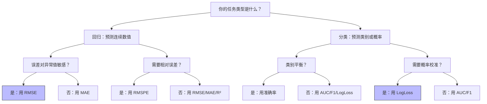

# 附录F 常用 Kaggle 评估指标速查表

Kaggle 比赛的排行榜分数由评估指标决定。选错指标优化方向，就算本地分再高，排行榜上也可能掉链子。本附录把回归和分类任务的常用指标汇总成一张速查表，每个指标都说明了计算公式、适用场景、以及“越大越好”还是“越小越好”。

> **Mermaid 图表：指标选择决策树**



---

## F.1 回归指标

回归任务预测的是连续数值（如房价、销售额、气温）。所有回归指标都**越小越好**（除了 R²，越大越好）。

### 1. RMSE（均方根误差，Root Mean Squared Error）

**公式：**

$$RMSE = \sqrt{\frac{1}{n}\sum_{i=1}^{n}(y_i - \hat{y}_i)^2}$$

**大白话：** 把预测值和真实值的差平方，求平均，再开平方根。结果和目标变量单位一致（比如预测房价，RMSE 单位就是“元”），好理解。因为对误差做了平方，**大误差会被放大**，所以 RMSE 对异常值很敏感。

**适用场景：** 最常用的回归指标，Kaggle 很多回归比赛（如 House Prices）默认用 RMSE。

**越小越好。**

### 2. MAE（平均绝对误差，Mean Absolute Error）

**公式：**

$$MAE = \frac{1}{n}\sum_{i=1}^{n}|y_i - \hat{y}_i|$$

**大白话：** 把预测值和真实值的差取绝对值，求平均。没有平方，所以**大误差不会被过度放大**，对异常值比 RMSE 更稳健。

**适用场景：** 当数据里有异常值，或者你不希望少数大误差主导分数时，用 MAE。

**越小越好。**

### 3. RMSPE（均方根百分比误差，Root Mean Squared Percentage Error）

**公式：**

$$RMSPE = \sqrt{\frac{1}{n}\sum_{i=1}^{n}\left(\frac{y_i - \hat{y}_i}{y_i}\right)^2}$$

**大白话：** 把误差除以真实值，变成“百分比误差”，再求 RMSE。关注的是**相对误差**而不是绝对误差。

**适用场景：** 当目标变量数值跨度很大（比如房价从 10 万到 1000 万），你更关心“预测偏了多少比例”而不是“偏了多少绝对值”时，用 RMSPE。Kaggle 的 Rossmann 门店销售、Blue Book 推土机比赛都用 RMSPE。

> ⚠️ 注意：如果真实值 $y_i$ 有 0，分母会为 0，需要预处理避免。

**越小越好。**

### 4. R²（决定系数，Coefficient of Determination）

**公式：**

$$R^2 = 1 - \frac{\sum_{i=1}^{n}(y_i - \hat{y}_i)^2}{\sum_{i=1}^{n}(y_i - \bar{y})^2}$$

**大白话：** 模型比“直接预测平均值”好多少。R² = 1 表示完美预测，R² = 0 表示和预测平均值一样差，R² < 0 表示比平均值还差。

**适用场景：** 当你想知道模型解释了多少比例的方差时，用 R²。但 R² 对异常值敏感，且不一定和排行榜指标一致，通常只作为参考。

**越接近 1 越好。**

### 回归指标对比

| 指标 | 公式特点 | 对异常值敏感度 | 单位 | 越小越好 / 越大越好 |
|------|---------|--------------|------|-------------------|
| RMSE | 误差平方后开根 | 敏感 | 和目标变量一致 | 越小越好 |
| MAE | 误差绝对值 | 较稳健 | 和目标变量一致 | 越小越好 |
| RMSPE | 相对误差平方后开根 | 敏感 | 百分比 | 越小越好 |
| R² | 1 - 残差平方和/总平方和 | 敏感 | 无单位（0~1） | 越大越好（接近 1） |

---

## F.2 分类指标

分类任务预测的是类别（0/1、猫/狗、信用等级）或概率。分类指标分两类：**基于类别预测**（0/1）和**基于概率预测**（0~1 的概率）。

### 混淆矩阵（Confusion Matrix）

很多分类指标都基于混淆矩阵。假设二分类，正例为 1，负例为 0：

| | 预测正例 | 预测负例 |
|---|---------|---------|
| **实际正例** | TP（真正例） | FN（假负例，漏检） |
| **实际负例** | FP（假正例，误报） | TN（真负例） |

- **TP (True Positive)**：实际是正例，预测也是正例。
- **TN (True Negative)**：实际是负例，预测也是负例。
- **FP (False Positive)**：实际是负例，预测成了正例（误报）。
- **FN (False Negative)**：实际是正例，预测成了负例（漏检）。

### 1. 准确率（Accuracy）

**公式：**

$$\text{Accuracy} = \frac{TP + TN}{TP + TN + FP + FN}$$

**大白话：** 预测对的样本占总样本的比例。最直观的指标。

**适用场景：** 类别比例平衡时（比如正负例各一半），用准确率。但如果类别极度不平衡（比如 99% 是负例），全预测负例也有 99% 的准确率，这时候准确率就没意义了。

**越大越好。**

### 2. 精确率（Precision）

**公式：**

$$\text{Precision} = \frac{TP}{TP + FP}$$

**大白话：** 在所有被预测为正例的样本中，真正是正例的比例。回答问题：“我预测为正例的，有多少是真的正例？”

**适用场景：** 误报代价高时，用精确率。比如垃圾邮件过滤，误把正常邮件判成垃圾（FP）会让用户丢失重要邮件。

**越大越好。**

### 3. 召回率（Recall / 灵敏度，Sensitivity）

**公式：**

$$\text{Recall} = \frac{TP}{TP + FN}$$

**大白话：** 在所有实际为正例的样本中，被预测为正例的比例。回答问题：“所有真正的正例，我有多少被找出来了？”

**适用场景：** 漏检代价高时，用召回率。比如疾病筛查，漏掉真正的病人（FN）可能耽误治疗，甚至危及生命。

**越大越好。**

### 4. F1 分数

**公式：**

$$F1 = 2 \times \frac{\text{Precision} \times \text{Recall}}{\text{Precision} + \text{Recall}}$$

**大白话：** 精确率和召回率的调和平均。两个都高，F1 才高；有任意一个很低，F1 也会被拉低。

**适用场景：** 类别不平衡时，比准确率更可靠。既想控制误报，又想控制漏检，用 F1 分数。

**越大越好。**

### 5. AUC-ROC（曲线下面积，Area Under the ROC Curve）

**大白话：** ROC 曲线是“真正例率 vs 假正例率”的曲线，AUC 是这条曲线下面的面积。AUC = 1 表示完美分类器，AUC = 0.5 表示随机猜测，AUC < 0.5 表示比随机猜测还差。

AUC 的一个直观解释：**随机抽一个正例和一个负例，模型给正例的概率高于负例的概率，这个概率就是 AUC。**

**适用场景：** 关注模型对样本的排序能力（谁更可能是正例），而不是具体的分类阈值。类别不平衡时，AUC 比准确率更可靠。Kaggle 很多分类比赛（如信用评分）用 AUC 或 LogLoss。

**越接近 1 越好。**

### 6. LogLoss（对数损失，Logarithmic Loss / 交叉熵）

**公式（二分类）：**

$$\text{LogLoss} = -\frac{1}{n}\sum_{i=1}^{n}\left[y_i \log(\hat{p}_i) + (1-y_i) \log(1-\hat{p}_i)\right]$$

其中 $y_i$ 是真实标签（0 或 1），$\hat{p}_i$ 是模型预测的正例概率。

**大白话：** 模型预测的概率越接近真实标签，LogLoss 越小。如果真实是正例却预测概率接近 0，惩罚会非常大（$\log(0)$ 趋向负无穷）。

**适用场景：** 关注概率预测的**校准程度**（预测概率是否可信），而不仅仅是排序。Kaggle 很多分类比赛（如 Quora 问题对去重、信用评分）用 LogLoss 作为评估指标。

**越小越好。**

> ⚠️ 注意：LogLoss 需要模型输出概率（0~1 之间），而不是 0/1 标签。如果你只提交了 0/1 标签，无法计算 LogLoss。

### 分类指标对比

| 指标 | 基于什么 | 对类别不平衡的稳健性 | 核心关注点 | 越大越好 / 越小越好 |
|------|---------|-------------------|-----------|-------------------|
| 准确率 | 类别预测 (0/1) | 差（不平衡时不可靠） | 整体正确比例 | 越大越好 |
| 精确率 | 类别预测 (0/1) | 中 | 减少误报 | 越大越好 |
| 召回率 | 类别预测 (0/1) | 中 | 减少漏检 | 越大越好 |
| F1 分数 | 类别预测 (0/1) | 较好 | 精确率和召回率平衡 | 越大越好 |
| AUC-ROC | 概率预测 (0~1) | 好 | 样本排序能力 | 越接近 1 越好 |
| LogLoss | 概率预测 (0~1) | 好 | 概率校准程度 | 越小越好 |

---

## F.3 Python 代码示例：sklearn 一键计算各指标

```python
import numpy as np
from sklearn.metrics import (
    mean_squared_error, mean_absolute_error, r2_score,
    accuracy_score, precision_score, recall_score, f1_score,
    roc_auc_score, log_loss, confusion_matrix, classification_report
)

# ========== 回归指标 ==========
y_true = np.array([3.0, -0.5, 2.0, 7.0])
y_pred = np.array([2.5, 0.0, 2.0, 8.0])

rmse = np.sqrt(mean_squared_error(y_true, y_pred))
mae = mean_absolute_error(y_true, y_pred)
r2 = r2_score(y_true, y_pred)

print(f"回归 - RMSE: {rmse:.4f}, MAE: {mae:.4f}, R²: {r2:.4f}")

# RMSPE（sklearn 没有内置，手动计算）
def rmspe(y_true, y_pred):
    return np.sqrt(np.mean(((y_true - y_pred) / y_true) ** 2))

print(f"回归 - RMSPE: {rmspe(y_true, y_pred):.4f}")

# ========== 分类指标 ==========
# 二分类：真实标签
y_true = np.array([0, 1, 1, 0, 1, 0, 1, 0])
# 预测类别（0/1）
y_pred = np.array([0, 1, 0, 0, 1, 0, 1, 1])
# 预测正例概率（0~1），用于 AUC 和 LogLoss
y_proba = np.array([0.1, 0.9, 0.4, 0.2, 0.8, 0.3, 0.7, 0.6])

acc = accuracy_score(y_true, y_pred)
prec = precision_score(y_true, y_pred)
rec = recall_score(y_true, y_pred)
f1 = f1_score(y_true, y_pred)
auc = roc_auc_score(y_true, y_proba)
logloss = log_loss(y_true, y_proba)
cm = confusion_matrix(y_true, y_pred)

print(f"分类 - 准确率: {acc:.4f}")
print(f"分类 - 精确率: {prec:.4f}")
print(f"分类 - 召回率: {rec:.4f}")
print(f"分类 - F1 分数: {f1:.4f}")
print(f"分类 - AUC-ROC: {auc:.4f}")
print(f"分类 - LogLoss: {logloss:.4f}")
print(f"分类 - 混淆矩阵:\n{cm}")

# 分类报告：一次性输出精确率、召回率、F1、支持数
print(classification_report(y_true, y_pred))
```

---

## F.4 小结

本附录汇总了 Kaggle 回归和分类任务的常用评估指标：

**回归指标（越小越好，除了 R² 越大越好）：**

| 指标 | 特点 | 适用场景 |
|------|------|---------|
| RMSE | 对大误差敏感，单位和目标一致 | 最常用回归指标 |
| MAE | 对异常值稳健 | 有异常值时 |
| RMSPE | 关注相对误差 | 目标变量数值跨度大时 |
| R² | 解释了多少方差 | 作为参考指标 |

**分类指标：**

| 指标 | 基于 | 越大越好 / 越小越好 | 适用场景 |
|------|------|-------------------|---------|
| 准确率 | 类别预测 | 越大越好 | 类别平衡 |
| 精确率 | 类别预测 | 越大越好 | 误报代价高 |
| 召回率 | 类别预测 | 越大越好 | 漏检代价高 |
| F1 分数 | 类别预测 | 越大越好 | 类别不平衡，平衡精确率和召回率 |
| AUC-ROC | 概率预测 | 越接近 1 越好 | 样本排序能力，类别不平衡 |
| LogLoss | 概率预测 | 越小越好 | 概率校准程度 |

**选指标原则：** 先看比赛官方规定用什么指标，那个就是最终排名依据。本地验证时尽量用同一个指标，避免“本地分和排行榜分不一致”。

---

> **下一步建议**：评估指标读完后，你已经具备了参加 Kaggle 比赛的完整技能栈。建议继续阅读正文第 20 章《模型评估与验证》、第 21 章《模型调参与集成学习》和第 22 章《竞赛策略与心态》，学习如何制定比赛策略、避免过拟合、在排行榜上稳步提升排名。