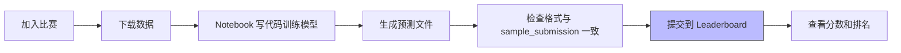

# 附录F Kaggle 提交与 Notebook 使用指南

学会了写模型，接下来就是把预测结果提交到 Kaggle，看到自己的排名。本附录手把手教你如何在 Kaggle 上提交结果、怎么用 Kaggle Notebooks 写代码、怎么看排行榜、怎么避免常见的提交错误。

> **Mermaid 图表：Kaggle 提交完整流程**



---

## F.1 加入比赛

参加 Kaggle 比赛的第一步是注册账号并加入比赛。

1. 打开 [kaggle.com](https://www.kaggle.com)，用 Google 账号或邮箱注册登录。
2. 找到你想参加的比赛，进入比赛主页。
3. 点击页面右上角的 **"Join Competition"** 按钮。
4. 阅读比赛规则，勾选“我接受比赛规则”，点击确认。

**只有加入比赛后，你才能**：下载数据、提交结果、查看排行榜、在讨论区发帖。

> 💡 **小窍门**：有些比赛（尤其是有奖金的）要求获奖者完成**实名认证**（身份验证），否则无法领取奖金。建议注册后尽早完成实名认证，免得到时候领奖卡壳。

---

## F.2 下载数据

进入比赛的 **Data** 页面，你会看到三份核心文件（详见正文第1章）：

| 文件 | 含义 |
|------|------|
| `train.csv` | 训练集，有特征也有目标标签 |
| `test.csv` | 测试集，只有特征，没有目标标签 |
| `sample_submission.csv` | 提交格式模板，ID 列 + 一个空的预测列 |

### 方式1：手动下载

在 Data 页面点击每个文件旁边的下载图标，下载到本地解压后使用。

### 方式2：在 Kaggle Notebooks 里直接用

如果你在 Kaggle Notebooks 里写代码，数据已经自动挂载到了 `/kaggle/input/<比赛目录名>/` 目录，不需要手动下载：

```python
import os
import pandas as pd

competition_dir = "/kaggle/input/<比赛目录名>/"   # 把 <比赛目录名> 换成实际的，比如 house-prices-regression

print(os.listdir(competition_dir))   # 看看目录里有哪些文件

train = pd.read_csv(competition_dir + "train.csv")
test  = pd.read_csv(competition_dir + "test.csv")
sample_sub = pd.read_csv(competition_dir + "sample_submission.csv")
```

> 💡 **怎么知道比赛目录名？** 在 Data 页面，每个文件右侧有一个 "Copy API command" 按钮，点击后会复制类似 `kaggle competitions download -c <比赛目录名>` 的命令，那个 `-c` 后面跟的就是比赛目录名。

---

## F.3 用 Kaggle Notebooks 写代码

Kaggle Notebooks 是 Kaggle 自带的云端 Jupyter 环境，好处是：

- **不用装环境**：Python、pandas、scikit-learn、XGBoost、PyTorch、TensorFlow 等都预装好了。
- **免费 GPU/GPU**：可以申请免费 GPU 小时数，训练深度学习模型不需要自己买显卡。
- **数据自动挂载**：比赛数据自动在 `/kaggle/input/` 目录，不用手动上传下载。
- **可公开分享**：写好的 Notebook 可以公开，其他人可以 Fork 一份在自己账号下运行。

### 创建 Notebook

1. 进入比赛页面，点击 **"Code"** 标签页。
2. 点击 **"New Notebook"** 按钮，选择语言（Python 或 R）。
3. 给 Notebook 起个名字，比如 "baseline-linear-regression"。
4. 选择是否启用 GPU（训练深度学习模型时选 GPU，普通表格模型选 CPU 就够了）。
5. 点击 **"Create"**，进入编辑器。

### 运行单元格

Notebook 是按“单元格”（cell）运行的：

- 选中一个代码单元格，按 `Shift + Enter` 运行该单元格并跳到下一个。
- 按 `Ctrl + Enter` 运行当前单元格但不跳转。
- 工具栏有运行全部、停止、重启内核等按钮。

### 输出预测文件

在 Notebook 里训练完模型、在测试集上做预测后，把预测结果保存成 CSV 文件：

```python
# 假设 test 是测试集 DataFrame，y_pred 是模型预测的结果
submission = pd.DataFrame({
    "Id": test["Id"],            # Id 列名要和 sample_submission 一致
    "Prediction": y_pred         # 预测列名也要和 sample_submission 一致
})

# 保存到 Notebook 的工作目录
submission.to_csv("submission.csv", index=False)
```

保存后，文件会出现在 Notebook 侧边栏的文件列表里，你可以右键下载，也可以直接在同一个 Notebook 里提交。

---

## F.4 提交预测结果

有两种方式提交：

### 方式1：通过比赛页面手动提交（最常用）

1. 进入比赛页面，点击顶部的 **"Submit Predictions"** 按钮。
2. 上传你的预测文件（CSV 格式）。
3. 给本次提交起个描述（比如 "baseline-linear-regression v1"），方便以后找。
4. 点击提交，等待几秒到几分钟，平台会自动计算分数。

### 方式2：在 Notebook 里用 Kaggle API 提交

如果你在 Kaggle Notebooks 里写代码，也可以用 `kaggle` 命令行工具直接提交，不需要离开 Notebook：

```bash
!pip install kaggle   # 通常已预装
```

首先需要配置 API 令牌：在 Kaggle 网站的个人设置里点击 "Create New API Token"，下载 `kaggle.json`，上传到 Notebook 并放到 `~/.kaggle/kaggle.json`。

然后在 Notebook 里：

```python
import os
os.environ["KAGGLE_USERNAME"] = "你的用户名"
os.environ["KAGGLE_KEY"] = "你的 API Key"

!kaggle competitions submit -c <比赛目录名> -f submission.csv -m "baseline-linear-regression v1"
```

> 💡 **推荐新手先用方式1（手动上传）**，更直观，出错了也容易看到错误信息。

---

## F.5 查看排行榜和分数

提交后，进入比赛页面的 **"Leaderboard"** 标签页，就能看到：

- **Public Leaderboard（公开榜）**：提交后立即可见，是对一部分测试数据（通常是测试集的 70%）的得分。
- **Private Leaderboard（私有榜）**：比赛结束后才揭晓，是对剩余测试数据（通常是 30%）的得分，决定最终排名。

注意：Public 分数不等于最终排名。有些选手在 Public 榜上很高，Private 榜上掉得很厉害，这通常是**过拟合**的迹象（在 Public 测试集上“猜中”了答案）。

---

## F.6 提交格式检查清单（避免常见错误）

Kaggle 对提交文件的格式要求非常严格，格式不对平台会直接拒绝。提交前请核对以下几点：

| 检查项 | 说明 |
|--------|------|
| **列名完全一致** | 你的 CSV 列名必须和 `sample_submission.csv` 完全一样（包括大小写、下划线） |
| **行数与测试集一致** | 预测行数必须等于 `test.csv` 的行数，不能多也不能少 |
| **ID 列与测试集一致** | ID 列的值和顺序必须和 `test.csv` 完全对应，不能乱序、不能缺、不能多 |
| **没有额外列** | 不能多出 sample_submission 里没有的列 |
| **没有缺失值** | 预测列不能有空值（NaN），每个测试样本都必须有预测值 |
| **不带行索引** | 保存 CSV 时用 `index=False`，不要把行号（0,1,2...）写进文件 |
| **编码为 UTF-8** | 建议用 UTF-8 编码保存，避免中文乱码 |

### 一个快速的格式自检代码

```python
import pandas as pd

sample = pd.read_csv("sample_submission.csv")
submission = pd.read_csv("submission.csv")

# 1. 列名是否一致
print("列名一致:", list(sample.columns) == list(submission.columns))

# 2. 行数是否一致
print("行数一致:", len(sample) == len(submission))

# 3. ID 是否完全一致（顺序也要一致）
print("ID 一致:", (sample.iloc[:, 0] == submission.iloc[:, 0]).all())

# 4. 是否有缺失值
print("有缺失值:", submission.isnull().any().any())

# 5. 是否有多余列
print("多余列:", set(submission.columns) - set(sample.columns))
```

如果上面全部通过，基本就可以放心提交了。

---

## F.7 提交次数限制

Kaggle 比赛通常对每天的提交次数有限制（比如每天最多提交 5 次或 10 次），具体看比赛规则。不要随便提交测试，建议：

- 本地跑通代码，格式自检通过后再提交。
- 每次提交前给文件起个有意义的名字（如 `submission_v1_lr.csv`、`submission_v2_rf.csv`），方便追踪哪个版本效果更好。
- 别一天内频繁提交试探 Public 分，容易用完次数且容易过拟合 Public 榜。

---

## F.8 小结

本附录快速过了一遍 Kaggle 提交流程：

1. **加入比赛**：登录后点击 "Join Competition"，勾选接受规则。
2. **获取数据**：手动下载，或在 Kaggle Notebooks 里直接用 `/kaggle/input/<比赛目录名>/`。
3. **写代码**：用 Kaggle Notebooks（免费、环境预装、数据自动挂载）或本地 Jupyter。
4. **生成提交文件**：用 `to_csv("submission.csv", index=False)`，列名和行数必须和 `sample_submission.csv` 一致。
5. **提交**：比赛页面点击 "Submit Predictions" 上传，或用 Kaggle API 提交。
6. **看分数**：进入 Leaderboard 查看 Public/Private 分数和排名。
7. **格式自检**：列名、行数、ID顺序、无缺失值、`index=False`。

第一次提交哪怕只交一个“填平均值”的基线，也要把整个“读数据 → 建模 → 预测 → 提交 → 查排名”的链路跑通。之后再逐步改进模型，提高分数。

---

> **下一步建议**：提交流程跑通后，建议继续阅读正文第22章《竞赛策略与心态》，学习如何制定比赛策略、避免过拟合、在排行榜上稳步提升排名。