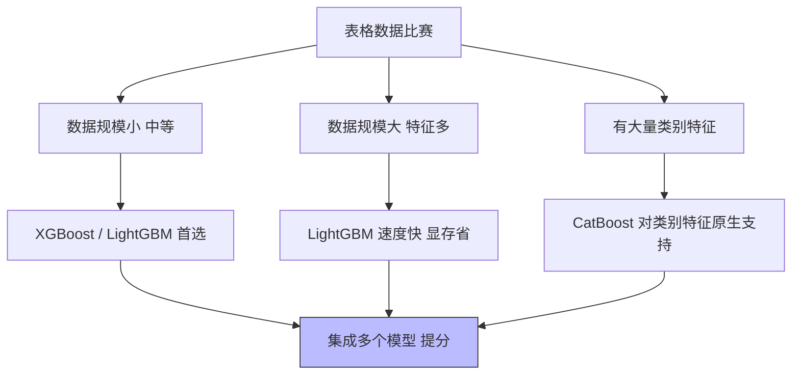

# 附录G 常见竞赛算法速查

在 Kaggle 表格数据比赛中，几乎每个榜单前列的解决方案都离不开几种“标配”算法：**梯度提升决策树（GBDT）家族**（XGBoost、LightGBM、CatBoost），以及它们的集变体。本附录面向零基础初学者，用大白话讲清楚这些算法各自的特点、适用场景、常用参数，以及如何在 scikit-learn 风格的 API 里调用它们。

> **Mermaid 图表：表格数据比赛常用算法选择**



---

## G.1 为什么是“梯度提升决策树”？

决策树（Decision Tree）本身很简单：像玩“猜数字”游戏，不断地用特征把数据切分成越来越纯的小组。但单棵树容易过拟合（记住训练数据，泛化能力差）。

**梯度提升（Gradient Boosting）** 的思路是：训练一棵树，发现预测错了哪些样本；再训练第二棵树，专门去纠正第一棵树的错误；再训练第三棵树，纠正前两棵树的错误……把成百上千棵“弱学习者”累加起来，就变成了一个很强的模型。

XGBoost、LightGBM、CatBoost 都是这种思路的不同实现，各有优劣。

---

## G.2 安装这三个库

```bash
pip install xgboost lightgbm catboost
```

Kaggle Notebooks 里三个库都预装好了，直接导入：

```python
from xgboost import XGBRegressor, XGBClassifier
from lightgbm import LGBMRegressor, LGBMClassifier
from catboost import CatBoostRegressor, CatBoostClassifier
```

命名规则很好记：`XGB` / `LGBM` / `CatBoost` + `Regressor`（回归）或 `Classifier`（分类），和 sklearn 的模型命名一致，都支持 `fit()`、`predict()`。

---

## G.3 XGBoost：最经典、最稳健

XGBoost 是 GBDT 家族里最早大火的库，稳定性好、文档多、社区活跃，是很多比赛的“默认首选”。

```python
from xgboost import XGBRegressor
from sklearn.model_selection import train_test_split
from sklearn.metrics import mean_squared_error
import numpy as np

# 划分数据
X_train, X_val, y_train, y_val = train_test_split(X, y, test_size=0.2, random_state=42)

# 创建模型（回归）
model = XGBRegressor(
    n_estimators=1000,      # 树的棵数，越多越慢但通常越准，需配合早停
    learning_rate=0.05,     # 学习率，越小越稳，但需要更多棵树
    max_depth=6,            # 单棵树最大深度，越深越容易过拟合
    subsample=0.8,          # 每棵树随机采样 80% 的行，防止过拟合
    colsample_bytree=0.8,   # 每棵树随机采样 80% 的列，防止过拟合
    random_state=42,
    n_jobs=-1               # 用所有CPU核心并行训练
)

# 训练，启用早停（early stopping）：验证集分数不再提升就提前停止
model.fit(
    X_train, y_train,
    eval_set=[(X_val, y_val)],       # 监控验证集
    early_stopping_rounds=50,        # 连续50轮没提升就停
    verbose=False                    # 不打印训练过程日志
)

# 预测
y_pred = model.predict(X_val)
rmse = np.sqrt(mean_squared_error(y_val, y_pred))
print("XGBoost 验证集 RMSE:", rmse)
```

### XGBoost 常用参数速查

| 参数 | 作用 | 典型取值 | 调参建议 |
|------|------|----------|----------|
| `n_estimators` | 树的棵数 | 100~2000 | 配合早停，先设大再早停截断 |
| `learning_rate` | 学习率 | 0.01~0.1 | 越小越稳，需增加 `n_estimators` |
| `max_depth` | 树最大深度 | 3~10 | 越深越容易过拟合，先试 6 |
| `subsample` | 行采样比例 | 0.6~1.0 | 小于1可防止过拟合 |
| `colsample_bytree` | 列采样比例 | 0.6~1.0 | 特征多时调小些 |
| `reg_alpha` | L1 正则化 | 0~10 | 越大正则越强 |
| `reg_lambda` | L2 正则化 | 1~10 | 越大正则越强 |

> 💡 **早停技巧**：设大 `n_estimators`（比如 2000），配合 `early_stopping_rounds=50`，让模型自动在最佳棵数处停止，不用手动猜棵数。

---

## G.4 LightGBM：训练快、显存省、适合大数据

LightGBM 是微软开发的，和 XGBoost 思路相似，但用了**直方图算法**和**叶子生长策略**，训练速度明显更快，内存占用更低，特别适合数据量大、特征多的比赛。

```python
from lightgbm import LGBMRegressor

model = LGBMRegressor(
    n_estimators=1000,
    learning_rate=0.05,
    num_leaves=31,            # 叶子节点数，控制模型复杂度（替代 max_depth）
    max_depth=-1,             # -1 表示不限制深度，由 num_leaves 控制
    subsample=0.8,
    colsample_bytree=0.8,
    random_state=42,
    n_jobs=-1,
    verbose=-1                # 不打印训练日志
)

model.fit(
    X_train, y_train,
    eval_set=[(X_val, y_val)],
    eval_metric="rmse",
    callbacks=[lgb.early_stopping(stopping_rounds=50), lgb.log_evaluation(period=100)]
)
```

> ⚠️ 注意：LightGBM 的早停 API 版本差异较大，新版用 `callbacks` 参数，旧版用 `early_stopping_rounds` 参数，按你安装的版本调整。

### LightGBM 常用参数速查

| 参数 | 作用 | 典型取值 |
|------|------|----------|
| `num_leaves` | 叶子节点数，控制复杂度 | 20~100，建议小于 `2^(max_depth)` |
| `max_depth` | 树最大深度，-1 表示由 num_leaves 控制 | -1 或 3~15 |
| `learning_rate` | 学习率 | 0.01~0.1 |
| `n_estimators` | 树的棵数 | 100~5000（配合早停） |
| `subsample` | 行采样比例 | 0.6~1.0 |
| `colsample_bytree` | 列采样比例 | 0.6~1.0 |
| `min_child_samples` | 叶子节点最少样本数 | 20~100，越大越不容易过拟合 |

---

## G.5 CatBoost：对类别特征最友好

CatBoost 是 Yandex 开发的，最大的特点是**原生支持类别特征（类别型变量）**，不需要你手动做 Label Encoding 或 One-Hot Encoding，直接传字符串列就行。它还针对类别特征做了特殊处理，减少目标泄露，对小数据和类别特征多的表格效果很好。

```python
from catboost import CatBoostRegressor, Pool

# 假设 X_train 有类别特征列，比如 "城市"、"性别" 是字符串类型
cat_features = ["城市", "性别"]   # 指定哪些列是类别特征

train_pool = Pool(X_train, y_train, cat_features=cat_features)
val_pool   = Pool(X_val, y_val, cat_features=cat_features)

model = CatBoostRegressor(
    iterations=2000,          # 迭代次数（相当于 n_estimators）
    learning_rate=0.05,
    depth=6,                  # 树深度
    l2_leaf_reg=3,            # L2 正则化
    random_seed=42,
    verbose=False
)

model.fit(
    train_pool,
    eval_set=val_pool,
    early_stopping_rounds=50,
    verbose=False
)

y_pred = model.predict(X_val)
```

### CatBoost 常用参数速查

| 参数 | 作用 | 典型取值 |
|------|------|----------|
| `iterations` | 迭代次数（树的棵数） | 500~5000（配合早停） |
| `learning_rate` | 学习率 | 0.01~0.1 |
| `depth` | 树深度 | 4~10 |
| `l2_leaf_reg` | L2 正则化 | 1~10 |
| `cat_features` | 类别特征列索引或列名 | 必须指定，否则类别列会被当成数值处理 |

---

## G.6 三个库的对比与选型建议

| 维度 | XGBoost | LightGBM | CatBoost |
|------|---------|----------|----------|
| **训练速度** | 中等 | 最快 | 中等偏慢 |
| **显存/内存占用** | 中等 | 最低 | 中等 |
| **类别特征支持** | 需手动编码 | 需手动编码 | **原生支持，最方便** |
| **小数据效果** | 好 | 好 | **通常最好** |
| **大数据效果** | 好 | **最好** | 好 |
| **调参友好度** | 参数多，文档多 | 参数多 | 参数相对少，开箱即用 |
| **Kaggle 流行度** | 很高 | 很高 | 高 |

**选型建议：**

1. **不确定用哪个，先用 XGBoost** —— 最稳、社区资源最多，出问题好搜答案。
2. **数据量大（几十万行以上）、训练慢** —— 优先试 LightGBM，速度快、内存省。
3. **类别特征多（如城市、设备型号、用户ID等字符串列）** —— 优先试 CatBoost，免去手动编码。
4. **最佳效果通常来自集成** —— 把 XGBoost、LightGBM、CatBoost 的预测结果做加权平均，往往比单模型更强。

---

## G.7 特征重要性：看模型依赖哪些列

训练完模型后，经常想知道“哪些特征对预测最重要”。三个库都支持导出特征重要性：

```python
# XGBoost
importance = model.feature_importances_
# 或者画图
from xgboost import plot_importance
plot_importance(model)

# LightGBM
importance = model.feature_importances_
from lightgbm import plot_importance
plot_importance(model)

# CatBoost
importance = model.get_feature_importance()
model.plot_feature_importance()
```

> 💡 **小窍门**：特征重要性高不代表该特征“因果”决定目标，只是模型在做预测时用得多。可以用它来剔除毫无用的特征（重要性接近0的列可以删掉，让模型更轻量），但不要过度解读。

---

## G.8 一个完整的 GBDT baseline 示例

下面是一个把 XGBoost、LightGBM、CatBoost 三个模型都跑一遍，最后做简单平均集成的完整示例：

```python
import pandas as pd
import numpy as np
from sklearn.model_selection import train_test_split
from sklearn.metrics import mean_squared_error
from xgboost import XGBRegressor
from lightgbm import LGBMRegressor
from catboost import CatBoostRegressor

# 读数据
train = pd.read_csv("train.csv")
test  = pd.read_csv("test.csv")

# 假设目标列是 "target"，ID 列是 "Id"
X = train.drop(["Id", "target"], axis=1)
y = train["target"]

# 划分训练/验证
X_train, X_val, y_train, y_val = train_test_split(X, y, test_size=0.2, random_state=42)

# 1. XGBoost
xgb = XGBRegressor(n_estimators=1000, learning_rate=0.05, max_depth=6,
                   subsample=0.8, colsample_bytree=0.8, random_state=42, n_jobs=-1)
xgb.fit(X_train, y_train, eval_set=[(X_val, y_val)], early_stopping_rounds=50, verbose=False)
pred_xgb = xgb.predict(X_val)

# 2. LightGBM
lgb = LGBMRegressor(n_estimators=1000, learning_rate=0.05, num_leaves=31,
                    subsample=0.8, colsample_bytree=0.8, random_state=42, n_jobs=-1, verbose=-1)
lgb.fit(X_train, y_train, eval_set=[(X_val, y_val)], eval_metric="rmse",
        callbacks=[__import__("lightgbm").early_stopping(stopping_rounds=50)], verbose=False)
pred_lgb = lgb.predict(X_val)

# 3. CatBoost（假设没有类别特征，直接传数值矩阵）
cat = CatBoostRegressor(iterations=1000, learning_rate=0.05, depth=6,
                        random_seed=42, verbose=False)
cat.fit(X_train, y_train, eval_set=(X_val, y_val), early_stopping_rounds=50, verbose=False)
pred_cat = cat.predict(X_val)

# 评估三个模型
for name, pred in [("XGBoost", pred_xgb), ("LightGBM", pred_lgb), ("CatBoost", pred_cat)]:
    rmse = np.sqrt(mean_squared_error(y_val, pred))
    print(f"{name} 验证集 RMSE: {rmse:.4f}")

# 简单平均集成
pred_ensemble = (pred_xgb + pred_lgb + pred_cat) / 3
rmse_ensemble = np.sqrt(mean_squared_error(y_val, pred_ensemble))
print(f"简单平均集成 RMSE: {rmse_ensemble:.4f}")

# 在测试集上预测并生成提交文件
test_pred = (xgb.predict(test.drop(["Id"], axis=1)) +
             lgb.predict(test.drop(["Id"], axis=1)) +
             cat.predict(test.drop(["Id"], axis=1))) / 3

submission = pd.DataFrame({"Id": test["Id"], "target": test_pred})
submission.to_csv("submission.csv", index=False)
print("提交文件已生成：submission.csv")
```

---

## G.9 小结

本附录快速过了一遍表格数据比赛最常用的算法：

1. **核心思想**：梯度提升决策树（GBDT）= 多棵树依次纠错，集成成强模型。
2. **XGBoost**：最经典、最稳、社区资源最多，默认首选。
3. **LightGBM**：训练最快、内存最省，适合大数据量。
4. **CatBoost**：原生支持类别特征，免手动编码，适合类别特征多的场景。
5. **关键参数**：棵数、学习率、树深度/叶子数、采样比例、正则化。
6. **早停**：配合验证集，自动在最佳棵数停止，防止过拟合。
7. **集成**：多模型简单加权平均，通常比单模型更强、更稳。
8. **特征重要性**：用来了解模型依赖哪些列，也可辅助特征筛选。

这三个库的 API 和 sklearn 高度一致，都支持 `fit()`/`predict()`，学会其中一个，其他两个也很快就能上手。

---

> **下一步建议**：算法速查读完后，你已经具备了参加 Kaggle 表格数据比赛的完整技能栈。建议回到正文第22章《竞赛策略与心态》和第23章《从 Kaggle 到真实 ML 项目》，学习如何制定比赛策略、避免过拟合、把竞赛经验迁移到实际工作中。