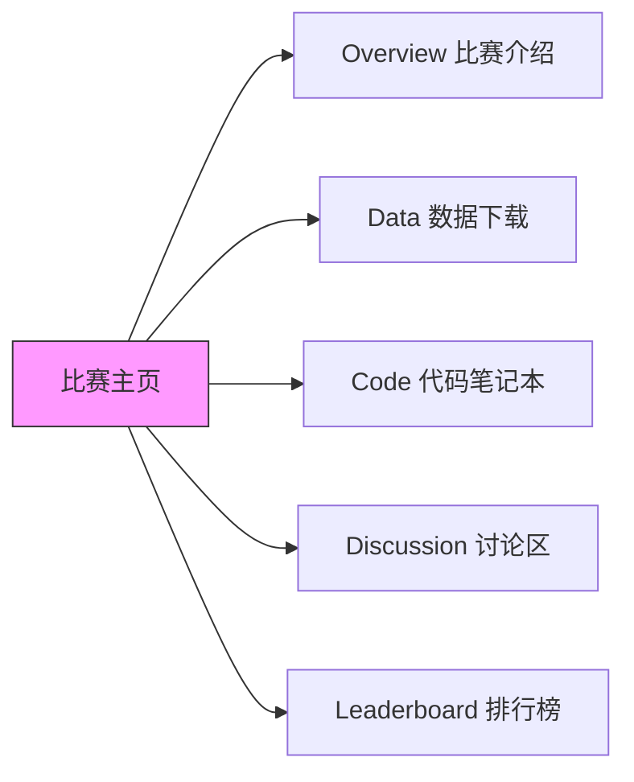
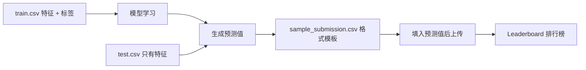
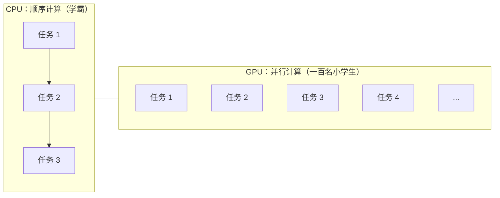
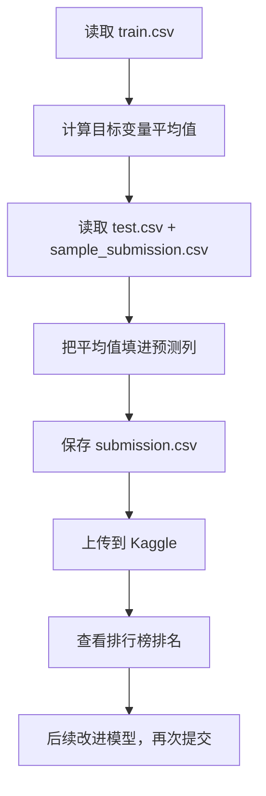
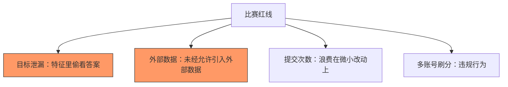
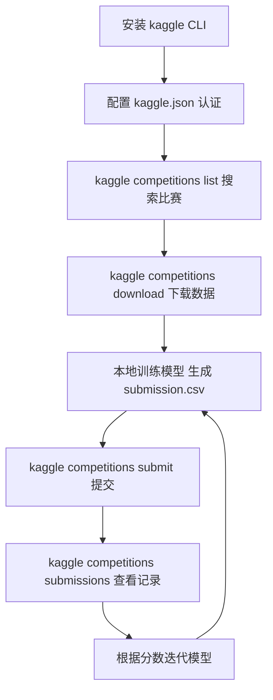
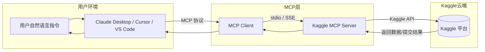

# 第1章 Kaggle 比赛流程与规则

在正式学习模型之前，我们先把 Kaggle 比赛的「战场」走一遍。很多新手卡住的地方不是模型调不出来，而是不知道数据从哪里下载、提交文件长什么样、排行榜分数怎么看。这一章就是带你从零开始，跑通第一场比赛，哪怕最后只提交一个「全填平均值」的基线，也要把「读数据 → 建模 → 预测 → 提交 → 查排名」这条完整链路走通。

---

## 1.1 什么是 Kaggle，比赛页面长什么样

Kaggle 是一个机器学习竞赛平台，全世界的数据科学家会在这里参加各种比赛，用数据解决具体问题。你可以把它想象成「程序员的 LeetCode」加上「数据科学家的擂台」：比赛方提供数据和题目，参赛者写代码训练模型，最后把预测结果提交上去，由平台自动计算分数并排名。

打开一个比赛的主页面，你通常会看到几个最重要的板块：

- **Overview（概述）**：比赛介绍、奖金、截止时间、数据描述、评价指标。这是你第一件事要读的地方，决定要不要参加。
- **Data（数据）**：可以下载训练集、测试集、样例提交文件，也可以直接在 Notebook 里挂载使用。
- **Code（代码/Notebooks）**：其他参赛者公开的代码笔记本，是学习他人解题思路的宝库。
- **Discussion（讨论区）**：参赛者提问、交流、分享经验的地方，新手卡住时可以先搜一下有没有人问过同样的问题。
- **Leaderboard（排行榜）**：显示所有参赛者的当前分数和排名。

**「比赛」与「数据集」的区别**：
- 比赛（Competition）：有明确的开始和结束时间，有排行榜，有评价指标，提交结果会被计算分数。
- 数据集（Dataset）：只是纯数据文件，没有截止时间，也没有排行榜，适合自己练习或做项目。

新手建议：先找一个奖金不高、数据规模适中、讨论区活跃的「入门型」比赛（比如 House Prices、Titanic、Dogs vs. Cats），不要一上来就选需要大规模 GPU 或专业领域知识的比赛。

> **Mermaid 图表：Kaggle 比赛页面导览图**



---

## 1.2 注册账号并加入一场比赛

参加 Kaggle 比赛的第一步是注册账号。你可以用 Google 邮箱直接登录，不需要单独记密码。登录后，建议完善个人资料，尤其是「实名认证」——有些比赛（尤其是有奖金的比赛）要求获奖者完成实名认证，否则无法领取奖金。

注册完成后，找一场感兴趣的比赛，点击页面上的「Join Competition」按钮。系统会弹出比赛规则，你需要勾选「我接受比赛规则」才能正式加入。只有加入后，你才能下载数据、提交结果、看到排行榜。

**如何选择适合新手入门的比赛**：

- **奖金不高、没有严格截止压力**：避免第一场就选奖金几万美元、只有两周时间的顶尖比赛，新手容易被吓到。
- **数据规模适中**：几百 MB 以内的表格数据、几万张以内的图片，笔记本电脑就能跑，不用冲云服务器。
- **话题熟悉**：房价预测、猫狗分类、情感分析这类题目，不需要你懂生物学或金融专业知识。
- **讨论区活跃**：进入比赛前先逛一逛讨论区，如果有很多新手问「数据怎么读」「提交格式怎么写」，说明这场比赛对新手友好。

---

## 1.3 理解三份核心文件：训练集、测试集、样例提交

进入比赛的 Data 页面，你几乎总会看到三份最核心的文件：

| 文件名 | 包含什么 | 作用 |
|--------|---------|------|
| `train.csv` | 特征列 + 目标列（标签） | 给模型学习用的「有答案」的数据 |
| `test.csv` | 特征列，**没有目标列** | 给模型预测用的「没答案」的数据 |
| `sample_submission.csv` | ID 列 + 一个空的预测列 | 提交格式的模板，你的提交文件必须和它长得一模一样 |

为什么测试集没有标签？因为比赛的目的就是考你「对没见过的数据做预测」。如果测试集里也给了答案，那比赛就没有意义了。

样例提交文件非常重要，因为它定义了你的输出格式：列名必须一致、行数必须和测试集一样、ID 顺序必须一一对应。哪怕预测值完全正确，如果列名写错了、多加了一行、或者 ID 顺序搞乱了，平台也会直接拒绝你的提交。

让我们用 pandas 把这三份文件都读进来，看看长什么样。以下代码可以直接在 Kaggle Notebooks 里运行（数据会自动挂载到 `/kaggle/input/<竞赛名>/` 目录）：

```python
import pandas as pd
import os

# Kaggle Notebooks 里，数据通常在 /kaggle/input/<竞赛目录名>/
# 这里以 House Prices 比赛为例，你需要把 'house-prices-regression' 换成你参加的比赛目录名
competition_dir = '/kaggle/input/house-prices-regression/'

# 先看看这个目录里有哪些文件
print("数据目录下的文件：")
print(os.listdir(competition_dir))

# 读取三份核心文件
train = pd.read_csv(competition_dir + 'train.csv')
test  = pd.read_csv(competition_dir + 'test.csv')
sample_sub = pd.read_csv(competition_dir + 'sample_submission.csv')

# 打印形状（行数，列数）和列名
print("\n=== 训练集 ===")
print("形状:", train.shape)
print("列名:", list(train.columns))

print("\n=== 测试集 ===")
print("形状:", test.shape)
print("列名:", list(test.columns))

print("\n=== 样例提交 ===")
print("形状:", sample_sub.shape)
print("列名:", list(sample_sub.columns))
print("前 5 行：")
print(sample_sub.head())
```

运行后你会看到类似这样的输出：

```
=== 训练集 ===
形状: (1460, 81)
列名: ['Id', 'MSSubClass', 'MSZoning', ..., 'SalePrice']

=== 测试集 ===
形状: (1459, 80)
列名: ['Id', 'MSSubClass', 'MSZoning', ..., 'SaleCondition']

=== 样例提交 ===
形状: (1459, 2)
列名: ['Id', 'SalePrice']
    Id  SalePrice
0  1461       nan
1  1462       nan
...
```

关键观察：

- 训练集比测试集多一列 `SalePrice`，这就是我们要预测的目标。
- 测试集和样例提交的行数一致（都是 1459 行），列名也一致（`Id` 和 `SalePrice`）。
- 样例提交里的 `SalePrice` 全是 `nan`，等着你填上预测值。

> **Mermaid 图表：三份文件的数据流向图**



---

## 1.4 使用 Kaggle Notebooks：浏览器里直接写代码

Kaggle Notebooks 是浏览器里直接运行的代码笔记本，相当于「云端 Jupyter」。你不需要在自己电脑上安装 Python、配置环境，打开网页就能写代码、跑模型、看结果。

打开一个比赛的 Code 页面，点击「New Notebook」，就会创建一个空白笔记本。笔记本由一个个「单元格」组成：

- **代码单元格（Code cell）**：写 Python 代码，点击运行按钮（▶）后，代码会在云端执行，结果直接显示在单元格下方。
- **Markdown 单元格**：写说明文字，支持标题、列表、粗体、公式等，用来给代码做注释或记录思路。

使用基础：

1. 新建一个代码单元格，输入 `print("Hello Kaggle")`，点击运行。
2. 变量在单元格之间共享：第一个单元格里定义的 `df`，在第二个单元格里可以直接用。
3. 执行顺序很重要：单元格右上角会显示一个数字（如 `[1]`、`[2]`），表示运行顺序。如果你修改了上面的单元格，下面的单元格需要重新运行才能拿到新结果。
4. 点击右上角的「Save」保存笔记本，Kaggle 会自动保存历史版本，你以后可以随时回到某个之前的版本。

```python
# 这是一个代码单元格
print("Hello Kaggle!")
print("我正在 Kaggle Notebooks 里写代码，不需要安装任何东西。")

# 定义一个变量，后面的单元格可以直接用
greeting = "欢迎参加第一场比赛"
print(greeting)
```

运行结果会直接显示在单元格下方：

```
Hello Kaggle!
我正在 Kaggle Notebooks 里写代码，不需要安装任何东西。
欢迎参加第一场比赛
```

---

## 1.5 免费 GPU 是什么，什么时候需要开

Kaggle Notebooks 免费提供 GPU（图形处理器）和 TPU，这是参加深度学习比赛的一大福音。普通电脑的 CPU 是「顺序计算」擅长的，一次只能处理一小部分数据；而 GPU 是「并行计算」擅长的，一次能处理成千上万个数字，训练神经网络时速度可以快几十倍甚至上百倍。

用大白话比喻：

- **CPU 像一个学霸**：很聪明，但一次只能做一道题，适合处理复杂逻辑。
- **GPU 像一百名小学生**：每个人单独看不太懂复杂逻辑，但一百人同时算加法，速度远超一个学霸。

**什么时候需要开 GPU**：

- 训练卷积神经网络（CNN）做图像分类（如猫狗大战）。
- 训练循环神经网络（RNN、LSTM）或 Transformer 做文本处理。
- 任何涉及大量矩阵乘法的深度学习模型。

**什么时候不需要开 GPU**：

- 表格数据比赛（房价预测、信用评分、销量预测），用随机森林、XGBoost 这类模型，CPU 完全够用。
- 纯数据清洗、EDA、特征工程。

如何开启：在 Notebook 设置（Settings）里，把「Accelerator」从「None」改为「GPU」，然后保存。重新启动 Notebook 后，就可以用 GPU 训练模型了。

> **Mermaid 图表：CPU 与 GPU 计算方式对比图**



---

## 1.6 把数据下载到本地：Kaggle API 与手动下载

在 Kaggle Notebooks 里，数据已经自动挂载好了，直接读就行。但如果你想在自己电脑上跑代码，就需要把数据下载下来。

**方法一：网页端手动下载**

进入比赛的 Data 页面，点击文件旁边的下载图标，浏览器就会下载一个 ZIP 压缩包。解压后就能在本地用 pandas 读取。这是最简单的方法，适合偶尔下载一两次的情况。

**方法二：Kaggle API 命令行工具**

如果你经常参加比赛，或者想把下载过程写进脚本自动化，可以使用 Kaggle API。安装和使用步骤如下：

1. 安装：`pip install kaggle`
2. 获取认证文件：登录 Kaggle 网站，进入账号设置（Account），滚动到最下方，点击「Create New API Token」，会下载一个 `kaggle.json` 文件。
3. 放置认证文件：把 `kaggle.json` 放到本地的 `~/.kaggle/kaggle.json`（Windows 上通常是 `C:\Users\你的用户名\.kaggle\kaggle.json`）。
4. 下载比赛数据：在终端运行 `kaggle competitions download -c <比赛简称>`，比如 `kaggle competitions download -c house-prices-regression`。

在 Python 里调用 Kaggle API 也可以，下面是一个示例代码，它通过 Python 的 `subprocess` 调用命令行来下载数据：

```python
import subprocess
import os


def download_competition_data(competition_name, output_dir='./data'):
    """
    使用 Kaggle API 下载比赛数据

    参数:
        competition_name: 比赛简称，如 'house-prices-regression'
        output_dir: 下载后保存的目录
    """
    # 确保输出目录存在
    os.makedirs(output_dir, exist_ok=True)

    # 构造 kaggle API 命令
    # kaggle competitions download -c <比赛名> -p <保存目录>
    cmd = [
        'kaggle', 'competitions', 'download',
        '-c', competition_name,
        '-p', output_dir
    ]

    print(f"正在下载比赛数据：{competition_name} ...")
    try:
        # 运行命令，等待完成
        result = subprocess.run(cmd, check=True, capture_output=True, text=True)
        print("下载成功！")
        print(result.stdout)
    except subprocess.CalledProcessError as e:
        print("下载失败，请检查：")
        print("1. 是否已安装 kaggle：pip install kaggle")
        print("2. 是否已配置 ~/.kaggle/kaggle.json")
        print("3. 比赛简称是否正确")
        print(e.stderr)
    except FileNotFoundError:
        print("未找到 kaggle 命令，请先安装：pip install kaggle")


# 示例调用（取消注释后使用）
# download_competition_data('house-prices-regression', './data')
```

下载完成后，目录里会有一个 ZIP 文件，解压后就是 `train.csv`、`test.csv`、`sample_submission.csv` 等文件。

---

## 1.7 你的第一份提交：哪怕全猜同一个数也能跑通

新手参加第一场比赛，最大的心理障碍是「我的模型还不够好，不敢提交」。其实完全不需要等模型好再提交——**你的第一个目标应该是把「读数据 → 建模 → 预测 → 提交 → 查排名」这条完整链路跑通**，哪怕预测值是全部填同一个数。

最简单的基线模型叫做「均值基线」：把训练集里目标变量的平均值算出来，把这个平均值填到测试集的每一行，生成提交文件并上传。这个分数可能很低，但它告诉你：「我已经知道怎么提交了，后续只需要不断改进模型就行。」

以下是一个完整的均值基线提交代码（以 House Prices 回归比赛为例，可在 Kaggle Notebooks 里直接运行）：

```python
import pandas as pd
import os

# 1. 读取数据（请把竞赛目录名换成你参加的比赛）
comp_dir = '/kaggle/input/house-prices-regression/'
train = pd.read_csv(comp_dir + 'train.csv')
test  = pd.read_csv(comp_dir + 'test.csv')
sample_sub = pd.read_csv(comp_dir + 'sample_submission.csv')

# 2. 查看目标列名（房价比赛通常是 SalePrice，其他比赛可能不同）
target_col = 'SalePrice'  # 请根据实际比赛修改
print("训练集目标列前 5 个值：")
print(train[target_col].head())

# 3. 计算训练集目标变量的平均值
mean_price = train[target_col].mean()
print(f"\n训练集 {target_col} 的平均值：{mean_price:.2f}")

# 4. 用平均值填满测试集的预测列
# 假设样例提交的预测列名也是 SalePrice，请根据实际比赛修改
prediction_col = sample_sub.columns[-1]  # 取最后一列作为预测列
sample_sub[prediction_col] = mean_price

print("\n填充后的前 5 行提交预览：")
print(sample_sub.head())

# 5. 保存提交文件
submission_path = 'submission.csv'
sample_sub.to_csv(submission_path, index=False)
print(f"\n提交文件已保存：{submission_path}")
print("在 Kaggle 网站的比赛页面，点击 \"Submit Predictions\" 上传这个文件即可。")
```

运行后，`submission.csv` 里的每一行预测值都等于训练集房价的平均值。把这个文件上传到 Kaggle 比赛页面，你就会在排行榜上看到自己的名次——哪怕是倒数第一也没关系，你已经跑通了全链路。

> **Mermaid 图表：基线提交流程图**



---

## 1.8 查看排行榜与理解 Public / Private 排名

提交完预测文件后，你可以去 Leaderboard 页面看到自己的分数和排名。Kaggle 比赛通常有两个排行榜：

- **Public Leaderboard（公开榜）**：提交后立即可见，基于测试集的一部分（比如 30% 的数据）计算分数。这个榜单是所有人都能看到的。
- **Private Leaderboard（私有榜）**：比赛结束后才揭晓，基于测试集的另一部分（比如剩下 70% 的数据）计算分数。这是决定最终名次的依据。

为什么分成两部分？防止参赛者「过拟合排行榜」——也就是说，有人不断提交、反复试探，直到在公开榜上刷出高分，但这个高分可能只是碰巧在公开榜那部分数据上表现好，在私有榜上可能表现很差。私有榜机制确保获奖者的模型是真正泛化好的，而不是专门针对公开榜数据「刷」出来的。

**为什么排行榜分数会波动**：

1. 公开榜和私有榜的数据分布可能不完全一样，公开榜分高不代表私有榜也高。
2. 有些模型在公开榜上表现很好，但在私有榜上掉排名，这叫「过拟合公开榜」。
3. 新手不必过度关注每一次提交的排名变化，更应该关注本地验证集上的分数是否稳定提升。

如何看待自己的名次：第一次提交可能排名靠后，这是非常正常的。顶尖选手通常也是从基线开始，一步步通过特征工程、模型调优、集成学习爬上去的。把排行榜当作学习参考，而不是压力来源。

---

## 1.9 比赛中的禁忌与常见规则

参加 Kaggle 比赛有一些红线，越过可能导致提交无效甚至账号被封，新手必须了解：

**1. 目标泄漏（Target Leakage）—— 最严重的禁忌**

在特征里包含了「只在预测时刻才能知道」的信息。比如预测明天的销量，特征里却包含了「明天的促销折扣」——在预测明天的时候，你根本不知道明天的折扣，这叫泄漏。目标泄漏会让本地分数非常好看，但提交后排行榜分数崩盘。

**2. 外部数据的使用限制**

大部分比赛只允许使用比赛官方提供的数据。私自引入外部数据（比如爬取其他网站的信息、使用比赛方未提供的标签）通常是违规的。具体规则要读比赛的 Rules 页面。

**3. 提交次数限制**

每个比赛每天有提交次数上限（比如每天 5 次），不要浪费在微小改动上。每次只改一处重要的东西，再提交。

**4. 截止时间规则**

比赛截止时间后，无法再提交。建议提前一天完成最终提交，避免最后一刻网络拥堵或出现意外。

**5. 不要共享账号或恶意刷分**

不要多个账号参加同一场比赛刷排名，不要和他人共享提交文件试图绕过提交次数限制。

> **Mermaid 图表：比赛规则红线清单**



---

## 1.10 Kaggle CLI 使用：命令行里跑遍 Kaggle

如果你经常参加比赛，或者想把「下载数据 → 训练 → 预测 → 提交」这套流程写成自动化脚本，Kaggle 官方提供的命令行工具（Kaggle CLI）会比网页点点点高效得多。

### 安装与认证

```bash
# 1. 安装
pip install kaggle

# 2. 获取认证文件
# 登录 Kaggle 网站 → 点击右上角头像 → Settings → API → Create New API Token
# 会下载一个 kaggle.json 文件，里面包含 username 和 key

# 3. 放置认证文件
# Linux / macOS: ~/.kaggle/kaggle.json
# Windows: C:\Users\<你的用户名>\.kaggle\kaggle.json

# 4. 设置权限（仅 Linux/macOS 需要）
chmod 600 ~/.kaggle/kaggle.json
```

### 常用命令全览

| 命令 | 作用 |
|------|------|
| `kaggle competitions list` | 列出所有比赛，`-s` 搜索关键词，`-p` 翻页 |
| `kaggle competitions download -c <比赛名>` | 下载比赛数据，自动解压到当前目录 |
| `kaggle competitions submit -c <比赛名> -f submission.csv -m "备注"` | 提交预测结果 |
| `kaggle competitions submissions -c <比赛名>` | 查看历史提交记录 |
| `kaggle datasets list / download` | 浏览与下载公开数据集 |
| `kaggle kernels list / push / pull` | 管理 Notebook（代码笔记本） |
| `kaggle config set -n competition -v <比赛名>` | 设置默认比赛，后续命令可省略 `-c` |

### 实战场景：一键跑通脚本

把「下载 → 训练 → 预测 → 提交」封装成一个 Python 脚本，以后每次参加新比赛只需改比赛名即可：

```python
import subprocess
import os
import sys


def run_cmd(cmd, description=""):
    """运行命令并打印结果"""
    print(f"\n=== {description or ' '.join(cmd)} ===")
    result = subprocess.run(cmd, capture_output=True, text=True)
    if result.stdout:
        print(result.stdout)
    if result.stderr:
        print(result.stderr, file=sys.stderr)
    if result.returncode != 0:
        print(f"❌ 失败，退出码: {result.returncode}")
        return False
    print("✅ 成功")
    return True


def main(competition_name):
    # 1. 下载数据
    if not run_cmd(['kaggle', 'competitions', 'download', '-c', competition_name], 
                   f"下载 {competition_name} 数据"):
        return

    # 2. 解压（kaggle CLI 会自动下载 zip，这里演示手动解压）
    import zipfile
    zip_path = f"{competition_name}.zip"
    if os.path.exists(zip_path):
        with zipfile.ZipFile(zip_path, 'r') as zf:
            zf.extractall(".")
        print(f"已解压到当前目录")

    # 3. 这里放你的训练+预测代码（示例：均值基线）
    # import pandas as pd
    # train = pd.read_csv('train.csv')
    # test = pd.read_csv('test.csv')
    # sample = pd.read_csv('sample_submission.csv')
    # target_col = 'SalePrice'  # 根据实际比赛修改
    # sample[target_col] = train[target_col].mean()
    # sample.to_csv('submission.csv', index=False)

    # 4. 提交
    # run_cmd(['kaggle', 'competitions', 'submit', '-c', competition_name, 
    #          '-f', 'submission.csv', '-m', '自动化基线提交'], 
    #         "提交预测结果")

    # 5. 查看提交记录
    run_cmd(['kaggle', 'competitions', 'submissions', '-c', competition_name],
            "查看提交记录")


if __name__ == '__main__':
    # 使用示例：python kaggle_auto.py house-prices-regression
    if len(sys.argv) < 2:
        print("用法: python kaggle_auto.py <比赛名>")
        sys.exit(1)
    main(sys.argv[1])
```

> **Mermaid 图表：Kaggle CLI 核心命令流程图**



---

## 1.11 Kaggle MCP 配置：让 AI 助手直接操作 Kaggle

### MCP 是什么

**MCP（Model Context Protocol）** 是 Anthropic 推出的开放协议，让大语言模型（如 Claude）能通过标准化接口调用外部工具。简单说：**你不用再在浏览器、终端、编辑器之间来回切换，直接在对话里说「帮我下载 House Prices 的数据」「提交我的 submission.csv」，AI 就能帮你完成。**

### 为什么要配 MCP

- **不再上下文切换**：不用记命令、不用开终端、不用登网页。
- **自然语言驱动**：「帮我找个适合新手的图像分类比赛」「把我刚才的模型提交上去并备注『调整了学习率』」。
- **可编程、可复用**：把常用操作封装成 Prompt，团队共享、新手上手快。

### 配置步骤（以 Claude Desktop 为例）

**前置条件**：已安装 Kaggle CLI 并完成 `kaggle.json` 认证（见上一节）。

1. 打开 Claude Desktop，进入 **Settings → Developer → Edit Config**，编辑 `claude_desktop_config.json`。

2. 添加 `kaggle` 服务器配置（推荐使用官方或社区维护的 MCP Server，这里以 `@modelcontextprotocol/server-kaggle` 为例）：

```json
{
  "mcpServers": {
    "kaggle": {
      "command": "npx",
      "args": ["-y", "@modelcontextprotocol/server-kaggle"],
      "env": {
        "KAGGLE_USERNAME": "你的Kaggle用户名",
        "KAGGLE_KEY": "你的API Key（来自 kaggle.json）"
      }
    }
  }
}
```

> **注意**：也有社区维护的 Python 版 MCP Server（如 `kaggle-mcp-server`、`arrismo/kaggle-mcp`），配置方式类似，只需把 `command` 改为 `uvx` 或 `python -m` 对应的模块名，`args` 相应调整。

3. 重启 Claude Desktop。

4. 在对话中直接使用：
   - 「帮我下载 `house-prices-regression` 比赛的训练集和测试集」
   - 「列出当前有哪些活跃的表格数据比赛」
   - 「把 `submission.csv` 提交到 `house-prices-regression`，备注『均值基线』」
   - 「查看我在这个比赛的历史提交记录」

### 常见问题排查

| 问题 | 排查方向 |
|------|----------|
| **认证失败** | 检查 `KAGGLE_USERNAME` 和 `KAGGLE_KEY` 是否正确，Key 中不要有多余空格或换行；确认 `kaggle.json` 在标准位置且权限 `600`。 |
| **命令找不到 / npx 报错** | 确认 Node.js 已安装且 `npx` 在 PATH 中；尝试 `npm install -g @modelcontextprotocol/server-kaggle` 后改用全局命令。 |
| **Windows 权限报错** | 以管理员身份运行终端，或在 PowerShell 执行 `Set-ExecutionPolicy -ExecutionPolicy RemoteSigned -Scope CurrentUser`。 |
| **MCP 服务器未启动** | 查看 Claude Desktop 的 Developer 面板日志，确认配置 JSON 语法正确（无尾随逗号、引号匹配）。 |

> **Mermaid 图表：MCP 客户端 ↔ Kaggle 服务器交互架构图**



---

## 1.12 小结

本章我们完成了 Kaggle 比赛的「第一次面对面」：

1. 了解了 Kaggle 比赛页面的五个核心板块：Overview、Data、Code、Discussion、Leaderboard，以及「比赛」与「数据集」的区别。
2. 学会了注册账号、加入比赛，并知道如何选择适合新手入门的比赛。
3. 搞清了三份核心文件：`train.csv`（有标签，给模型学）、`test.csv`（无标签，给模型预测）、`sample_submission.csv`（提交格式模板，必须严格匹配）。
4. 学会了使用 Kaggle Notebooks：代码单元格与 Markdown 单元格、变量跨单元格共享、执行顺序、版本保存。
5. 了解了免费 GPU 的适用场景：深度学习需要，表格数据通常 CPU 即可。
6. 学会了下载数据的两种方式：网页手动下载和 Kaggle API 命令行。
7. 跑通了第一份提交：用训练集目标变量的平均值做均值基线，生成 `submission.csv` 并上传。
8. 理解了 Public / Private 排行榜的区别，知道不必过度关注单次排名波动。
9. 了解了比赛禁忌：目标泄漏、外部数据限制、提交次数、截止时间等。
10. **掌握了 Kaggle CLI**：安装认证、常用命令（list/download/submit/submissions/datasets/kernels/config）、一键自动化脚本。
11. **配置了 Kaggle MCP**：理解 MCP 协议、完成 Claude Desktop 配置、会用自然语言让 AI 下载数据、提交结果、查记录。

下一章我们将进入正式的数据分析，学习探索性数据分析（EDA）：在建模之前，先把数据摊开来看，看清它的分布、缺失、异常值和相关性。
