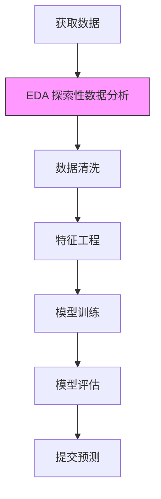

# 第2章 探索性数据分析（EDA）：先把数据摊开看

在建模之前，先不要急着把数据丢进模型。就像买房子要先看房、看户型、看周边环境，机器学习也要先「看数据」。这叫探索性数据分析（EDA，Exploratory Data Analysis）。

EDA 的核心任务就是回答几个问题：数据长什么样？有没有缺失值？有没有异常值？各个特征之间有什么关系？目标变量的分布怎样？把这些搞清楚了，后面的清洗、特征工程、建模才会有方向。否则你可能会用错模型、漏掉关键信息，甚至得出完全错误的结论。

本章我们用 House Prices（房价预测）作为贯穿示例，带你把一张表格数据从头到尾摊开看一遍。所有代码都可以直接在 Kaggle Notebooks 里运行。

---

## 2.1 什么是 EDA，为什么建模前必须做 EDA

EDA 的直观含义，就是像侦探勘查现场一样，先把数据摊开来看，看清它的真实面目，再决定下一步怎么做。

跳过 EDA 直接建模，会遇到以下常见麻烦：

1. **缺失值爆炸**：某些列缺失率超过 90%，你却没发现，直接喂进模型会报错或得到错觉般的结果。
2. **异常值误导**：数据里有一两个极端的错误值（比如房龄写成 200 年），把模型的注意力全吸走了。
3. **目标偏态**：房价这种目标变量通常右偏（少数豪宅把均值拉高），直接用原始房价做回归，模型会被大房子的绝对误差主导，忽略小房子。
4. **特征无用**：有些列（比如 ID 列、文件名列）对预测毫无帮助，却被你当成特征塞进模型，浪费计算资源还可能引入噪声。

做完 EDA，你会对数据有底：哪些列能用、哪些列要清洗、目标变量要不要变换、该选什么模型。这就像出门前先看天气预报，虽然不能保证万无一失，但能避免大部分麻烦。

> **Mermaid 图表：EDA 在机器学习流程中的位置图**



---

## 2.2 数值型特征的探索：分布、均值、中位数、偏态

数值型特征是可以进行加减乘除的列，比如房价、面积、房龄。探索数值型特征主要看三件事：**分布怎么分布、集中趋势在哪、有没有异常值**。

### 读取数据并查看整体情况

我们先读取 House Prices 的训练集，看看数据的基本形状：

```python
import pandas as pd
import numpy as np
import matplotlib.pyplot as plt
import seaborn as sns

# 读取训练集（Kaggle Notebooks 里数据会自动挂载）
train = pd.read_csv('/kaggle/input/house-prices-regression/train.csv')

print("数据形状:", train.shape)           # (1460, 81)
print("\n前 5 行：")
print(train.head())

print("\n数据类型和非空值统计：")
print(train.info())
```

### 查看目标变量 SalePrice 的分布

房价是我们要预测的目标，先看它的分布：

```python
# 直方图看房价分布
plt.figure(figsize=(8, 5))
plt.hist(train['SalePrice'], bins=50, edgecolor='black', alpha=0.7)
plt.xlabel('SalePrice')
plt.ylabel('Count')
plt.title('Distribution of SalePrice')
plt.show()

# 打印统计摘要
print(train['SalePrice'].describe())
```

你可能会看到类似这样的结果：

```
count     1460.000000
mean   180921.195890
std     79843.397293
min      34900.000000
25%     129975.000000
50%     163000.000000
75%     214000.000000
max     755000.000000
```

从直方图和统计摘要可以看出，房价分布**明显右偏**：大部分房子集中在 10万~20万美元，但少数豪宅高达 70多万，把均值（180921）拉得比中位数（163000）还高。这就是典型的右偏分布。

### 什么是偏态？

- **右偏（正偏）**：大部分值集中在左边，少数极大值把「尾巴」拉到右边。均值 > 中位数。房价、收入、销量常见这种分布。
- **左偏（负偏）**：大部分值集中在右边，少数极小值把「尾巴」拉到左边。均值 < 中位数。
- **对称分布**：均值 ≈ 中位数，像正态分布。

偏态对模型的影响：如果目标变量严重右偏，直接用原始值做回归，模型会被少数大值主导，误差对大房子更敏感。后面我们会看到，取对数变换（如 `np.log1p`）可以让分布更接近正态，模型效果通常会更好。

### 异常值的发现：箱线图与 3σ原则

箱线图（Boxplot）可以直观展示异常值：

```python
plt.figure(figsize=(8, 5))
plt.boxplot(train['SalePrice'], vert=False)
plt.xlabel('SalePrice')
plt.title('Boxplot of SalePrice')
plt.show()
```

箱线图里，箱子代表中间 50% 的数据， whiskers（胡须）代表正常范围，超出 whiskers 的点就是潜在的异常值。

更客观的方法是 **3σ原则**：如果一个数值距离均值超过 3 个标准差，通常视为异常值。

```python
mean = train['SalePrice'].mean()
std = train['SalePrice'].std()
print("均值:", mean)
print("标准差:", std)
print("3σ上限:", mean + 3 * std)
print("3σ下限:", mean - 3 * std)

# 找出超出 3σ 范围的房价
outliers = train[(train['SalePrice'] < mean - 3 * std) | (train['SalePrice'] > mean + 3 * std)]
print("异常值数量:", len(outliers))
```

不过要注意：异常值不一定要删。比如一套真正的豪宅房价很高，但它是真实的，删掉会丢失信息。是否处理异常值，要结合业务常识判断。

---

## 2.3 类别型特征的探索：基数、稀有类别、缺失模式

类别型特征是存储文字或离散标签的列，比如街区（Neighborhood）、房屋质量（OverallQual）、车库类型（GarageType）。探索类别型特征主要看：**有多少种取值（基数）、哪些类别很少见（稀有类别）、缺失值是什么模式**。

### 查看类别频次

```python
# 看 Neighborhood（街区）的取值分布
print(train['Neighborhood'].value_counts())
```

输出可能是：

```
CollgCr      198
OldTown      142
Edwards       97
Somerst       83
Gilbert       70
...
```

从中可以看出，不同街区的样本数量差异很大。有些街区样本多，模型更容易学到规律；有些街区样本少，预测可能不稳定。

### 什么是基数？

基数是指一个类别型特征有多少种不同的取值。比如：
- `OverallQual`（房屋整体质量，1~10 分）：基数小，只有 10 种，适合做有序编码。
- `Neighborhood`（街区）：基数中等，有 20 多种，适合做独热编码。
- `Id`（房屋编号）：基数极大，每个房子都不一样，完全没用，应该直接删掉。

### 稀有类别的问题

如果某个类别只出现了一两次，模型很难从中学到有用规律，反而可能过拟合。处理稀有类别的常见做法是把它们合并为一个「Other」类别，或者直接删除。

### 缺失值本身可能是信息

这是新手最容易忽略的一点。**缺失不等于「数据坏了」**，有时候缺失本身就有含义。

以 House Prices 为例：
- `PoolQC`（泳池质量）缺失，往往意味着这套房子**没有泳池**，而不是数据丢失。
- `GarageYrBlt`（车库建成年份）缺失，往往意味着**没有车库**。

如果你一律把缺失值删掉，或者一律填成 0，就会丢掉这个「没有泳池/没有车库」的信息。正确的做法是按语义填充：把 `PoolQC` 的缺失填成 `'None'`（表示没有泳池），把 `GarageYrBlt` 的缺失填成 0（表示无车库），或者额外增加一列 `_is_missing` 标记缺失。

我们会在第3章详细讲缺失值处理，这里先建立这个意识：**不要一看到缺失就删行或填 0，先想一想缺失是什么意思。**

---

## 2.4 多变量关系与相关性：特征之间和特征与目标的关系

单独看每个特征不够，还要看特征之间、特征与目标之间的关系。这能帮你发现哪些特征对预测目标有帮助，哪些特征可以组合出新特征。

### 相关系数：两个数值列是否一起变动

相关系数（Pearson 相关系数）衡量两个数值变量的线性相关程度，取值范围是 -1 到 1：

- 接近 1：强正相关，一个变大另一个也变大。
- 接近 -1：强负相关，一个变大另一个变小。
- 接近 0：几乎无线性关系。

```python
# 计算所有数值特征与 SalePrice 的相关系数
corr = train.corr(numeric_only=True)['SalePrice'].sort_values(ascending=False)
print(corr.head(15))
```

你可能会看到：

```
SalePrice        1.000000
OverallQual      0.793985
GrLivArea        0.708671
GarageCars       0.642407
GarageArea       0.623431
TotalBsmtSF      0.613581
1stFlrSF         0.605852
...
```

`OverallQual`（房屋整体质量）与房价的相关性最高（0.79），说明房子质量越好，价格通常越高。这符合直觉，也告诉我们 `OverallQual` 是个重要特征。

### 散点图：看两个数值特征的关系

散点图能让你肉眼看到两个变量的关系：

```python
plt.figure(figsize=(8, 5))
plt.scatter(train['GrLivArea'], train['SalePrice'], alpha=0.5)
plt.xlabel('GrLivArea (地上面积)')
plt.ylabel('SalePrice')
plt.title('GrLivArea vs SalePrice')
plt.show()
```

你会发现：地上面积越大，房价通常越高，两者呈正相关。但也能看到一些离群点，比如面积不大但房价很高的房子，可能是位置好或质量极高。

### 热力图：一次看所有特征之间的相关性

如果特征很多，一个个看相关系数太慢。可以用热力图一次性展示相关性矩阵：

```python
plt.figure(figsize=(12, 10))
sns.heatmap(train.corr(numeric_only=True), annot=False, cmap='coolwarm', center=0)
plt.title('Correlation Heatmap')
plt.show()
```

热力图里颜色越深（红或蓝），相关性越强。你可以一眼看出哪些特征与房价关系密切，哪些特征之间本身也高度相关。

### 高度相关的特征可能导致多重共线性

如果两个特征彼此高度相关（比如 `1stFlrSF` 和 `TotalBsmtSF` 都衡量面积），把它们都塞进模型，可能会导致**多重共线性**：模型不知道该信哪个，系数变得不稳定，解释性变差。处理方法包括：保留一个、删除一个、或者把它们组合成一个新特征（比如总面积 = 一楼面积 + 二楼面积 + 地下室面积）。

---

## 2.5 目标变量的探索：回归看分布，分类看类别比例

目标变量（y）是我们要预测的东西，探索目标变量是 EDA 的重中之重。回归和分类的关注点不同：

### 回归任务：看目标变量是否偏态

对于房价预测这种回归任务，主要看目标变量 `SalePrice` 的分布：

- 如果分布右偏（如房价），考虑取对数变换（`np.log1p`），让分布更接近正态，模型更容易拟合。
- 评价指标如果是 RMSE，对大值更敏感；如果是 LogLoss 或基于对数的指标，对数变换后的目标更合适。

```python
# 原始房价分布（右偏）
plt.figure(figsize=(8, 5))
plt.hist(train['SalePrice'], bins=50, edgecolor='black', alpha=0.7)
plt.xlabel('SalePrice')
plt.title('Original SalePrice Distribution')
plt.show()

# 对数变换后的分布（更接近正态）
plt.figure(figsize=(8, 5))
np.log1p(train['SalePrice']).hist(bins=50, edgecolor='black', alpha=0.7)
plt.xlabel('log1p(SalePrice)')
plt.title('Log-Transformed SalePrice Distribution')
plt.show()
```

取对数后，原来的长尾被压缩了，分布看起来更对称了。这就是为什么 House Prices 比赛社区里常用「log 空间 RMSE」作为参考指标。

### 分类任务：看各类别样本是否平衡

如果是分类任务（比如预测房子是否卖出，或信用卡是否违约），要重点看**类别比例**：

```python
# 假设 target 是 0/1 的二分类标签
print(train['target'].value_counts())
print("\n各类别比例：")
print(train['target'].value_counts(normalize=True))
```

如果某个类别占了 90% 以上，另一个类别只有 10% 以下，这就是**类别不平衡**。这时候模型容易学成「全猜大类」，准确率看起来很高，但实际上对小类预测很差。处理类别不平衡的常见方法包括：过采样小类、欠采样大类、使用类别权重、或者选择对不平衡不敏感的评估指标（如 F1、AUC、LogLoss）。

---

## 2.6 小结

本章我们学习了探索性数据分析（EDA）的核心内容：

1. **什么是 EDA**：建模前先把数据摊开看，像侦探勘查现场，避免直接建模踩坑。
2. **数值型特征探索**：用直方图看分布，用 describe 查看统计摘要，识别偏态（右偏/左偏），用箱线图和 3σ原则发现异常值。
3. **类别型特征探索**：用 value_counts 看类别频次，理解基数的概念，识别稀有类别，意识到缺失值本身可能是信息（如「没有泳池」≠「数据坏了」）。
4. **多变量关系与相关性**：用相关系数看特征与目标的线性关系，用散点图看两个数值特征的关系，用热力图一次查看所有特征相关性，警惕多重共线性。
5. **目标变量探索**：回归任务看目标分布是否偏态，考虑对数变换；分类任务看类别比例，识别类别不平衡。

做完 EDA，你对数据已经有了整体认识。下一章我们将进入表格数据的通用清洗与建模：缺失值怎么填、类别怎么编码、特征怎么组合、用什么模型做基线。
