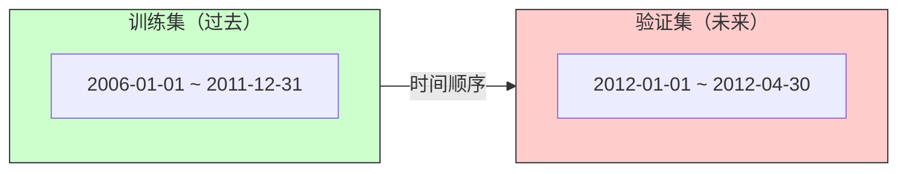

# 第8章 时序数据的通用清洗与建模方法

时序数据的每一行都关联一个时间点，样本之间有先后顺序，不能随便打乱。常见比赛包括门店销售预测、交通流量预测、电力负荷预测、股票价格预测等。

与普通表格数据最大的区别在于：**时序数据不能随机划分验证集**，必须按时间顺序切分（训练在前，验证在后），否则会出现"未来信息泄漏"——模型偷看了还没发生的事情，验证分数好看得虚假，提交后排行榜崩盘。

本章我们讲时序数据的通用清洗与建模方法：日期特征拆分、滞后特征与滚动统计、按时间切分验证集、目标变换（对数变换与差分）、以及时序数据的主力模型（XGBoost 回归与 LightGBM）。所有代码都可以直接在 Kaggle Notebooks 里运行。

---

## 8.1 日期特征拆分：把日期拆成模型能用的数字

原始的日期列（如 `2015-08-01`）是一个字符串或 datetime 对象，模型没法直接理解。我们需要把它拆成模型能用的数字特征，让模型学习星期、月份、季节等周期性规律。

常见的拆分方式：

| 拆分特征 | 含义 | 适用场景 |
|---------|------|---------|
| `year` | 年份 | 捕捉多年趋势、通货膨胀 |
| `month` | 月份 | 捕捉季节性（如冬季取暖、夏季制冷） |
| `day` | 日期 | 捕捉月初/月中/月末模式 |
| `dayofweek` | 星期几（0-6） | 捕捉周周期（如工作日 vs 周末） |
| `is_weekend` | 是否周末 | 捕捉周末特殊行为 |
| `dayofyear` | 一年中的第几天 | 捕捉年度进度 |
| `is_holiday` | 是否节假日 | 捕捉节假日效应 |

```python
import pandas as pd
import numpy as np

# 假设 df 是读取后的数据，包含 'Date' 列
df['Date'] = pd.to_datetime(df['Date'], errors='coerce')

# 拆分日期特征
df['Year']  = df['Date'].dt.year
df['Month'] = df['Date'].dt.month
df['Day']   = df['Date'].dt.day
df['DayOfWeek'] = df['Date'].dt.dayofweek   # 0=周一, 6=周日
df['IsWeekend'] = (df['DayOfWeek'] >= 5).astype(int)
df['DayOfYear'] = df['Date'].dt.dayofyear

# 拆完之后，原始的 Date 列通常可以删掉，避免重复信息
# df = df.drop('Date', axis=1)
```

**为什么要拆成多个数字？** 因为树模型（随机森林、XGBoost）只会做"这个数大于阈值吗"这样的切分，它不理解"2015-08-01"这个整体概念。拆开之后，「月份 == 12」就是一次干净的切分，模型很容易学到"12月销量高"这样的规律。

**节假日特征**：如果比赛提供了节假日日历，可以把节假日标记为 1，非节假日标记为 0。节假日对零售、交通、电力负荷都有显著影响。

---

## 8.2 滞后特征与滚动统计：用过去的值预测未来

时序预测的核心思想是：**用过去的信息预测未来**。滞后特征（Lag Features）和滚动统计（Rolling Statistics）是最常用、也最有效的时序特征。

### 滞后特征

滞后特征就是把目标变量或某个特征的过去值，作为当前时刻的特征。比如预测今天的销量，可以用昨天、前天、上周同天的销量作为特征。

```python
# 假设 df 已按时间排序，包含 'Sales' 列
# 滞后 1 天、7 天、30 天的销量
df['Sales_Lag1']  = df['Sales'].shift(1)
df['Sales_Lag7']  = df['Sales'].shift(7)
df['Sales_Lag30'] = df['Sales'].shift(30)
```

`shift(n)` 会把数据向下移动 n 行，第 i 行的滞后特征值等于第 i-n 行的原始值。前 n 行会变成 NaN，后续处理缺失值时可以填 0 或前向填充。

### 滚动统计

滚动统计在某个时间窗口内计算统计量，捕捉近期趋势与波动：

```python
# 过去 7 天、30 天的滚动均值
df['Sales_RollingMean_7']  = df['Sales'].rolling(window=7).mean()
df['Sales_RollingMean_30'] = df['Sales'].rolling(window=30).mean()

# 过去 7 天的滚动标准差（捕捉波动程度）
df['Sales_RollingStd_7'] = df['Sales'].rolling(window=7).std()

# 过去 7 天的滚动最大值/最小值
df['Sales_RollingMax_7']  = df['Sales'].rolling(window=7).max()
df['Sales_RollingMin_7']  = df['Sales'].rolling(window=7).min()
```

**注意**：滚动统计必须只使用"当前时刻及之前"的数据，不能包含未来。`rolling().mean()` 默认就是前向窗口，满足这个要求。

**滚动窗口怎么选？** 取决于数据的周期性：
- 日数据：窗口 7（一周）、30（一个月）
- 小时数据：窗口 24（一天）、168（一周）
- 周数据：窗口 4（一个月）、12（一季度）

### 滞后特征与滚动统计的注意事项

1. **前几行会产生 NaN**：滞后 30 天意味着前 30 行没有滞后特征，滚动窗口 30 意味着前 29 行没有完整窗口。这些 NaN 需要填充（填 0、前向填充 `fillna(method='ffill')`，或直接删掉前几行）。
2. **不要泄漏未来信息**：计算滚动统计时，默认包含当前行。如果你想严格只用"过去"的数据（不含当前），可以用 `shift(1).rolling(...)` 先滞后再滚动。

---

## 8.3 防止未来信息泄漏：按时间切分验证集

时序数据最容易犯的错误，就是**随机划分训练集和验证集**。如果你随机切分，验证集里可能包含训练集之后的日期，模型在训练时就"偷看"了未来的信息，验证分数会好得虚假，提交到排行榜后崩盘。

### 错误做法：随机切分

```python
# ❌ 错误：随机切分时序数据
from sklearn.model_selection import train_test_split
X_train, X_valid, y_train, y_valid = train_test_split(X, y, test_size=0.2, random_state=42)
```

### 正确做法：按时间顺序切分

```python
# ✅ 正确：按日期顺序切分，训练在前，验证在后
# 假设 df 已按 Date 排序
split_date = '2015-01-01'  # 2015年1月1日之前训练，之后验证

train_mask = df['Date'] < split_date
valid_mask = df['Date'] >= split_date

X_train, y_train = df.loc[train_mask, features], df.loc[train_mask, 'Sales']
X_valid, y_valid = df.loc[valid_mask, features], df.loc[valid_mask, 'Sales']
```

这样验证集模拟的是"用过去的数据预测未来"的真实场景。

### TimeSeriesSplit：时序交叉验证

如果你想做交叉验证，不能用普通的 KFold，要用 `TimeSeriesSplit`。它按时间顺序切分，每一折的训练集都在验证集之前：

```python
from sklearn.model_selection import TimeSeriesSplit

tscv = TimeSeriesSplit(n_splits=5)
for train_idx, valid_idx in tscv.split(X):
    X_train, X_valid = X.iloc[train_idx], X.iloc[valid_idx]
    y_train, y_valid = y.iloc[train_idx], y.iloc[valid_idx]
    # 训练模型、评估...
```

`TimeSeriesSplit` 的特点是：训练集只扩大，验证集向后推移，永远不会出现验证集在训练集之前的情况。

> **Mermaid 图表：时间序列验证集划分图**



---

## 8.4 时序数据的目标变换：对数变换与差分

时序数据的目标变量（如销售额、电力负荷）通常有以下特征：
- **右偏分布**：大部分时间销量普通，少数促销日或节假日销量极高。
- **趋势**：随时间整体上涨或下降。
- **季节性**：每年、每月、每周重复的模式。

### 对数变换

对右偏的目标变量取对数，可以让分布更接近正态，模型更容易拟合：

```python
# 销售额取对数（log1p 安全处理 0 值）
df['Sales_Log'] = np.log1p(df['Sales'])
```

预测完成后，记得用 `np.expm1` 还原回原始价格空间。

### 差分

如果目标变量有明显的趋势（比如销量年年上涨），直接预测绝对值会比较困难。可以用**差分**把趋势去掉，预测"今天比昨天多了多少"而不是"今天是多少"：

```python
# 一阶差分：今天的销量 - 昨天的销量
df['Sales_Diff'] = df['Sales'].diff()

# 预测完成后还原：今天的预测值 = 昨天的真实值 + 预测的差分
```

差分后的序列通常更平稳，模型更容易学习。不过差分也有代价：第一行会变成 NaN，还原时需要用到真实的昨天值（在预测未来时，昨天的真实值可能不可得，需要用递推方式逐步预测）。

---

## 8.5 时序数据的主力模型：XGBoost 回归与 LightGBM

时序数据虽然有时间顺序，但建模时常用树模型（XGBoost、LightGBM），原因如下：
- 树模型对特征的量纲不敏感，不需要标准化。
- 树模型能处理类别特征（如星期几、月份）。
- 树模型对缺失值有天然耐受性。
- 加上滞后特征和滚动统计后，树模型可以捕捉"过去的值影响未来"的自回归关系。

### XGBoost 回归示例

```python
import xgboost as xgb
from sklearn.metrics import mean_squared_error

# 假设 X_train, y_train, X_valid, y_valid 已按时间切分好
# y_train 已经做过 log1p 变换

model = xgb.XGBRegressor(
    n_estimators=1000,
    max_depth=8,
    learning_rate=0.05,
    subsample=0.8,
    colsample_bytree=0.8,
    objective='reg:squarederror',
    n_jobs=-1,
    random_state=42
)

# 使用验证集做早停，防止过拟合
model.fit(
    X_train, y_train,
    eval_set=[(X_valid, y_valid)],
    early_stopping_rounds=50,
    verbose=False
)

# 预测（还在对数空间）
valid_pred_log = model.predict(X_valid)

# 还原回原始空间
valid_pred = np.expm1(valid_pred_log)
y_valid_orig = np.expm1(y_valid)

# 计算 RMSE
rmse = np.sqrt(mean_squared_error(y_valid_orig, valid_pred))
print(f"Validation RMSE: {rmse:.4f}")
```

### LightGBM

LightGBM 是 XGBoost 的轻量级替代品，训练速度更快，对大规模数据更友好。用法与 XGBoost 类似：

```python
from lightgbm import LGBMRegressor

model = LGBMRegressor(
    n_estimators=1000,
    max_depth=8,
    learning_rate=0.05,
    subsample=0.8,
    colsample_bytree=0.8,
    random_state=42,
    n_jobs=-1
)
model.fit(X_train, y_train)
```

### 时序建模的关键提醒

1. **特征里不能包含未来信息**：比如不要用"未来 7 天的平均销量"作为今天的特征，这在预测时是不可得的。
2. **滞后特征的 NaN 处理**：滞后 30 天会导致前 30 行缺失，训练时可以填 0 或删掉前几行；预测时要确保测试集也有足够的历史数据来计算滞后特征。
3. **验证集必须按时间切分**：这是时序建模的生命线，违反了这个原则，所有的验证分数都是假的。

---

## 8.6 小结

本章我们学习了时序数据的通用清洗与建模方法：

1. **日期特征拆分**：把日期拆成年、月、日、星期几、是否周末、一年中的第几天等，让模型学习周期性规律。
2. **滞后特征**：用 `shift(n)` 把目标变量的过去值作为当前特征，捕捉自回归关系。
3. **滚动统计**：用 `rolling(window).mean()` 等计算近期均值、标准差、最大最小值，捕捉短期趋势与波动。
4. **按时间切分验证集**：时序数据不能随机切分，必须训练在前、验证在后；交叉验证用 `TimeSeriesSplit`。这是防止未来信息泄漏的生命线。
5. **目标变换**：右偏的目标变量用 `log1p` 对数变换；有趋势的目标变量可用 `diff()` 差分去趋势。
6. **主力模型**：XGBoost 和 LightGBM 是时序回归的常用选择，对类别特征和缺失值耐受性好，配合滞后特征和滚动统计效果通常很好。

下一章我们将进入具体的时序比赛详解：门店销售预测（Rossmann Store Sales），把本章的通用方法完整应用到一个真实比赛中。
