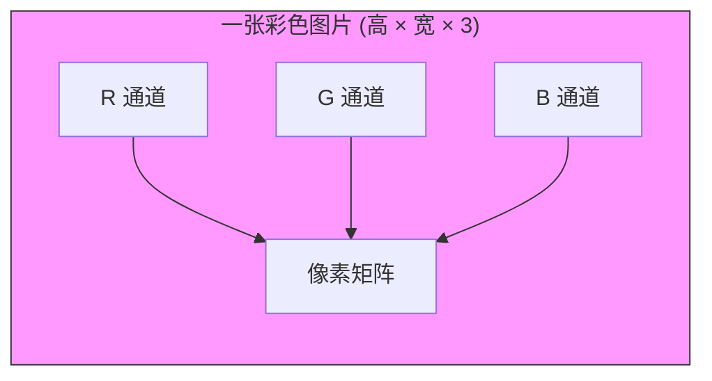
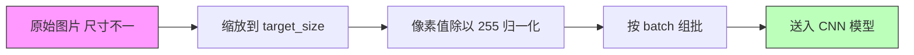
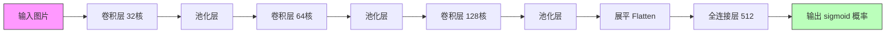
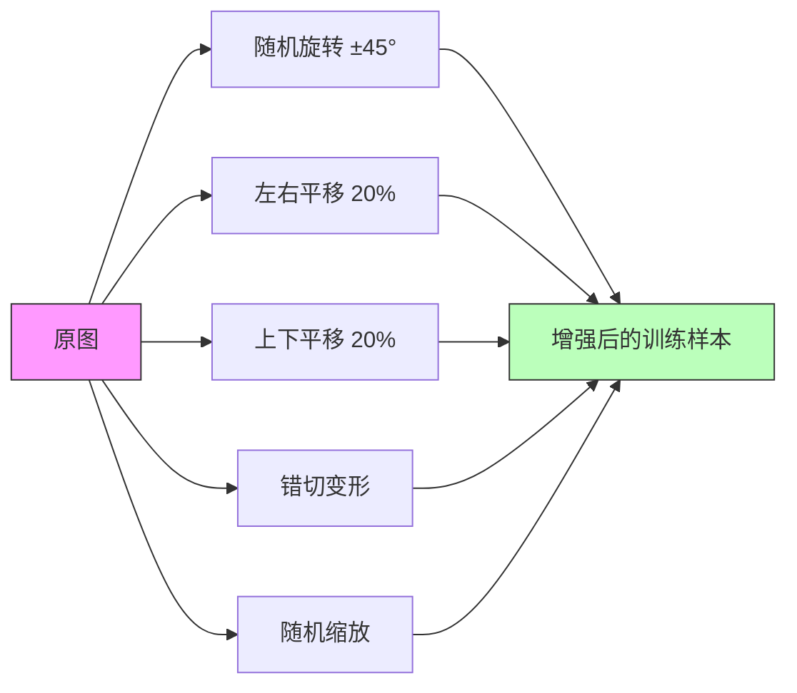
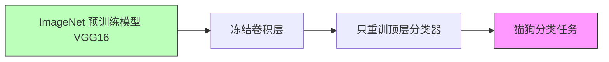

# 第12章 图像数据的通用清洗与建模方法

图像数据是 Kaggle 上另一大常见赛道。猫狗大战、糖尿病视网膜病变检测、卫星图像分类、物体检测，这些比赛的核心输入都是图片。

图像建模和表格建模最大的区别在于：图片不能直接喂给模型，必须先读成像素矩阵、统一尺寸、归一化，然后通过卷积神经网络（CNN）提取特征。而且图像数据集通常很大，不能一次性全部读进内存，需要用生成器按批次读取。

本章我们讲图像数据的通用清洗与建模方法：图像在计算机里怎么表示、读取与预处理、CNN 的直观原理、从零训练小型 CNN、过拟合与数据增强、迁移学习。所有代码都可以直接在 Kaggle Notebooks 里运行。

---

## 12.1 图像在计算机里怎么表示：像素、通道、尺寸

### 像素矩阵

一张彩色图片在计算机里是一个三维数组：高 × 宽 × 通道。

- **高（Height）**：图片有多少行像素。
- **宽（Width）**：图片有多少列像素。
- **通道（Channel）**：彩色图片通常有 3 个通道，分别是红（R）、绿（G）、蓝（B）。每个通道是一个二维像素矩阵，值域是 0~255，数值越大代表该颜色越亮。

用大白话说：一张图片就像一张方格纸，每个小方格是一个像素点，每个像素点用三个数字（R、G、B）来描述颜色。比如（255, 0, 0）是纯红，（0, 255, 0）是纯绿，（0, 0, 255）是纯蓝，（255, 255, 255）是白色，（0, 0, 0）是黑色。

> **Mermaid 图表：图像像素矩阵示意图**



### 尺寸不一的问题

不同图片的尺寸通常不一样：有的是 430×499，有的是 319×255，有的是 186×239。但模型要求每个 batch 里的图片尺寸必须一致，才能拼成一个四维数组（批次 × 高 × 宽 × 通道）送进网络。所以我们必须在使用前把所有图缩放到同一个尺寸，比如 200×200 或 224×224。

```python
from PIL import Image
import numpy as np

img = Image.open('cat.3660.jpg')
arr = np.array(img)
print(arr.shape)  # 例如 (430, 499, 3)
```

---

## 12.2 读取与预处理图片：缩放、归一化、批次送入

### 读取图片

可以用 PIL、OpenCV 或 matplotlib 读取图片。读取后得到一个 numpy 数组，形状是 (高, 宽, 通道)。

### 缩放到统一尺寸

把所有图缩放到统一尺寸（如 200×200）。为什么选 200？这是速度和精度的一个折中——太小（比如 64×64）猫狗的细节就糊了，太大（比如 512×512）训练会慢好几倍。

### 归一化

把像素值从 0~255 除以 255，压到 0~1。这样每一层的输入都落在小范围里，梯度下降更稳。

### 按批次读图：ImageDataGenerator

如果一次性把几万张图全读进内存，容易撑爆显存/内存。Keras 的 `ImageDataGenerator` 可以按批次读取图片，自动完成缩放和归一化，不需要提前把所有图处理一遍存到硬盘上。

```python
from keras.preprocessing.image import ImageDataGenerator

# 验证集只做归一化，不做任何随机增强
val_datagen = ImageDataGenerator(rescale=1./255)

# 训练集走增强流程（下面 12.5 节解释）
train_datagen = ImageDataGenerator(
    rescale=1./255,
    rotation_range=45,       # 随机旋转 ±45 度
    width_shift_range=0.2,   # 左右平移最多 20%
    height_shift_range=0.2,  # 上下平移最多 20%
    shear_range=0.2,         # 错切变形
    zoom_range=0.2           # 随机缩放
)

# 从表格读图，按 batch 逐批送入，避免一次性把所有图全读进内存
train_gen = train_datagen.flow_from_dataframe(
    dataframe=train_part,
    directory=train_dir,
    x_col='filename', y_col='label',
    class_mode='binary',      # 二分类
    target_size=(200, 200),   # 统一缩放到 200x200
    batch_size=32
)
```

这里要特别强调 `rescale=1./255` 和 `target_size`：生成器会在读图时自动完成缩放和归一化。

> **Mermaid 图表：图像预处理流水线**



---

## 12.3 卷积神经网络直观理解：滤波器、池化、全连接层

### 卷积层

卷积层用小滤波器（例如 3×3）在图片上扫描，提取边缘、纹理、部件等特征。第一层卷积提取低级特征（边缘、颜色块），深层卷积提取更复杂的特征（耳朵、眼睛、轮胎）。

### 池化层

池化层（如最大池化）缩小特征图的尺寸，保留重要信息，减少计算量，同时让模型对位置微小变化不那么敏感。

### 全连接层

经过多组「卷积+池化」后，特征图被展平（Flatten）成一维向量，接全连接层，最后输出层用 sigmoid 或 softmax 压成类别概率。

> **Mermaid 图表：CNN 层结构示意图**



---

## 12.4 从零训练小型 CNN：猫狗大战示例

我们先搭一个「够用就好」的小 CNN。它的结构是四组「卷积 + 池化」，卷积核数量逐层翻倍（32 → 64 → 128 → 128），最后拉平接一个 512 维全连接层，输出层用 sigmoid 压成 0~1 的概率——正好对应「是狗的概率」。

```python
from keras import models, layers, optimizers

network = models.Sequential()
# 第 1 组：32 个 3x3 卷积核，提取边缘、颜色块等低级特征
network.add(layers.Conv2D(32, (3, 3), activation='relu', input_shape=(200, 200, 3)))
network.add(layers.MaxPooling2D((2, 2)))   # 尺寸减半
# 第 2 组：64 个卷积核，学更复杂的纹理
network.add(layers.Conv2D(64, (3, 3), activation='relu'))
network.add(layers.MaxPooling2D((2, 2)))
# 第 3 组：128 个卷积核，学「耳朵」「眼睛」这类部件
network.add(layers.Conv2D(128, (3, 3), activation='relu'))
network.add(layers.MaxPooling2D((2, 2)))
# 第 4 组：再叠一层 128，让感受野更大
network.add(layers.Conv2D(128, (3, 3), activation='relu'))
network.add(layers.MaxPooling2D((2, 2)))

network.add(layers.Flatten())
network.add(layers.Dense(512, activation='relu'))
# 二分类输出：1 个神经元 + sigmoid，输出「是狗」的概率
network.add(layers.Dense(1, activation='sigmoid'))

# 二分类标准损失是 binary_crossentropy，优化器用 Adam，学习率 1e-4
network.compile(optimizer=optimizers.adam(lr=1e-4),
                loss='binary_crossentropy',
                metrics=['accuracy'])
```

训练 30 轮后，我们观察到：

- 训练准确率一路从 0.52 涨到 **0.917**；
- 验证准确率在第 26 轮达到最高 **0.863**，之后开始震荡，最后一轮只有 0.840；
- 训练损失持续下降，验证损失却在中后期开始回升。

这就是**过拟合**的典型症状：模型把训练集的细节（甚至背景）背下来了，遇到没见过的图就原形毕露。训练准确率和验证准确率越拉越开，就是警报。

---

## 12.5 过拟合与数据增强：让图片自己变出更多样本

### 过拟合的直观理解

训练准确率高、验证准确率低 = 过拟合。模型把训练集的细节（甚至背景）背下来了，遇到没见过的图就原形毕露。

### 数据增强

对训练图片随机旋转、平移、错切、缩放、翻转，等于每轮都看到「略有不同」的同一张图，逼模型学形状而不是记像素。上面的 `ImageDataGenerator` 里那一串参数就是干这个的。

```python
train_datagen = ImageDataGenerator(
    rescale=1./255,
    rotation_range=45,       # 随机旋转 ±45 度
    width_shift_range=0.2,   # 左右平移最多 20%
    height_shift_range=0.2,  # 上下平移最多 20%
    shear_range=0.2,         # 错切变形
    zoom_range=0.2           # 随机缩放
)
```

加了增强和 Dropout 之后，验证准确率最高只到 **0.808**，反而比不加时的 0.863 更低。看起来很反直觉，但很正常——增强会让训练任务变难、收敛变慢，50 轮的预算下模型还没完全吃透。它的好处是**训练和验证曲线贴得更近**（训练准确率降到 0.77 左右，和验证的 0.81 差不多），泛化更稳，不容易在测试集上突然崩掉。所谓「调模型」很多时候就是在「训练集分数」和「测试集稳健性」之间做取舍。

> **Mermaid 图表：数据增强变换示意图**



### Dropout

在 Flatten 之后、Dense 之前插一个 `Dropout(0.2)`，训练时随机「关掉」20% 的神经元，防止某几个神经元记住训练样本。

```python
network.add(layers.Flatten())
network.add(layers.Dropout(0.2))   # 训练时随机丢弃 20% 的神经元
network.add(layers.Dense(512, activation='relu'))
network.add(layers.Dense(1, activation='sigmoid'))
```

---

## 12.6 迁移学习：借用 ImageNet 上已经学会的「眼睛」

### 什么是迁移学习

用在 ImageNet 上预训练好的 VGG16、ResNet50 等模型，冻结卷积层、只重训顶层。预训练模型已经见过上千万张图，学会了「边缘 → 纹理 → 部件」的通用识别能力，这些能力换成猫狗同样管用。

### 为什么小数据集上迁移学习效果通常远好于从零训练

从零训练需要模型从最基础的边缘检测开始学，数据量不足时很难学好。迁移学习直接借用已经学好的通用特征，只需要在最后几层做微调，数据需求小得多。

资料里这类做法普遍能到 95% 以上，好的能到 98%～99%，比从零训练高出一大截。

```python
from keras.applications import VGG16
from keras import models, layers, optimizers

# 加载在 ImageNet 上预训练好的 VGG16，不包含顶层分类器
conv_base = VGG16(weights='imagenet',
                  include_top=False,
                  input_shape=(200, 200, 3))

# 冻结卷积层，只训练顶层
conv_base.trainable = False

model = models.Sequential()
model.add(conv_base)
model.add(layers.Flatten())
model.add(layers.Dense(256, activation='relu'))
model.add(layers.Dense(1, activation='sigmoid'))

model.compile(optimizer=optimizers.RMSprop(lr=2e-5),
              loss='binary_crossentropy',
              metrics=['acc'])
```

> **Mermaid 图表：迁移学习迁移路径图**



---

## 12.7 小结

本章我们学习了图像数据的通用清洗与建模方法：

1. **图像表示**：彩色图片 = 高 × 宽 × 3 通道的像素矩阵，值域 0~255。尺寸不一的图片必须统一缩放才能拼成 batch。
2. **读取与预处理**：用 PIL/OpenCV 读取，缩放到统一尺寸（如 200×200），像素值除以 255 归一化到 0~1。用 `ImageDataGenerator` 按批次读图，不占满内存。
3. **CNN 直观原理**：卷积层提取边缘、纹理、部件；池化层缩小尺寸；全连接层映射到类别概率。
4. **从零训练小型 CNN**：四组「卷积+池化」，卷积核数量逐层翻倍，输出 sigmoid 概率。二分类用 `binary_crossentropy`，优化器 Adam。
5. **过拟合与数据增强**：训练准确率高、验证准确率低 = 过拟合。随机旋转、平移、缩放等数据增强让模型学形状而不是记像素；Dropout 随机关掉部分神经元防止记忆。
6. **迁移学习**：用 ImageNet 上预训练好的 VGG16/ResNet，冻结卷积层、只重训顶层。小数据集上迁移学习效果通常远好于从零训练。

下一章我们将进入具体的图像比赛详解：猫狗大战（Dogs vs. Cats），把本章的通用方法完整应用到一个真实比赛中，并对比从零训练和迁移学习的效果差异。
