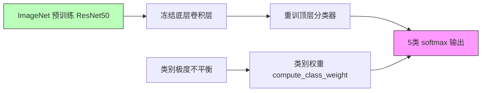

# 第14章 图像数据比赛详解：糖尿病视网膜病变检测（Diabetic Retinopathy）

糖尿病视网膜病变（Diabetic Retinopathy，简称 DR）是糖尿病最常见的并发症之一——长期高血糖会损伤眼底视网膜上的血管，血管可能渗漏、堵塞，甚至长出异常的新生血管，最终导致视力受损乃至失明。它在早期往往**没有任何明显症状**，等到视力下降再去就医，常常已经错过最佳治疗时机。

因此，定期给糖尿病人拍眼底照片、由医生判断有没有病变，是最有效的筛查手段。但人工读片既慢又依赖专业医生，在糖尿病高发、医疗资源紧张的地区尤其困难。这个比赛的目的，就是让算法**自动给眼底照片分级**，把医生从海量的重复读片中解放出来。

比赛提供的照片是用不同型号、不同质量的眼底相机拍的，光照、对焦、曝光都不统一，有的照片偏暗、有的过曝、有的模糊。比赛方明确说，数据里的图像和标签都带有噪声，参赛者要做出一个**在噪声和差异下依然稳定**的算法。

与猫狗大战（二分类、LogLoss）不同，这是一个**图像多分类**任务（0～4 级，共 5 个类别），评价指标是**二次加权 Kappa 系数（QWK）**。QWK 不光看「猜对了多少」，还惩罚「预测错得离谱」——把重病患者判成健康，比把轻度判成中度罚得狠得多。这也意味着光看准确率会骗人：如果 90% 的病人都是 0 级，模型全猜 0 也能有 90% 准确率，但 QWK 会接近 0，等于什么都没学到。

本章我们完整走一遍这场比赛的解题流程：EDA → 清洗（图像缩放、归一化） → 特征工程与建模（迁移学习、类别权重） → 模型训练与调优（数据增强、早停） → 测试与提交。

---

## 14.1 比赛背景与数据

### 比赛背景

糖尿病视网膜病变检测，眼底图像多分类，预测视网膜病变严重程度等级。

每个病人的眼底要被医生打一个 0～4 的严重程度等级：

| 等级 | 含义 |
|------|------|
| 0 | 没有病变（No DR） |
| 1 | 轻度（Mild） |
| 2 | 中度（Moderate） |
| 3 | 重度（Severe） |
| 4 | 增殖期（Proliferative DR） |

### 数据结构

输入是一张彩色眼底照片，文件名形如 `1_left.jpeg`、`1_right.jpeg`，其中数字是**病人编号**，`left`/`right` 表示左眼还是右眼。每位病人通常左右眼各有一张照片。

训练集是 `trainLabels.csv`，两列：`image`（图片名）和 `level`（0～4 的等级）。测试集只有图片，我们要为每张测试图片预测一个 `level`。

这里有一个初学者常踩的坑：Kaggle 原始比赛有约 3.5 万张照片，但很多公开 notebook 挂载的只是**一份 1000 张的抽样子集**（1001 个文件 = 1000 张图 + 1 个 csv）。我们写的时候也会说明这个区别，免得读者把子集的结果和完整比赛的成绩混在一起。

### 评价指标

比赛使用**二次加权 Kappa 系数（Quadratic Weighted Kappa，简称 QWK）**。

Kappa 系数衡量的不是「猜对了多少」，而是「比瞎猜好多少」。它的想法是：先算一个「纯靠运气按类别比例随机猜」的期望一致率，再看模型的预测和真实标签有多一致，两者相减再归一化。得分为 1 表示完全一致，为 0 表示和随机猜一样，负数表示比随机猜还差。

「二次加权」的意思是：预测错得越离谱，扣分越重。比如真实是 0 级（没病）却预测成 4 级（增殖期），比预测成 1 级要罚得狠得多。这一点非常符合医学场景——把重病患者判成健康，后果远比把轻度判成中度严重。QWK 越高越好。

---

## 14.2 探索性数据分析（EDA）

我们首先读进标签表，并从文件名里解析出病人编号，同时检查左右眼的等级是否一致：

```python
import pandas as pd
import numpy as np

# 读入标签表，只有 image 和 level 两列
df = pd.read_csv('../input/trainLabels.csv')
print(df.shape)                 # 完整比赛约 (35126, 2)
print(df['level'].value_counts())  # 看 0~4 各有多少张

# 从 "10_left" / "10_right" 里去掉后缀，得到病人编号
df['PatientID'] = df['image'].str.replace('_left', '').str.replace('_right', '')
print('不同病人数:', df['PatientID'].nunique())   # 约 17563

# 检查同一病人左右眼等级是否相同
pivot = df.pivot(index='PatientID', columns=df['image'].str[-4:], values='level')
pivot.columns = ['left', 'right']
mismatch = (pivot['left'] != pivot['right']).sum()
print('左右眼等级不一致的病人数:', mismatch)       # 约 2240
```

这里有一个很关键的发现：**同一个病人的左右眼，等级经常不一样**（约 2240 个病人如此）。这说明两件事：一是病变确实是按眼独立发展的，不能简单地把一只眼的标签抄给另一只眼；二是同一病人的两张图高度相关，做训练/验证划分时最好**按病人分组**，否则同一病人的左眼在训练集、右眼在验证集，模型等于提前「见过答案」，验证分数会虚高。

接着我们看等级分布，这是这个数据集最大的难点：

```python
import seaborn as sns
import matplotlib.pyplot as plt

# 统计每个等级的图片数量
sns.countplot(x='level', data=df)
plt.title('Label distribution')
plt.show()

# 直接打印比例，方便看清不平衡程度
print(df['level'].value_counts(normalize=True))
```

结果是**极度不平衡**：0 级（没病）占了绝大多数，3 级和 4 级（重度、增殖期）的样本很少。这解释了为什么这个比赛不能只看准确率——模型只要学会「全猜 0」，就能拿到很高的准确率，但真正需要被识别出来的重症病人反而全被漏掉。

---

## 14.3 数据清洗

图像数据的「清洗」和表格数据不太一样，主要是**尺寸统一和归一化**。

原始眼底照片分辨率非常高（最小也有 2500×1900 左右），直接喂进网络会慢到无法训练。所以第一步是把所有图缩放到统一的小尺寸。我们的做法是：读图 → 双三次插值缩放到 128×128 → 像素值除以 255 归一化到 0～1。

```python
import cv2

WIDTH, HEIGHT, DEPTH = 128, 128, 3

def load_and_resize(path):
    """读一张眼底图，统一缩放到 128x128 并归一化"""
    # 用 cv2 读进来是 BGR 顺序，这里我们只关心形状，
    # 后续如果要用预训练模型需要转成 RGB
    img = cv2.imread(path)
    # 原始图非常大，必须先缩小，否则显存和时间都吃不消
    img = cv2.resize(img, (WIDTH, HEIGHT))
    # 除以 255 让像素落在 0~1，网络更容易收敛
    img = img.astype('float32') / 255.0
    return img
```

这里有一个重要的取舍。资料里的 bronze 方案做过一组对比实验：先把图缩小 20 倍训练一个小网络，准确率约 75%；换成更深的网络，准确率约 79%；再把缩小倍数改成 10 倍（保留更多细节），准确率提升到约 82%。

为什么缩小倍数这么重要？因为 DR 的关键证据——出血点、微动脉瘤、硬性渗出——都是图里**很小很小的斑点**。如果把图缩得太狠，这些斑点直接被抹掉，一张明明有病变的图看起来就和健康图没区别了，模型自然判成 0 级。这也是为什么后面有队伍愿意用更高分辨率、甚至做「渐进式放大」训练。

我们自己训练用的是 128×128，这是精度和速度之间的一个折中，适合先把整条流程跑通。

---

## 14.4 特征工程与建模

### 特征工程

图像比赛的「特征工程」主要体现在模型架构和数据处理上，而不是像表格比赛那样手动构造列。对于 DR 多分类，关键的建模思路是：

1. **迁移学习**：ResNet/EfficientNet 等预训练模型，冻结底层卷积层，重训顶层分类器。
2. **类别权重**：针对类别极度不平衡（0 级占绝大多数，3/4 级极少），给少数类更高的权重，让模型更关注重症病人。
3. **数据增强**：旋转、翻转、缩放，扩充少数类样本，同时也起到正则作用。

### 建模代码示例

```python
from keras.applications import ResNet50
from keras import models, layers, optimizers
from sklearn.utils.class_weight import compute_class_weight

# 加载在 ImageNet 上预训练好的 ResNet50，不包含顶层分类器
conv_base = ResNet50(weights='imagenet',
                     include_top=False,
                     input_shape=(128, 128, 3),
                     pooling='avg')

# 冻结卷积层，只训练顶层
conv_base.trainable = False

model = models.Sequential()
model.add(conv_base)
model.add(layers.Dense(256, activation='relu'))
model.add(layers.Dropout(0.5))
# 5 个类别，用 softmax 输出各等级概率
model.add(layers.Dense(5, activation='softmax'))

model.compile(optimizer=optimizers.Adam(lr=1e-4),
              loss='sparse_categorical_crossentropy',
              metrics=['accuracy'])
```

类别权重计算：

```python
from sklearn.utils.class_weight import compute_class_weight

# 计算类别权重，少数类权重更高
class_weights = compute_class_weight('balanced', classes=np.unique(df['level']), y=df['level'])
class_weight_dict = dict(enumerate(class_weights))
print(class_weight_dict)
```

> **Mermaid 图表：迁移学习与类别权重图**



---

## 14.5 模型训练与调优

### 数据增强

DR 的关键证据（出血点、微动脉瘤、硬性渗出）都很小，数据增强既能扩充少数类样本，又能起到正则作用，防止模型在少数类上过拟合。

```python
from keras.preprocessing.image import ImageDataGenerator

train_datagen = ImageDataGenerator(
    rescale=1./255,
    rotation_range=20,
    width_shift_range=0.1,
    height_shift_range=0.1,
    shear_range=0.1,
    zoom_range=0.1,
    horizontal_flip=True,
    vertical_flip=True,
    fill_mode='nearest'
)

val_datagen = ImageDataGenerator(rescale=1./255)
```

### 早停机制

训练时加入早停，在验证集分数不再提升时停止训练，防止过拟合：

```python
from keras.callbacks import EarlyStopping, ModelCheckpoint

early_stop = EarlyStopping(monitor='val_loss', patience=5, restore_best_weights=True)
checkpoint = ModelCheckpoint('best_model.h5', monitor='val_loss', save_best_only=True)
```

训练代码示例：

```python
history = model.fit(
    train_generator,
    epochs=50,
    validation_data=val_generator,
    class_weight=class_weight_dict,
    callbacks=[early_stop, checkpoint],
    verbose=1
)
```

### 调优思路

- 如果验证集上的 QWK 不再提升，早停会自动停止训练并恢复最佳权重。
- 如果少数类（3/4 级）的召回率太低，可以适当提高类别权重，或者对少数类做更激进的数据增强。
- 如果显存允许，可以尝试更大的输入尺寸（如 224×224 或 512×512），保留更多病变细节。

---

## 14.6 模型测试与提交

训练完成后，对测试集做预测，输出每个等级的概率，生成提交文件。

```python
import numpy as np

# 对测试集预测，输出各等级概率
test_preds = model.predict(test_generator, verbose=1)
# test_preds 形状为 (测试集样本数, 5)，每行是 5 个等级的概率，和为 1

# 按照 sample_submission 格式生成提交文件
# 假设 test_ids 是测试图片的 ID 列表
submission = pd.DataFrame({
    'id': test_ids,
    # 如果需要输出单一等级标签，取概率最大的等级
    'level': np.argmax(test_preds, axis=1)
})

# 或者如果比赛要求输出各等级概率，可以展开成多列
# for i in range(5):
#     submission[f'level_{i}'] = test_preds[:, i]

submission.to_csv('submission.csv', index=False)

# 核对清单
assert len(submission) == len(test_ids), "提交行数与测试集不一致"
assert submission['level'].isnull().sum() == 0, "预测结果包含缺失值"
assert submission['level'].min() >= 0 and submission['level'].max() <= 4, "预测等级必须在 0~4 之间"
print("提交文件已生成：submission.csv")
print(submission.head())
```

**核对说明**：
- 行数必须与测试集一致，不能多也不能少。
- 列名必须与 `sample_submission.csv` 严格匹配。
- 预测等级必须在 0~4 之间，不能出现越界值。
- 不能有缺失值。

把 `submission.csv` 上传到 Kaggle 比赛页面，你就能在排行榜上看到自己的 QWK 分数了。

---

## 14.7 小结

本章我们完成了糖尿病视网膜病变检测的完整流程：

1. **比赛背景**：眼底图像多分类，预测视网膜病变等级（0～4 级），评价指标为二次加权 Kappa（QWK）。
2. **EDA**：发现类别极度不平衡（0 级占绝大多数，3/4 级极少），同一病人左右眼等级常不一致（按病人划分验证集更可靠）。
3. **数据清洗**：原始眼底照片分辨率很高，缩放到 128×128（精度和速度的折中），像素值除以 255 归一化到 0～1。缩得太狠会把微小的出血点、微动脉瘤等关键证据抹掉。
4. **特征工程与建模**：迁移学习（ResNet50 预训练模型，冻结底层卷积层，重训顶层）；类别权重（`compute_class_weight` 给少数类更高权重）；5 类 softmax 输出。
5. **模型训练与调优**：数据增强（旋转、翻转、缩放）扩充少数类并起正则作用；早停（EarlyStopping）在验证集分数不再提升时停止训练，防止过拟合。
6. **模型测试与提交**：输出各等级概率或最大概率等级，按 `sample_submission` 格式生成 `submission.csv`，上传前核对行数、列名、等级范围、缺失值。

这个比赛给我们的最大启发是：**医学图像分类里，类别不平衡和评价指标的选择比模型结构更关键**。QWK 惩罚「预测错得离谱」，这提醒我们不能只盯准确率，而要给少数类（重症病人）更高的权重，让模型更关注那些「漏掉代价很大」的样本。同时，图像分辨率的取舍直接决定模型能不能看清微小病变，这是表格数据比赛里不存在的问题。

下一章我们将详解另一个图像比赛：卫星图像分类（Planet / Carvana），看看在多标签分类和图像分割场景下，上述流程有什么共通之处和不同之处。
