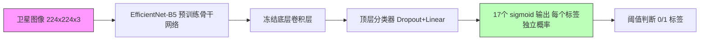

# 第15章 图像数据比赛详解：卫星图像分类（Planet / Carvana）

Planet 是 Kaggle 上经典的卫星图像多标签分类比赛。比赛由 Planet 和 SCCON 联合发起，目的是用卫星图像监测亚马逊雨林的砍伐和气候变化。Planet 是一家自己设计、制造并运营地球成像卫星的公司，它的卫星群能提供 3～5 米分辨率的影像，分辨率高到可以从一张图里看出农田、道路、居住区、矿场这些人类活动的痕迹。

与猫狗大战（二分类、一张图一个标签）和糖尿病视网膜病变（单标签多分类）不同，Planet 是一个**多标签分类（multilabel classification）**任务：一张卫星图可以同时打上若干标签，比如「晴天 + 原始森林 + 河流」，也可以同时是「有雾 + 农田 + 道路 + 居住区」。每张图至少有 2 个标签，最多有 9 个标签，全部标签一共 17 类。

评价指标是 **F2 score**。F2 是精确率和召回率的加权调和平均，召回率的权重更大（beta=2）。换成大白话：**漏掉一个真实标签的惩罚，比多报一个标签的惩罚更重。** 比赛选择 F2 是有现实理由的——漏掉一片正在被砍伐的森林，后果比多标注一片「疑似被砍伐」严重得多。

本章我们完整走一遍 Planet 比赛的解题流程：EDA → 清洗（标签串转 0/1 向量、多标签分层切分验证集、图片通道统一） → 特征工程与建模（ImageNet 预训练模型迁移学习、二分类交叉熵损失） → 模型训练与调优（验证集搜阈值、F2 作为模型选择依据） → 测试与提交（标签串还原）。

顺便提一下，Carvana 图像抠图比赛是另一个图像赛道的代表：它是图像分割任务，输入是汽车照片，输出是汽车的分割掩码，评价指标是 IoU（交并比），主流做法是 U-Net 架构。Planet 和 Carvana 共同的点是都大量依赖迁移学习和数据增强，区别在于 Planet 是多标签分类、Carvana 是像素级分割。

---

## 15.1 比赛背景与数据

### 比赛背景

世界上每分钟消失的森林面积相当于 48 个足球场，而亚马逊流域占了其中最大的一份。森林消失会带来生物多样性下降、栖息地丧失和气候变化等一系列问题；如果能更快、更准地知道哪里发生了砍伐，政府和当地机构就能更及时地响应。

### 数据结构

数据最初包含红、绿、蓝和近红外（NIR）四个波段，后来社区里保存了完整的 RGB 版 PNG 图片。常见的预训练模型都是在 RGB 三通道图片上训练的，综合成本和效果，主线只使用 RGB 图片。

标注数据大约 4 万张，训练图片 40479 张、测试图片 40669 张。数据量不算大，却要做 17 类的多标签分类，所以几乎所有参赛者都选择「加载在 ImageNet 上预训练好的模型，再在 Planet 数据上微调」这条迁移学习路线。

另一个大麻烦是**类别极不平衡**：超过 90% 的标签里都含有「原始森林（primary）」，而「传统采矿（conventional mine）」只占 0.25%。像 Blooming、Conventional Mine 这样的标签总共不到 500 个样本，Burn Down 甚至不到 100 个。稀有类样本少，却恰恰是发现人类活动的关键，也是能不能把分数做上去的关键。

训练数据由两个文件组成：图片目录 `train-jpg` 和标签表 `train_classes.csv`（另一版材料里叫 `train_v2.csv`）。标签表只有两列：

- `image_name`：图片名，例如 `train_0`；
- `tags`：用空格分隔的标签串，例如 `haze primary` 或 `agriculture clear primary water`。

测试集只有图片和 `sample_submission_v2.csv` 里的 `image_name` 列，我们要给每个测试样本补上 `tags` 列，多个标签之间同样用空格隔开。

### 评价指标

比赛使用 **F2 score**。F2 是精确率和召回率的加权调和平均：

$$
F_2 = \frac{(1 + 2^2) \cdot P \cdot R}{2^2 \cdot P + R} = \frac{5 \cdot P \cdot R}{4P + R}
$$

其中 P 是精确率，R 是召回率。召回率前面乘了 4，所以召回率的权重更大。具体到多标签任务，评分时会拿一张图的真实标签集合和预测标签集合做比较，数出真正例（TP）、假正例（FP）、假负例（FN），算出这张图的 F2，再对所有测试图取平均。分数范围是 0 到 1，越高越好。

也正因为指标偏向召回，我们不能只盯着「预测对了多少」，更要想办法把稀有标签找出来。

---

## 15.2 探索性数据分析（EDA）

我们首先把标签表读进来，统计训练集、测试集的规模和每个标签出现的次数。做多标签任务之前，必须先知道「哪些标签很常见、哪些标签几乎见不到」，否则模型会悄悄退化成「只预测常见标签」的懒模型。

```python
import os
import pandas as pd
from collections import Counter

# 数据目录里，训练图、测试图和标签表是分开放的
path = "../input/planets-dataset/planet/planet/"
path_train = os.path.join(path, "train-jpg")
path_test  = os.path.join(path, "test-jpg")

# 先核对图片数量，确认训练图和标签表能对得上
print(f"train files: {len(os.listdir(path_train))}, "
      f"test files: {len(os.listdir(path_test))}")

# 标签表只有两列：图片名 image_name 和标签串 tags
df_class = pd.read_csv(os.path.join(path, "train_classes.csv"))
print(df_class.shape)

# 标签串用空格分隔，例如 "agriculture clear primary water"
# 先按空格切开，得到每张图对应的标签列表
df_class["list_tags"] = df_class["tags"].str.split(" ")

# 把所有图的标签摊平成一个长列表，再统计每个标签出现的总次数
row_tags = df_class["list_tags"].values
tags = [tag for row in row_tags for tag in row]
counter_tags = Counter(tags)

# 按出现次数从少到多排序，稀有标签会排在最前面
df_tags = pd.DataFrame(
    {"tag": counter_tags.keys(), "total": counter_tags.values()}
).sort_values("total")
print(df_tags)
```

运行后我们看到训练图片 40479 张、测试图片 40669 张，标签表是 40479 行 2 列，和训练图片数量一致。统计结果里，`primary` 和 `agriculture` 的出现次数远远高于其他标签，而 `conventional_mine`、`blooming`、`burn` 这类标签的柱子短得几乎看不见。这就是材料里反复强调的类别不平衡：多数类占了绝大多数，少数类可能只有几十到几百个样本。如果直接拿全部数据训练、只看总体准确率，模型很可能学会「无脑预测 primary」，分数看起来不差，实际上对监测砍伐毫无用处。

只看数字还不够，我们接着为每个标签挑一张包含它的图，拼成一个网格，亲眼看看这些标签在图像上是什么样子：

```python
import matplotlib.image as mpimg
import matplotlib.pyplot as plt

# 读入训练表，并把图片名拼成完整路径
df_train = pd.read_csv("../input/train_v2.csv")
df_train["image_name"] = "../input/train-jpg/" + df_train["image_name"] + ".jpg"
df_train["tags2"] = df_train["tags"].str.split(" ")
```

这些观察直接决定了后面的建模策略：稀有标签需要专门的处理（类别权重、更低的预测阈值、数据增强），而常见标签（如 primary）容易被模型过度预测，需要控制假正例。

---

## 15.3 数据清洗

Planet 比赛的数据清洗主要有三步：

### 第一步：把空格分隔的标签串变成 17 维 0/1 向量

多标签分类不能直接把「haze primary」这样的字符串喂进模型，需要把每张图的标签编码成一个 17 维的二进制向量，每个位置对应一个标签，1 表示有这个标签，0 表示没有。

```python
from sklearn.preprocessing import MultiLabelBinarizer

# 假设 df_class["list_tags"] 已经是标签列表
mlb = MultiLabelBinarizer()
y = mlb.fit_transform(df_class["list_tags"])
print(y.shape)  # (40479, 17)
print(mlb.classes_)  # 17 个标签的名字
```

`MultiLabelBinarizer` 会自动为每个唯一标签分配一个列，输出形状为 (样本数, 17) 的 0/1 矩阵。

### 第二步：多标签分层切分验证集

普通的 `train_test_split` 在多标签场景下会有问题：某个稀有标签可能只出现在训练集或验证集的一边，导致模型没学到这个标签，或者验证集上根本没有这个标签可评估。我们需要用**多标签分层抽样**，确保每个标签的正负例比例在训练集和验证集里都大致一致。

```python
from skmultilearn.model_selection import iterative_train_test_split

X_train, y_train, X_valid, y_valid = iterative_train_test_split(
    df_class[["image_name"]].values, y, test_size=0.2
)
```

`iterative_train_test_split` 来自 `skmultilearn` 库，专门为多标签数据设计，能保持各标签的分布一致。

### 第三步：图片通道统一

所有图片统一读成 RGB 三通道，尺寸缩放到模型要求的输入尺寸（如 224×224 或 256×256），像素值除以 255 归一化到 0~1。

---

## 15.4 特征工程与建模

### 特征工程

图像比赛的「特征工程」主要体现在模型架构和输入处理上。对于 Planet 多标签分类，关键的建模思路是：

1. **迁移学习**：加载在 ImageNet 上预训练好的模型（如 EfficientNet-B5、ResNet、MobileNetV2），冻结底层卷积层，只重训顶层分类器。
2. **多标签损失函数**：每个标签独立看作一个二分类任务，用二分类交叉熵（Binary Cross Entropy）作为损失函数，输出层用 17 个 sigmoid 神经元，每个神经元输出该标签的概率（0~1 之间）。
3. **预测阈值搜索**：模型输出的是概率，需要决定一个阈值（如 0.2）来判断是否预测为某个标签。不同标签可以用不同的阈值，稀有标签可以用更低的阈值以提高召回率。

### 建模代码示例（PyTorch 风格伪代码）

```python
import torch
import torch.nn as nn
from torchvision import models

# 加载预训练 EfficientNet-B5
base_model = models.efficientnet_b5(pretrained=True)

# 冻结底层参数
for param in base_model.features.parameters():
    param.requires_grad = False

# 替换顶层分类器：17 个 sigmoid 输出，每个标签独立
num_features = base_model.classifier[1].in_features
base_model.classifier = nn.Sequential(
    nn.Dropout(0.3),
    nn.Linear(num_features, 17),
    nn.Sigmoid()
)

# 损失函数：二分类交叉熵（每个标签独立）
criterion = nn.BCELoss()
optimizer = torch.optim.Adam(filter(lambda p: p.requires_grad, base_model.parameters()), lr=1e-4)
```

训练循环中，每个 batch 计算 17 个标签的 BCELoss 并求平均，反向传播更新顶层参数。

> **Mermaid 图表：多标签分类模型结构图**



---

## 15.5 模型训练与调优

### 训练策略

- 用 5 折交叉验证或单次划分验证集，监控验证集上的 F2 分数。
- 每个 epoch 结束后，在验证集上预测概率，搜索最佳预测阈值。
- 稀有标签可以用更低的阈值（如 0.1），常见标签可以用更高的阈值（如 0.5），以平衡精确率和召回率。

### 阈值搜索

```python
import numpy as np
from sklearn.metrics import fbeta_score

def find_best_thresholds(y_valid, val_probs, beta=2):
    """为每个标签搜索最佳预测阈值，最大化 F2"""
    best_thresholds = []
    for i in range(y_valid.shape[1]):
        best_thr = 0.5
        best_f2 = 0
        for thr in np.arange(0.05, 0.95, 0.05):
            y_pred = (val_probs[:, i] > thr).astype(int)
            f2 = fbeta_score(y_valid[:, i], y_pred, beta=beta, zero_division=0)
            if f2 > best_f2:
                best_f2 = f2
                best_thr = thr
        best_thresholds.append(best_thr)
    return np.array(best_thresholds)

# 在验证集上搜阈值
best_thresholds = find_best_thresholds(y_valid, val_probs)
print("每个标签的最佳阈值:", best_thresholds)
```

### 模型选择依据

以 F2 分数作为模型选择和早停的依据，而不是准确率或 loss。因为 F2 直接对应比赛评分，且偏向召回，更符合比赛目标。

社区高分方案（官方测试集上拿到 0.90）的主线是：先跑通 PyTorch 版的 EfficientNet-B5 基线，再换成 TFRecord + MobileNetV2 的数据流水线，后者在数据加载速度和训练稳定性上更有优势。

---

## 15.6 模型测试与提交

训练完成后，对测试集做预测，输出每个标签的概率，用搜到的最佳阈值判断是否预测为该标签，最后还原成空格分隔的标签串。

```python
# 对测试集预测各标签概率
test_probs = model.predict(test_generator)  # 形状 (测试集样本数, 17)

# 用最佳阈值转成 0/1 预测
test_preds = (test_probs > best_thresholds).astype(int)

# 还原成标签串
inv_classes = {i: cls for i, cls in enumerate(mlb.classes_)}
test_tags = []
for row in test_preds:
    labels = [inv_classes[i] for i, v in enumerate(row) if v == 1]
    test_tags.append(" ".join(labels) if labels else "clear")  # 如果没有标签，填一个默认标签

submission = pd.DataFrame({
    'image_name': test_image_names,
    'tags': test_tags
})

# 核对清单
assert len(submission) == len(test_image_names), "提交行数与测试集不一致"
assert submission['tags'].isnull().sum() == 0, "标签串包含缺失值"
print("提交文件已生成：submission.csv")
print(submission.head())

submission.to_csv('submission.csv', index=False)
```

**核对说明**：
- 行数必须与测试集一致，不能多也不能少。
- 列名必须是 `image_name` 和 `tags`，与 `sample_submission_v2.csv` 严格匹配。
- `tags` 列不能有缺失值，如果某张图没有预测出任何标签，可以填一个默认标签（如 `clear`）。
- 多个标签之间用空格隔开，顺序建议与训练集保持一致。

把 `submission.csv` 上传到 Kaggle 比赛页面，你就能在排行榜上看到自己的 F2 分数了。

---

## 15.7 小结

本章我们以 Planet 卫星图像多标签分类为例，完整解析了一场图像多标签比赛：

1. **比赛背景**：用卫星图像监测亚马逊雨林砍伐，17 类多标签分类，每张图 2~9 个标签，评价指标为 F2（召回率权重更高）。
2. **EDA**：训练图片 40479 张，发现类别极不平衡（primary >90%，conventional mine 0.25%），稀有标签样本极少。
3. **数据清洗**：把空格分隔的标签串转成 17 维 0/1 向量（`MultiLabelBinarizer`）；用多标签分层切分（`iterative_train_test_split`）保持各标签分布一致；图片统一缩放和归一化。
4. **特征工程与建模**：ImageNet 预训练模型（EfficientNet-B5 / ResNet / MobileNetV2）迁移学习，冻结底层卷积层，顶层 17 个 sigmoid 输出，二分类交叉熵损失。
5. **模型训练与调优**：以 F2 分数作为模型选择和早停依据；在验证集上为每个标签搜索最佳预测阈值，稀有标签用更低阈值以提高召回率。
6. **模型测试与提交**：输出各标签概率，按阈值转成 0/1，还原成空格分隔的标签串，生成 `submission.csv`，上传前核对行数、列名、缺失值。

这个比赛给我们的最大启发是：**多标签分类里，评价指标（F2）和阈值搜索比模型结构更能决定分数上限**。F2 偏向召回，提醒我们不要为了精确率而把稀有标签全部漏掉；为每个标签单独搜阈值，是零成本提升分数的有效手段。

图像数据部分到此结束。下一章我们将进入文本数据部分，讲解文本数据的通用清洗与建模方法：文本清洗、词袋模型、TF-IDF、文本相似度、浅层文本模型等。
