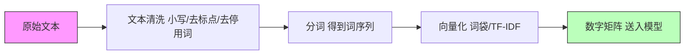
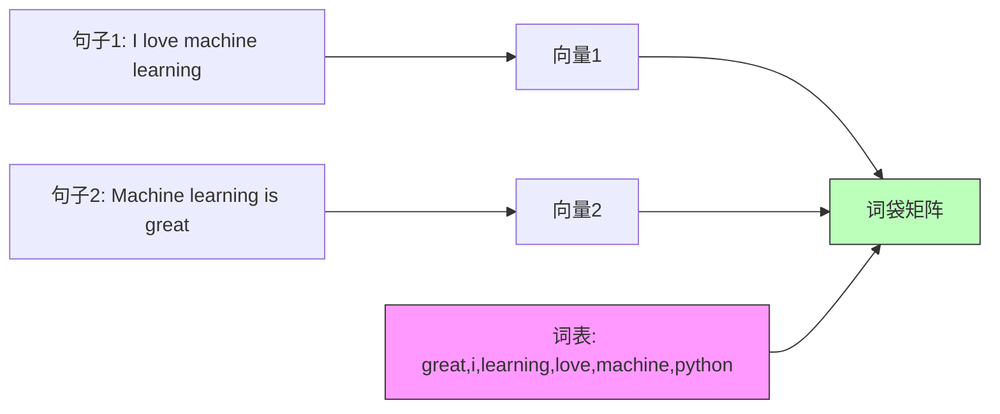
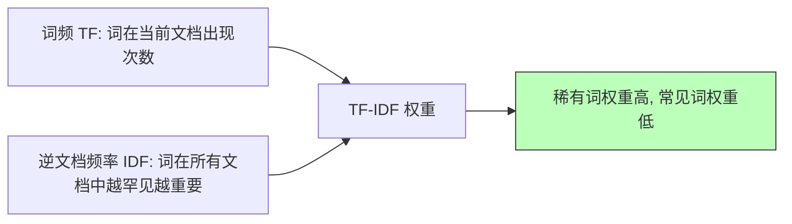
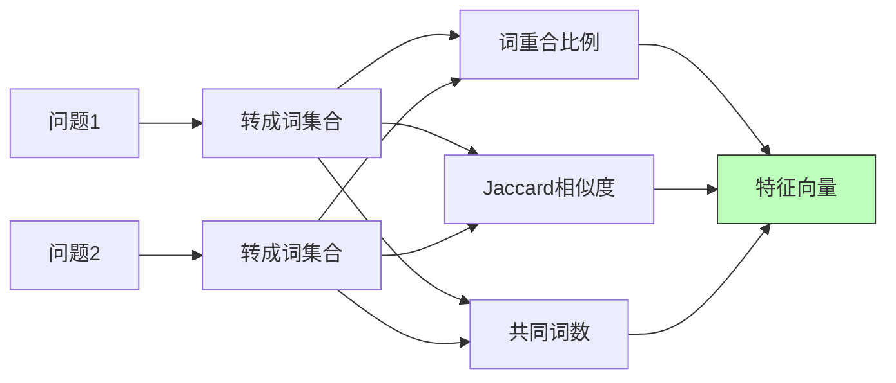

# 第16章 文本数据的通用清洗与建模方法

文本数据是 Kaggle 上另一大常见赛道。情感分析、问题对去重、文本分类、关键词抽取，这些比赛的核心输入都是文字。

文本建模和表格建模最大的区别在于：文本不能直接喂给模型，必须先变成数字。这个过程叫做「文本向量化」。常见的方法有词袋模型（Bag of Words）和 TF-IDF，而深度学习方法则用词向量（Word Embedding）或预训练语言模型。

本章我们讲文本数据的通用清洗与建模方法：文本数据的特点、文本清洗、词袋模型、TF-IDF、文本相似度特征、浅层文本模型。所有代码都可以直接在 Kaggle Notebooks 里运行。

---

## 16.1 文本数据的特点：短、吵、不结构化

### 短

文本比赛里的文本通常很短。比如 Quora 问题对去重里，平均每条问题只有 59.82 个字符、11.06 个词；IMDB 电影评论虽然长一些，但也远不如一篇完整的文章。短文本意味着模型能抓的线索很少，一个词的选择可能就决定了整句的意思。

### 吵

文本数据里噪声很多：拼写错误、网络用语、大小写混杂、标点符号、HTML 标签、特殊符号等。比如 Quora 数据里，几乎所有问题都以大写字母开头、都包含问号，这些「人人都有」的特征对区分问题几乎没用，反而会稀释真正有信息的词。

### 不结构化

文本没有固定的列结构，不能像表格数据那样直接说「第 3 列是年龄」。我们需要先把文本拆成词，再统计每个词的出现情况，最后才能变成模型能吃的数字矩阵。

> **Mermaid 图表：文本转数字的流程图**



---

## 16.2 文本清洗：小写、去标点、去停用词

文本清洗的目标是把文本变成可以比较的集合，去掉干扰信息，保留有信息的词。

### 统一小写

把所有文字转成小写，这样 "Hello" 和 "hello" 就会被当成同一个词，不会因为大小写不同而被模型当成两个词。

### 去标点

去掉句号、逗号、问号、感叹号等标点符号，这些符号通常不携带核心语义信息。

### 去停用词

停用词（stopwords）是指在语言中出现频率极高但语义信息很少的词，比如英文里的 "the"、"is"、"how"、"a"、"an"、"in" 等。这些词几乎每条文本都有，对判断两段文字是否相似几乎没帮助，反而会稀释真正有信息的名词和动词。

```python
from nltk.corpus import stopwords

stops = set(stopwords.words('english'))

def to_word_set(text):
    """把一条文本变成「去掉停用词后的小写词集合」"""
    words = str(text).lower().split()
    # 用集合而不是列表：集合天然去重，也方便求交集
    return {w for w in words if w not in stops}
```

### 处理空集合

有些文本去掉停用词后就什么都不剩了（比如全是停用词组成的句子）。这时候如果直接做除法或求交集，会得到除零错误或 NaN。我们的处理是返回空集合或 0，避免程序报错。

```python
def word_match_share(row):
    """两个文本的词重合比例：交集大小 / 总词数"""
    q1 = to_word_set(row['question1'])
    q2 = to_word_set(row['question2'])
    # 任意一边为空（全是停用词）就直接判为不重合，避免除零
    if not q1 or not q2:
        return 0.0

    shared_1 = [w for w in q1 if w in q2]
    shared_2 = [w for w in q2 if w in q1]
    # 分子是「两边共享的词各数一遍」，分母是「两边词数之和」
    return (len(shared_1) + len(shared_2)) / (len(q1) + len(q2))
```

---

## 16.3 词袋模型：把句子变成数字向量

### 什么是词袋模型

词袋模型（Bag of Words）是把文本转成数字向量的最简单方法。每个词是一个维度，值为该词在文档中出现的次数。不管词的顺序，只管词出现了多少次。

用大白话说：想象一个口袋，把句子里的所有词都丢进去，然后数一数每个词出现了几次，就得到了一个向量。

### CountVectorizer 的直观用法

sklearn 提供了 `CountVectorizer` 来自动完成这个过程：

```python
from sklearn.feature_extraction.text import CountVectorizer

sentences = [
    "I love machine learning",
    "Machine learning is great",
    "I love Python"
]

vectorizer = CountVectorizer()
X = vectorizer.fit_transform(sentences)

print(vectorizer.get_feature_names_out())
# ['great', 'i', 'learning', 'love', 'machine', 'python']
print(X.toarray())
# [[0 1 1 1 1 0]
#  [1 0 1 0 1 0]
#  [0 1 0 1 0 1]]
```

每一行对应一句话，每一列对应一个词，值是该词在句子里出现的次数。

> **Mermaid 图表：词袋向量构建示意图**



### 词袋模型的局限

词袋模型把每个词看得一样重，但「exercise」显然比「and」更能说明问题。而且常见词（停用词）会占据大部分维度，稀有但有区分度的词反而被淹没。这就是 TF-IDF 要解决的问题。

---

## 16.4 TF-IDF：让稀有词更有发言权

### 什么是 TF-IDF

TF-IDF（Term Frequency-Inverse Document Frequency）是一种让稀有词更有发言权的加权方法。

- **TF（词频）**：某个词在当前文档中出现的次数。出现次数越多，该词在当前文档中越重要。
- **IDF（逆文档频率）**：某个词在所有文档中出现的频率的倒数。越常见的词 ID 越小，越罕见的词 ID 越大。

TF-IDF 直观解释：一个词在当前文档重要，但在所有文档中罕见，那么这个词就有很强的区分度，应该给高权重。

```python
from sklearn.feature_extraction.text import TfidfVectorizer

sentences = [
    "I love machine learning",
    "Machine learning is great",
    "I love Python"
]

vectorizer = TfidfVectorizer()
X = vectorizer.fit_transform(sentences)

print(vectorizer.get_feature_names_out())
print(X.toarray())
```

### TF-IDF 权重计算示意图

> **Mermaid 图表：TF-IDF 权重计算示意图**



### TF-IDF 的优点

- 常见词（如 "the"、"is"）权重降低，不再主导向量。
- 稀有但有区分度的词权重提高，更容易被模型注意到。
- 出现次数太少的词（如只出现一次的拼写错误）可以通过设置 `min_count` 直接忽略，避免噪声。

在 Quora 问题对去重中，TF-IDF 加权版本的单特征 AUC 约为 0.7705，虽然比原始词重合比例（0.7804）略低，但它提供了和原始特征不同的信息，两个一起用效果更好。

---

## 16.5 文本相似度特征：两段文字是不是在说同一件事

在「问题对」任务中，我们需要判断两段文字是不是在说同一件事。常用的文本相似度特征有：

### 词重合比例

把两段文字转成词集合，计算交集大小除以总词数：

```python
def word_match_share(row):
    q1 = to_word_set(row['question1'])
    q2 = to_word_set(row['question2'])
    if not q1 or not q2:
        return 0.0
    shared_1 = [w for w in q1 if w in q2]
    shared_2 = [w for w in q2 if w in q1]
    return (len(shared_1) + len(shared_2)) / (len(q1) + len(q2))
```

在 Quora 数据上，这个单特征的 AUC 约为 0.7804，说明「重复问题通常共享较多实词」这个直觉是对的。

### Jaccard 相似度

Jaccard 相似度 = 两个集合的交集大小 / 并集大小：

```python
def jaccard_similarity(q1, q2):
    intersection = len(q1 & q2)
    union = len(q1 | q2)
    return intersection / union if union > 0 else 0.0
```

### 共同词数

直接统计两个文本共有多少个词，作为一个简单的计数特征。

> **Mermaid 图表：问题对特征提取图**



这些相似度特征可以直接作为浅层模型（如 XGBoost、逻辑回归）的输入，也可以和 TF-IDF 向量一起使用。

---

## 16.6 浅层文本模型：逻辑回归、朴素贝叶斯、XGBoost

### 为什么中小规模文本竞赛中 TF-IDF + 线模型往往够用

在中小规模的文本竞赛里，TF-IDF 向量化后喂给逻辑回归、朴素贝叶斯或 XGBoost 等传统机器学习模型，效果通常已经很好了。原因是：

1. 文本数据量不大，深度学习模型容易过拟合。
2. TF-IDF 已经捕捉了词的区分度信息，线模型足以利用这些信息。
3. 传统模型训练快、易解释、易调参。

### 逻辑回归

逻辑回归是文本分类的经典基线。它对 TF-IDF 向量输出每个类别的概率，训练快、效果稳。

```python
from sklearn.linear_model import LogisticRegression
from sklearn.feature_extraction.text import TfidfVectorizer

vectorizer = TfidfVectorizer(max_features=5000)
X_train = vectorizer.fit_transform(train_texts)
X_test = vectorizer.transform(test_texts)

clf = LogisticRegression(max_iter=1000)
clf.fit(X_train, y_train)
```

### 朴素贝叶斯

朴素贝叶斯（如 `MultinomialNB`）特别适合文本分类，它基于词的出现频率计算概率，对高维稀疏的文本向量效果很好。

```python
from sklearn.naive_bayes import MultinomialNB

nb = MultinomialNB()
nb.fit(X_train, y_train)
```

### XGBoost

XGBoost 也可以直接处理 TF-IDF 稀疏矩阵，适合做文本分类和文本相似度任务。

```python
import xgboost as xgb

xgb_clf = xgb.XGBClassifier(
    n_estimators=200,
    max_depth=6,
    learning_rate=0.05,
    random_state=42
)
xgb_clf.fit(X_train, y_train)
```

### 模型选择建议

- 快速基线：逻辑回归或朴素贝叶斯。
- 追求更高分数：XGBoost 或 LightGBM，配合 TF-IDF 特征和手工构造的文本相似度特征。
- 大规模文本或需要理解语序：考虑深度学习（CNN、RNN、Transformer）或预训练语言模型（BERT 等），但这需要更多数据和计算资源。

---

## 16.7 小结

本章我们学习了文本数据的通用清洗与建模方法：

1. **文本数据的特点**：短、吵、不结构化。短文本线索少，噪声多，没有固定列结构。
2. **文本清洗**：统一小写、去标点、去停用词。停用词（如 "the"、"is"）几乎每条文本都有，区分度低，去掉后能让模型更关注有信息的词。去掉停用词后可能出现空集合，需要特殊处理避免除零。
3. **词袋模型**：把每个词当作一个维度，值为出现次数。`CountVectorizer` 可以自动完成。局限是把每个词看得一样重，常见词会淹没稀有词。
4. **TF-IDF**：让稀有词更有发言权。TF（词频）越高越重要，IDF（逆文档频率）越罕见越重要。常见词权重降低，稀有词权重提高。
5. **文本相似度特征**：词重合比例、Jaccard 相似度、共同词数。在 Quora 问题对去重中，词重合比例单特征 AUC 约 0.7804。
6. **浅层文本模型**：TF-IDF 向量化后喂给逻辑回归、朴素贝叶斯或 XGBoost。中小规模文本竞赛中，TF-IDF + 线模型往往够用，训练快且效果稳。

下一章我们将进入具体的文本比赛详解：Quora 问题对去重，把本章的通用方法完整应用到一个真实比赛中，并引入「共同邻居」这个图特征，看看文本特征之外的技巧如何提升分数。
