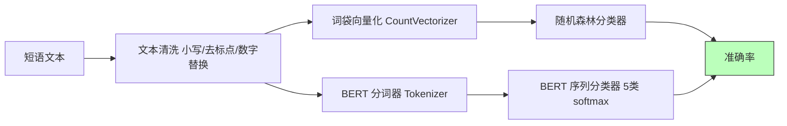

# 第18章 文本数据比赛详解：电影评论情感分析（IMDb）

电影评论情感分析是文本数据比赛中非常经典的一个类型。这个比赛的数据来自著名影评网站 Rotten Tomatoes（中文常叫「烂番茄」）。网站上的影评原本是一句句完整的话，比赛组织方用斯坦福句法分析器（Stanford parser）把每个句子拆成了很多更短的短语。比如一句话会被拆出完整句、半句、几个词，甚至单个单词。每条短语都有自己的 `PhraseId`，同一句话拆出来的短语共享一个 `SentenceId`。为了避免重复，像 `A`、`series` 这种很短又常见的短语只保留一次。

所以这个比赛的任务，就是判断一条短语表达的情感是偏负面还是偏正面。它和我们平时看到的「给整篇影评打好评/差评」不太一样：这里面对的是很碎的片段，很多短语只有一两个词，缺少上下文，判断起来更难。材料里也特别提到，否定句、讽刺、过于简短的表达、语言歧义都会让任务变得很有挑战。

与 Quora 问题对去重（文本相似度、LogLoss 指标）不同，这是一个**文本多分类**任务（0～4 级，共 5 个类别），评价指标是**分类准确率**。而且输入是单条短语，而不是问题对。

本章我们完整走一遍这场比赛的解题流程：EDA → 清洗（小写、去标点、数字替换） → 特征工程（词袋/随机森林基线，BERT 微调） → 模型训练与调优 → 测试与提交。

---

## 18.1 比赛背景与数据

### 比赛背景

烂番茄影评情感分析，5 类情感分类，预测短语情感标签。

每个短语的情感标签取值 0 到 4：

| 标签 | 含义 |
|------|------|
| 0 | negative（负面） |
| 1 | somewhat negative（有点负面） |
| 2 | neutral（中性） |
| 3 | somewhat positive（有点正面） |
| 4 | positive（正面） |

### 数据结构

训练集 `train.tsv` 有 156060 行、4 列：

- `PhraseId`：短语编号，每条短语唯一；
- `SentenceId`：句子编号，同一句话拆出的短语共用；
- `Phrase`：短语原文；
- `Sentiment`：情感标签，取值 0 到 4。

测试集 `test.tsv` 有 66292 行，只有前三列，没有 `Sentiment`。我们要给每条测试短语预测一个 0 到 4 的标签，并按照 `PhraseId, Sentiment` 的格式生成提交文件。`sampleSubmission.csv` 给出了提交样例。

注意：这两个文件是用制表符分隔的，不是常见的逗号分隔 CSV，所以 `read_csv` 要写 `sep='\t'`。

### 评价指标

比赛使用**分类准确率（Accuracy）**作为评价指标。做法很直接：对每条测试短语预测一个类别，预测正确的条数除以总条数，就是最终得分。得分越高越好，满分是 1.0。

需要提前知道一个「偷懒基线」：训练集里情感为中性（标签 2）的短语有 79582 条，大约占一半。也就是说，如果不管输入是什么，全部猜成中性，也能拿到接近 0.5 的准确率。因此在这个比赛里，0.5 左右的分数并不说明模型学到了东西，真正有意义的提升要看能不能明显超过这个基线。

---

## 18.2 探索性数据分析（EDA）

我们首先把两个 TSV 文件读进来，看看数据规模和列的含义。

```python
import pandas as pd

# 训练集和测试集都是 TSV（制表符分隔），必须显式指定分隔符
train_df = pd.read_csv('../input/sentiment-analysis-on-movie-reviews/train.tsv', sep='\t')
test_df  = pd.read_csv('../input/sentiment-analysis-on-movie-reviews/test.tsv', sep='\t')

# 查看规模：训练集 156060 行 4 列，测试集 66292 行 3 列
print(train_df.shape)   # (156060, 4)
print(test_df.shape)    # (66292, 3)

# 看列名、数据类型和是否有缺失值
print(train_df.info())
print(train_df.head())
```

打印结果确认：`PhraseId`、`SentenceId`、`Sentiment` 都是整数，`Phrase` 是字符串，训练集没有缺失值。测试集只少一列 `Sentiment`。这说明数据本身比较干净，主要工作量在文本建模上。

### 统计标签分布

```python
# 按标签值 0~4 排序后统计数量
label_counts = train_df['Sentiment'].value_counts().sort_index()
print(label_counts)

# 算一下每个标签的占比，方便和随机猜测比较
print(label_counts / len(train_df))
```

从统计结果看，中性（2）最多，有 79582 条，接近一半；其余四类少一些，但都真实存在。这个分布告诉我们两件事：第一，模型很容易偏向中性，因为猜中性「性价比」最高；第二，只看总体准确率会被中性类主导，所以后面要同时关注模型是不是真的学会了区分正负情感。

### 查看短语长度

因为后面做模型时要设定一个固定的最大长度，太短会截掉信息，太长又浪费显存：

```python
# 按空格切分，统计每条短语包含多少个词
train_df['word_count'] = train_df['Phrase'].str.split().str.len()

# 看最短、最长、平均值和分位数
print(train_df['word_count'].describe())

# 顺便看看最短的短语长什么样
print(train_df.nsmallest(5, 'word_count')[['Phrase', 'Sentiment']])
```

我们发现短语整体很短，大量样本只有一两个词，比如 `A`、`series`，长句子相对少。这解释了比赛难在哪里：一个孤零零的词，往往既可以是中性，也可以带情感，必须结合它原来所在的句子才能判断。但比赛把句子打散了，我们只能看到短语本身，所以模型能利用的上下文非常有限。

---

## 18.3 数据清洗

我们接着做文本清洗。这里要区分两条路线：如果做传统词袋模型，需要把文本规整成统一的词；如果做 BERT 微调，反而不应该清洗得太狠。

### 传统路线：文本清洗

我们把所有字母转小写，去掉标点，并把连续数字替换成一个统一符号 `num`：

```python
import re
import string

def clean_text(text):
    # 统一转小写，避免 Good 和 good 被当成两个不同的词
    text = text.lower()
    # 去掉标点：标点对情感判断帮助有限，还会让词表变大
    text = text.translate(str.maketrans('', '', string.punctuation))
    # 把数字统一成 num，减少大量只出现一两次的稀有 token
    text = re.sub(r'\d+', 'num', text)
    return text

# 对训练集和测试集使用同一套清洗规则
train_df['Phrase_clean'] = train_df['Phrase'].apply(clean_text)
test_df['Phrase_clean'] = test_df['Phrase'].apply(clean_text)

# 检查清洗前后的效果
print(train_df[['Phrase', 'Phrase_clean']].head())
```

清洗的目的是让模型更容易从文本中提取有效信息：小写避免同一个词因大小写不同被当成两个词；去标点减少噪声和词表大小；数字替换减少只出现一两次的稀有 token。

---

## 18.4 特征工程与建模

### 路线一：词袋模型 + 随机森林（快速基线）

先做一个基于词袋和随机森林的快速基线，确认数据和流程没问题：

```python
from sklearn.feature_extraction.text import CountVectorizer
from sklearn.ensemble import RandomForestClassifier
from sklearn.model_selection import cross_val_score
import numpy as np

# 词袋向量化
vectorizer = CountVectorizer(max_features=5000)
X_train = vectorizer.fit_transform(train_df['Phrase_clean'])
y_train = train_df['Sentiment'].values

# 随机森林分类器
rf = RandomForestClassifier(n_estimators=200, max_depth=10, random_state=42, n_jobs=-1)

# 5折交叉验证
scores = cross_val_score(rf, X_train, y_train, cv=5, scoring='accuracy')
print('RandomForest CV Accuracy: {:.4f} (±{:.4f})'.format(scores.mean(), scores.std()))
```

### 路线二：BERT 微调（真正的提升）

再上 BERT 做真正的微调。BERT 是预训练语言模型，已经在大规模语料上学习了语言的表示能力，对情感分析这种需要理解语义的任务效果通常远好于传统词袋模型。

```python
from transformers import AutoTokenizer, AutoModelForSequenceClassification, Trainer, TrainingArguments
from torch.utils.data import Dataset
import torch

class SentimentDataset(Dataset):
    def __init__(self, texts, labels, tokenizer, max_len=64):
        self.texts = texts
        self.labels = labels
        self.tokenizer = tokenizer
        self.max_len = max_len

    def __len__(self):
        return len(self.texts)

    def __getitem__(self, idx):
        encoding = self.tokenizer(
            self.texts[idx],
            truncation=True,
            padding='max_length',
            max_length=self.max_len,
            return_tensors='pt'
        )
        return {
            'input_ids': encoding['input_ids'].flatten(),
            'attention_mask': encoding['attention_mask'].flatten(),
            'labels': torch.tensor(self.labels[idx], dtype=torch.long)
        }

# 加载预训练 BERT
tokenizer = AutoTokenizer.from_pretrained('bert-base-uncased')
model = AutoModelForSequenceClassification.from_pretrained('bert-base-uncased', num_labels=5)

# 训练参数
training_args = TrainingArguments(
    output_dir='./results',
    num_train_epochs=3,
    per_device_train_batch_size=16,
    per_device_eval_batch_size=16,
    warmup_steps=500,
    weight_decay=0.01,
    logging_dir='./logs',
    evaluation_strategy='epoch',
    save_strategy='epoch',
    load_best_model_at_end=True,
    metric_for_best_model='accuracy'
)

# 构造数据集
train_dataset = SentimentDataset(train_df['Phrase_clean'].tolist(), y_train.tolist(), tokenizer)

trainer = Trainer(
    model=model,
    args=training_args,
    train_dataset=train_dataset,
    compute_metrics=lambda p: {'accuracy': (p.predictions.argmax(-1) == p.label_ids).mean()}
)

trainer.train()
```

> **Mermaid 图表：情感分析建模路线图**



---

## 18.5 模型训练与调优

### 传统模型调优

对于词袋 + 随机森林，主要调参的是 `n_estimators`（树的数量）、`max_depth`（树深）、`max_features`（词表大小）。可以用 `GridSearchCV` 或 `RandomizedSearchCV` 进行调参：

```python
from sklearn.model_selection import GridSearchCV

param_grid = {
    'n_estimators': [100, 200, 300],
    'max_depth': [5, 10, 20, None],
    'max_features': [3000, 5000, 8000]
}

grid_search = GridSearchCV(RandomForestClassifier(random_state=42, n_jobs=-1),
                           param_grid, cv=3, scoring='accuracy', n_jobs=-1)
grid_search.fit(X_train, y_train)
print('最佳参数:', grid_search.best_params_)
print('最佳交叉验证准确率: {:.4f}'.format(grid_search.best_score_))
```

### BERT 调优

对于 BERT，主要调参的是学习率、batch size、epoch 数、最大序列长度。通常使用较小的学习率（如 2e-5 或 3e-5）进行微调，避免破坏预训练模型已经学到的知识。

---

## 18.6 模型测试与提交

### 生成提交文件

训练完成后，对测试集做预测，生成 `PhraseId, Sentiment` 格式的提交文件：

```python
# 传统模型预测
X_test = vectorizer.transform(test_df['Phrase_clean'])
test_preds = rf.predict(X_test)

# 或者 BERT 预测（使用 trainer.predict）
# test_preds = trainer.predict(test_dataset).predictions.argmax(-1)

submission = pd.DataFrame({
    'PhraseId': test_df['PhraseId'],
    'Sentiment': test_preds
})

# 核对清单
assert len(submission) == len(test_df), "提交行数与测试集不一致"
assert list(submission.columns) == ['PhraseId', 'Sentiment'], "列名不一致"
assert submission['Sentiment'].isnull().sum() == 0, "预测结果包含缺失值"
assert submission['Sentiment'].min() >= 0 and submission['Sentiment'].max() <= 4, "预测标签必须在 0~4 之间"

submission.to_csv('submission.csv', index=False)
print("提交文件已生成：submission.csv")
print(submission.head())
```

**核对说明**：
- 行数必须与测试集一致（66292 行），不能多也不能少。
- 列名必须是 `PhraseId` 和 `Sentiment`，与 `sampleSubmission.csv` 严格匹配。
- `PhraseId` 顺序与测试集一一对应，不能打乱。
- 预测标签必须在 0~4 之间，不能出现越界值。
- 不能有缺失值。

把 `submission.csv` 上传到 Kaggle 比赛页面，你就能在排行榜上看到自己的准确率了。

---

## 18.7 小结

本章我们完成了电影评论情感分析的完整流程：

1. **比赛背景**：烂番茄影评短语情感分析，156060 行训练、66292 行测试，5 类情感（0 负面～4 正面），评价指标为准确率。
2. **EDA**：中性（标签 2）占接近一半，全部猜中性能到 0.5 的偷懒基线；短语整体很短，很多只有 1~2 个词，上下文有限。
3. **数据清洗**：TSV 格式需要 `sep='\t'` 读取；小写、去标点、数字替换为 `num`。
4. **特征工程与建模**：词袋模型 + 随机森林做快速基线；BERT 预训练模型微调做真正的提升。
5. **模型训练与调优**：随机森林调 `n_estimators`、`max_depth`、`max_features`；BERT 调学习率、batch size、epoch 数、最大序列长度。
6. **模型测试与提交**：按 `PhraseId, Sentiment` 格式生成提交文件，上传前核对行数、列名、PhraseId 顺序、标签范围、缺失值。

这个比赛给我们的最大启发是：**短文本情感分析中，缺乏上下文是主要困难**，传统词袋模型很难捕捉否定句、讽刺等语义；预训练语言模型（如 BERT）通过在大规模语料上预训练，能更好地理解词义和语境，效果通常显著优于传统方法。同时，类别不平衡（中性占一半）提醒我们不要被高准确率误导，要关注模型是否真的学会了区分正负情感。

文本数据部分到此结束。下一章我们将进入模型调优、集成学习与验证策略章节，讲解超参数调优、集成学习、验证策略等提升比赛分数的通用技巧。
