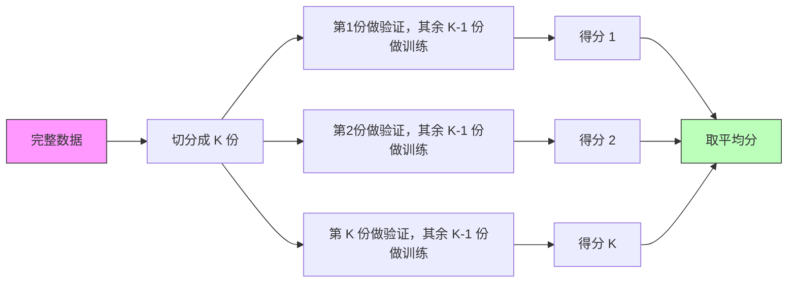
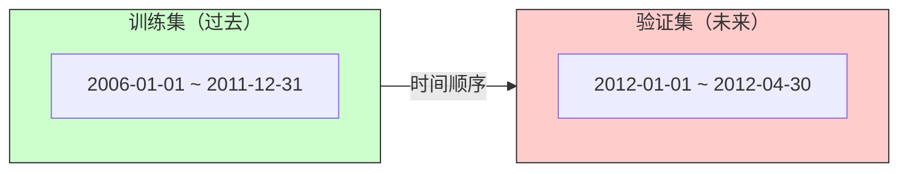
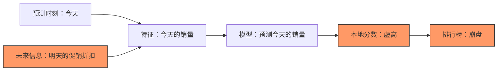
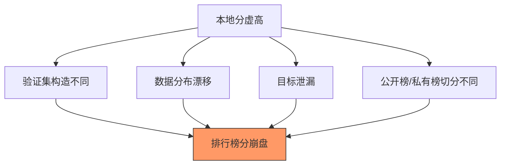

# 第20章 模型评估与验证：先看得分准不准

有了模型之后，怎么知道得分准不准？很多新手只看训练集上的高分，结果提交到排行榜上惨不忍睹。本章我们讲模型评估与验证的通用技巧：评估指标选型、交叉验证、时间序列验证、目标泄漏检查、本地分与排行榜分差距分析。这些技巧适用于所有类型的比赛，是避免「本地分虚高、排行榜崩盘」的关键。

所有代码都可以直接在 Kaggle Notebooks 里运行。

---

## 20.1 评估指标选型：回归看 RMSE/MAE，分类看准确率/AUC/LogLoss

不同的比赛用不同的评价指标，选错指标会导致模型优化方向完全错误。

### 回归指标

| 指标 | 公式特点 | 适用场景 | 越小越好 |
|------|---------|---------|---------|
| RMSE | 均方根误差，对大误差惩罚重 | 房价、销量预测 | 是 |
| MAE | 均值绝对误差，对异常值更稳健 | 对异常值不敏感的场景 | 是 |
| RMSPE | 均方根百分比误差，对低值更敏感 | 门店销售（Rossmann） | 是 |
| R² | 决定系数，1 为完美拟合 | 回归效果解释 | 否（越大越好） |

房价比赛用 log 空间 RMSE，是因为房价右偏，取对数后大房子的绝对误差不会压倒小房子。

### 分类指标

| 指标 | 特点 | 适用场景 |
|------|------|---------|
| 准确率（Accuracy） | 直观，但类别不平衡时不可靠 | 类别平衡的分类 |
| AUC | 看排序能力，不受概率尺度影响 | 二分类、信用评分 |
| LogLoss | 看概率校准，惩罚过度自信 | Quora 问题对去重、Tradeshift |
| F1 | 精确率和召回率的调和平均 | 类别不平衡 |

例如，信用评分比赛正例只有 6.68%，全部猜负类准确率就有 93.32%，但什么都没学到。这时候应该用 AUC 或 LogLoss，而不是准确率。

```python
from sklearn.metrics import mean_squared_error, mean_absolute_error, roc_auc_score, log_loss, accuracy_score
import numpy as np

# 回归：RMSE
rmse = np.sqrt(mean_squared_error(y_true, y_pred))

# 分类：AUC（只看排序，不看概率绝对值）
auc = roc_auc_score(y_true, y_prob)

# 分类：LogLoss（看概率校准）
logloss = log_loss(y_true, y_prob)

# 分类：准确率（需要先把概率转成 0/1 标签）
y_pred = (y_prob > 0.5).astype(int)
acc = accuracy_score(y_true, y_pred)
```

---

## 20.2 交叉验证：把数据切成几份轮流当考卷

单次划分训练集/验证集可能运气好（验证集恰好简单）或运气差（验证集恰好难）。K 折交叉验证把数据切成 K 份，每份都当一次验证集，最后取平均分，结果更稳、更不骗人。

### K 折交叉验证

```python
from sklearn.model_selection import KFold, cross_val_score
from sklearn.linear_model import Ridge
import numpy as np

kf = KFold(n_splits=5, shuffle=True, random_state=42)
model = Ridge(alpha=10.0, random_state=42)

scores = cross_val_score(model, X_train, y_train, cv=kf, scoring='neg_mean_squared_error')
rmse_scores = np.sqrt(-scores)
print("5折 RMSE: {:.4f} (±{:.4f})".format(rmse_scores.mean(), rmse_scores.std()))
```

### 分层抽样（StratifiedKFold）

分类任务中，每一折都应该保持各类别比例一致，避免某一折全是负例：

```python
from sklearn.model_selection import StratifiedKFold

skf = StratifiedKFold(n_splits=5, shuffle=True, random_state=42)
```

> **Mermaid 图表：K 折交叉验证流程图**



---

## 20.3 时间序列验证：按时间顺序切，严禁未来预测过去

时序数据不能随机划分验证集，必须按时间顺序切分（训练在前，验证在后），否则会出现「未来信息泄漏」——模型偷看了还没发生的事情，验证分数好看得虚假，提交后排行榜崩盘。

### 错误做法：随机切分

```python
# ❌ 错误：时序数据不能用 train_test_split 随机切分
from sklearn.model_selection import train_test_split
X_train, X_valid, y_train, y_valid = train_test_split(X, y, test_size=0.2, random_state=42)
```

### 正确做法：按时间顺序切分

```python
# ✅ 正确：按日期顺序切分
split_date = '2015-01-01'
train_mask = df['Date'] < split_date
valid_mask = df['Date'] >= split_date

X_train, y_train = df.loc[train_mask, features], df.loc[train_mask, 'Sales']
X_valid, y_valid = df.loc[valid_mask, features], df.loc[valid_mask, 'Sales']
```

### TimeSeriesSplit：时序交叉验证

```python
from sklearn.model_selection import TimeSeriesSplit

tscv = TimeSeriesSplit(n_splits=5)
for train_idx, valid_idx in tscv.split(X):
    X_tr, X_val = X.iloc[train_idx], X.iloc[valid_idx]
    y_tr, y_val = y.iloc[train_idx], y.iloc[valid_idx]
    # 训练模型、评估...
```

`TimeSeriesSplit` 的特点是：训练集只扩大，验证集向后推移，永远不会出现验证集在训练集之前的情况。

> **Mermaid 图表：时间序列验证集划分图**



Rossmann 门店销售预测比赛就是典型的时序场景：训练集是 2011 年及以前，验证集取 2012 年的样本，模拟「用历史预测未来」的真实场景。

---

## 20.4 目标泄漏检查：验证集里不能偷看答案

目标泄漏（Target Leakage）是比赛中最严重的禁忌之一：在特征里包含了「只在预测时刻才能知道」的信息。目标泄漏会让本地分数非常好看，但提交后排行榜分数崩盘。

### 典型例子

1. **用未来的销量预测今天的销量**：特征里包含了「未来 7 天的平均销量」，在预测今天时这是不可得的。
2. **用测试集本身计算特征**：比如用测试集的均值填充缺失值，或者把测试集的信息编入特征。
3. **包含目标的衍生特征**：比如预测「是否违约」，特征里包含了「违约后的罚款金额」。

### 如何自查

```python
# 检查特征的时间戳，看是否包含未来信息
# 例如：特征列里是否有「未来 N 天的平均值」
for col in X_train.columns:
    if 'future' in col.lower() or 'next' in col.lower():
        print(f"⚠️  可能的目标泄漏特征：{col}")

# 检查训练集和验证集的特征分布是否一致
# 如果某个特征在训练集和验证集上的分布差异巨大，可能存在泄漏
for col in X_train.columns:
    train_mean = X_train[col].mean()
    valid_mean = X_valid[col].mean()
    if abs(train_mean - valid_mean) > abs(train_mean) * 0.5:
        print(f"⚠️  分布差异大的特征：{col}，训练均值 {train_mean:.2f}，验证均值 {valid_mean:.2f}")
```

> **Mermaid 图表：目标泄漏示意图**



---

## 20.5 为什么本地分和排行榜分经常不一样

新手常困惑：「我本地交叉验证得分 0.85，为什么提交后排行榜只有 0.72？」原因主要有三个：

### 1. 验证集构造不同

你本地用的验证集可能和排行榜用的测试集分布不一样。比如 Quora 问题对去重，训练集正例 36.92%、测试集正例约 16.5%，如果本地验证集用了重采样后的训练集（正例约 19%），分布和线上测试集就不一致，本地分就不具备参考价值。

### 2. 数据分布不同

训练集和测试集可能来自不同时间段、不同地区、不同人群，分布漂移会导致模型在测试集上表现下降。

### 3. 公测/私测切分不同

Kaggle 排行榜分 Public（公开榜）和 Private（私有榜）。公开榜基于测试集的一部分（比如 30%），私有榜基于另一部分（比如 70%）。公开榜分高不代表私有榜也高，有些模型会「过拟合公开榜」——在公开榜上刷出高分，但在私有榜上掉排名。

### 应对建议

- 不要迷信单一本地指标，多用几种验证方式交叉确认。
- 验证集的构造方式本身就是一个需要调的超参数，不能随便切一刀就当真。
- 把排行榜当作学习参考，而不是压力来源。第一次提交排名靠后是正常的。

> **Mermaid 图表：本地验证与排行榜分差异原因图**



---

## 20.6 小结

本章我们学习了模型评估与验证的通用技巧：

1. **评估指标选型**：回归看 RMSE/MAE/RMSPE，分类看准确率/AUC/LogLoss。类别不平衡时别只看准确率，要用 AUC 或 LogLoss。
2. **交叉验证**：K 折交叉验证把数据切成几份轮流当考卷，结果更稳；分层抽样保持各类别比例一致。
3. **时间序列验证**：时序数据不能随机切分验证集，必须按时间顺序切（训练在前，验证在后）；用 `TimeSeriesSplit` 做时序交叉验证。这是防止未来信息泄漏的生命线。
4. **目标泄漏检查**：特征里不能包含只在预测时刻才能知道的信息。自查时看特征时间戳和训练/验证集分布一致性。
5. **本地分与排行榜分差距**：验证集构造不同、数据分布不同、公测/私测切分不同，都会导致本地分和排行榜分不一致。不要迷信单一本地指标。

下一章我们将讲模型调优与集成学习：超参数调优、网格搜索、贝叶斯优化、投票集成、Stacking 等提升分数的进阶技巧。
