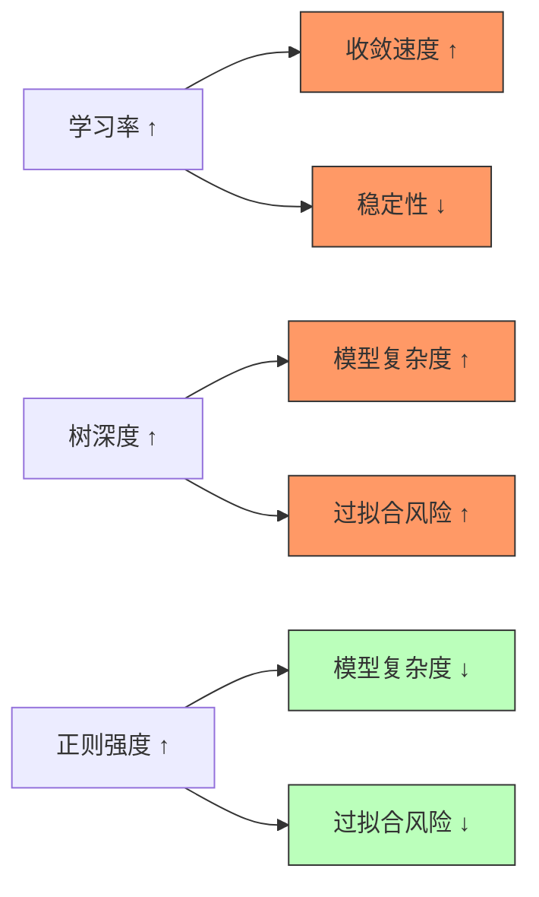
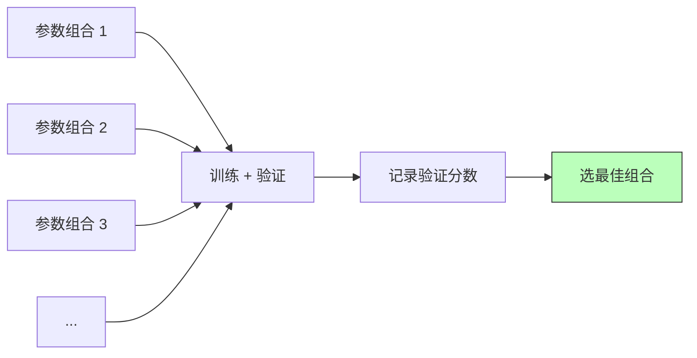
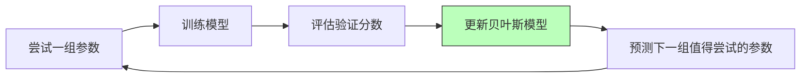
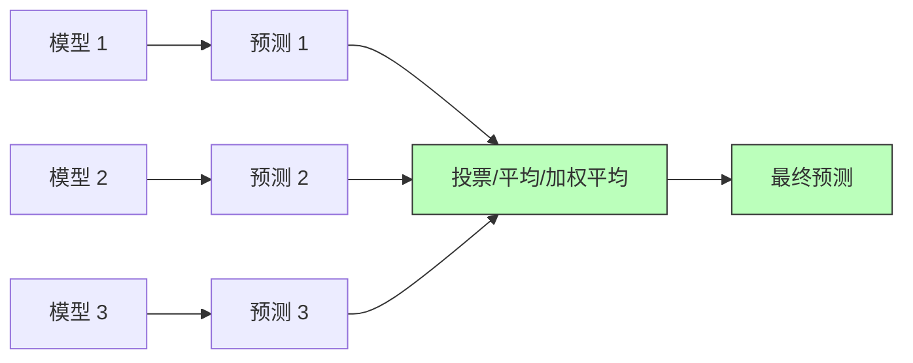
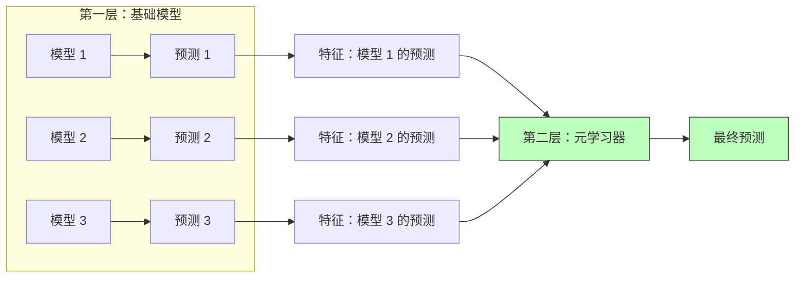
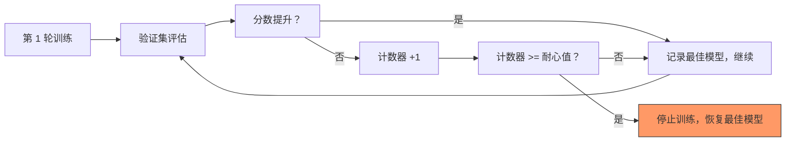

# 第21章 模型调优与集成学习：榜单上的最后几名

有了基线模型和可靠的验证方案后，接下来要做的是榜单上的最后几名：通过超参数调优让模型更强，通过集成学习让多个模型取长补短。本章我们讲模型调优与集成学习的通用技巧：超参数是什么、网格搜索与随机搜索、贝叶斯优化、集成学习（投票、平均、加权平均）、Stacking、早停。所有代码都可以直接在 Kaggle Notebooks 里运行。

---

## 21.1 超参数是什么：学习率、树深度、正则强度

### 模型参数 vs 超参数

- **模型参数**：由数据学习出来的，比如线性回归的系数、神经网络的权重。你不需要手动设定，模型在训练时自动优化。
- **超参数**：由人提前设定的，控制模型的复杂度和训练行为，比如学习率、树深度、正则强度。你需要在训练前先给定一个值，然后通过验证集看效果。

用大白话说：模型参数是模型「学」来的，超参数是模型「怎么学」的设置。

### 常见超参数及其直观影响

| 模型 | 超参数 | 作用 | 越大 | 越小 |
|------|--------|------|------|------|
| 所有梯度下降模型 | 学习率 | 每次更新迈多大步子 | 收敛快但易震荡/不收敛 | 收敛慢但稳 |
| 决策树/树模型 | 树深度（max_depth） | 树能长多深 | 更容易过拟合 | 欠拟合风险大 |
| 树模型 | 最小叶子样本数（min_samples_leaf） | 每个叶子节点最少多少样本 | 更泛化，但可能欠拟合 | 更容易记住训练数据 |
| 线性模型/神经网络 | 正则强度（alpha/lambda） | 对复杂模型的惩罚 | 防止过拟合，但可能欠拟合 | 更容易过拟合 |
| XGBoost/LightGBM | 子采样比例（subsample） | 每棵树随机用多少比例样本 | 更稳，但可能欠拟合 | 更容易过拟合 |

> **Mermaid 图表：超参数对模型复杂度的影响图**



---

## 21.2 网格搜索与随机搜索：有策略地尝试

调参的基本思路是：尝试几组常用参数，看验证集分数。

### GridSearchCV：穷举所有组合

```python
from sklearn.model_selection import GridSearchCV
from sklearn.ensemble import RandomForestRegressor

param_grid = {
    'n_estimators': [100, 200, 300],
    'max_depth': [5, 10, 20, None],
    'min_samples_leaf': [1, 2, 4]
}

grid_search = GridSearchCV(
    RandomForestRegressor(random_state=42, n_jobs=-1),
    param_grid,
    cv=5,
    scoring='neg_mean_squared_error',
    n_jobs=-1
)
grid_search.fit(X_train, y_train)
print('最佳参数:', grid_search.best_params_)
print('最佳得分:', np.sqrt(-grid_search.best_score_))
```

GridSearchCV 会把所有参数组合都跑一遍，保证找到候选空间里的最优解，但计算代价很高（组合数呈指数增长）。

### RandomizedSearchCV：随机采样

```python
from sklearn.model_selection import RandomizedSearchCV
import scipy.stats as stats

param_dist = {
    'n_estimators': stats.randint(100, 1000),
    'max_depth': [3, 5, 7, 10, None],
    'learning_rate': stats.uniform(0.01, 0.2)
}

random_search = RandomizedSearchCV(
    xgb.XGBRegressor(random_state=42, n_jobs=-1),
    param_distributions=param_dist,
    n_iter=50,  # 只尝试 50 组组合
    cv=5,
    scoring='neg_mean_squared_error',
    random_state=42,
    n_jobs=-1
)
random_search.fit(X_train, y_train)
```

RandomizedSearchCV 从参数分布里随机采样，只跑指定次数（n_iter），计算代价低得多，在大多数情况下能找到接近最优的参数。

**选择建议**：参数少的时候用 GridSearchCV；参数多、计算代价高的时候用 RandomizedSearchCV。

> **Mermaid 图表：网格搜索示意图**



---

## 21.3 贝叶斯优化：聪明一点的调参方式

网格搜索和随机搜索都是「盲目尝试」，不利用历史结果。贝叶斯优化则根据历史结果预测哪些超参数组合更值得尝试，适合评估代价高昂的模型（如深度学习、大规模 XGBoost）。

### Optuna 贝叶斯调参简例

```python
import optuna
import xgboost as xgb
from sklearn.model_selection import cross_val_score

def objective(trial):
    params = {
        'n_estimators': trial.suggest_int('n_estimators', 100, 1000),
        'max_depth': trial.suggest_int('max_depth', 3, 10),
        'learning_rate': trial.suggest_float('learning_rate', 0.01, 0.3),
        'subsample': trial.suggest_float('subsample', 0.6, 1.0),
        'colsample_bytree': trial.suggest_float('colsample_bytree', 0.6, 1.0),
        'random_state': 42,
        'n_jobs': -1
    }
    model = xgb.XGBRegressor(**params)
    score = cross_val_score(model, X_train, y_train, cv=3, scoring='neg_mean_squared_error').mean()
    return np.sqrt(-score)

study = optuna.create_study(direction='minimize')
study.optimize(objective, n_trials=100)
print('最佳参数:', study.best_params)
print('最佳 RMSE:', study.best_value)
```

Optuna 会自动记录每次试验的结果，并根据历史结果决定下次尝试哪些参数。通常比网格搜索和随机搜索更高效，尤其是参数空间很大时。

> **Mermaid 图表：贝叶斯优化循环图**



---

## 21.4 集成学习：投票、平均、加权平均取长补短

集成学习的核心思想是：多个模型的预测取平均，通常比单一模型更稳。不同的模型容易犯不同的错误，取平均可以抵消一部分误差。

### 硬投票 vs 软投票

- **硬投票**：每个模型预测一个类别，得票最多的类别胜出。适用于分类。
- **软投票**：每个模型预测一个概率，把概率取平均。适用于分类，且能保留模型的置信度信息。

```python
from sklearn.ensemble import VotingClassifier, VotingRegressor
from sklearn.linear_model import LogisticRegression
from sklearn.ensemble import RandomForestClassifier
import xgboost as xgb

# 软投票分类
voting_clf = VotingClassifier(
    estimators=[
        ('lr', LogisticRegression(max_iter=1000)),
        ('rf', RandomForestClassifier(n_estimators=200, random_state=42)),
        ('xgb', xgb.XGBClassifier(n_estimators=200, random_state=42))
    ],
    voting='soft'
)
voting_clf.fit(X_train, y_train)

# 投票回归
voting_reg = VotingRegressor(
    estimators=[
        ('ridge', Ridge(alpha=10.0)),
        ('rf', RandomForestRegressor(n_estimators=200, random_state=42)),
        ('xgb', xgb.XGBRegressor(n_estimators=200, random_state=42))
    ]
)
voting_reg.fit(X_train, y_train)
```

### 加权平均

如果某个模型明显更强，可以给它更高的权重：

```python
# 假设有三个模型的验证集预测概率
pred_lr = lr.predict_proba(X_valid)[:, 1]
pred_rf = rf.predict_proba(X_valid)[:, 1]
pred_xgb = xgb.predict_proba(X_valid)[:, 1]

# 网格搜索最优权重
best_score = 0
best_weights = (1/3, 1/3, 1/3)
for w1 in np.arange(0, 1.05, 0.1):
    for w2 in np.arange(0, 1.05 - w1, 0.1):
        w3 = 1 - w1 - w2
        ensemble = w1 * pred_lr + w2 * pred_rf + w3 * pred_xgb
        score = roc_auc_score(y_valid, ensemble)
        if score > best_score:
            best_score = score
            best_weights = (w1, w2, w3)

print('最佳权重:', best_weights)
print('集成 AUC:', best_score)
```

> **Mermaid 图表：集成学习结构图**



---

## 21.5 Stacking：用模型去预测模型的预测

Stacking 是更高级的集成方式：第一层模型的预测结果作为第二层模型的输入，元学习器（通常是简单的线性模型）做最终组合。

### Stacking 两层结构

```
第一层：模型 1、模型 2、模型 3 → 各自的预测
        ↓
第二层：元学习器（如逻辑回归、岭回归） → 最终预测
```

```python
from sklearn.ensemble import StackingRegressor
from sklearn.linear_model import Ridge

stacking_reg = StackingRegressor(
    estimators=[
        ('ridge', Ridge(alpha=10.0)),
        ('rf', RandomForestRegressor(n_estimators=200, random_state=42)),
        ('xgb', xgb.XGBRegressor(n_estimators=200, random_state=42))
    ],
    final_estimator=Ridge(alpha=1.0),
    cv=5
)
stacking_reg.fit(X_train, y_train)
```

Stacking 的关键是：第一层模型的预测必须用交叉验证得到的「Out-of-Fold」预测，不能用在训练集上训练过的模型直接预测训练集，否则会有目标泄漏。`StackingRegressor` 内部已经处理好了这个问题。

> **Mermaid 图表：Stacking 两层结构图**



---

## 21.6 早停：验证分数不再提升时停止训练

早停（Early Stopping）是防止过拟合的简单有效方法：在训练过程中监控验证集分数，如果连续若干轮验证分数不再提升，就提前停止训练。

```python
import xgboost as xgb

model = xgb.XGBRegressor(
    n_estimators=1000,
    max_depth=8,
    learning_rate=0.05,
    random_state=42,
    n_jobs=-1
)

model.fit(
    X_train, y_train,
    eval_set=[(X_valid, y_valid)],
    early_stopping_rounds=50,  # 连续 50 轮验证集分数不提升就停止
    verbose=False
)

print("最佳迭代轮数:", model.best_iteration)
```

> **Mermaid 图表：早停机制示意图**



早停的好处是：既不用预先猜测该训练多少轮，又能自动在过拟合开始前停止，节省计算时间。

---

## 21.7 小结

本章我们学习了模型调优与集成学习的通用技巧：

1. **超参数**：由人提前设定，控制模型复杂度。学习率、树深度、正则强度是最常见的三个。超参数越大不代表越好，要在验证集上找平衡点。
2. **网格搜索与随机搜索**：GridSearchCV 穷举所有组合，RandomizedSearchCV 随机采样。参数少用前者，参数多用后者。
3. **贝叶斯优化**：根据历史结果预测哪些参数组合更值得尝试，适合评估代价高昂的模型。Optuna 是常用库。
4. **集成学习**：多个模型取长补短。硬投票/软投票、加权平均、Stacking 都能提升稳定性和分数。
5. **早停**：验证集分数不再提升时停止训练，防止过拟合，节省计算时间。

下一章我们将讲比赛策略与心态：如何选比赛、先跑基线再优化、防止过拟合、提交策略、团队合作，以及从前 10% 到前 1% 的细节。
