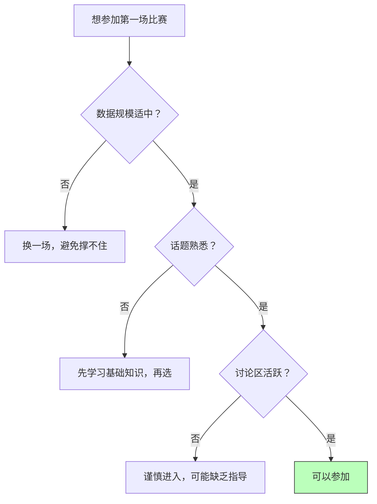
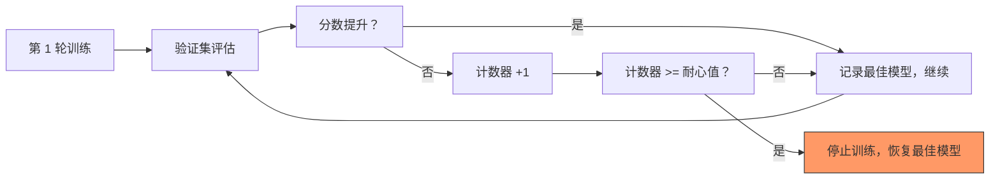

# 第22章 比赛策略与心态

参加 Kaggle 比赛，模型和代码只是一半，另一半是策略和心态。很多新手不仅卡在模型调不出来，还卡在「选错比赛」、「一上来就搞复杂模型」、「过度关注单次排名」、「提交次数浪费在微小改动」等问题上。本章我们讲比赛策略与心态：如何选比赛、先跑基线再优化、防止过拟合、提交策略、团队合作，以及从前 10% 到前 1% 的细节。

---

## 22.1 选比赛：适合新手入手的比赛类型

第一场比赛选得好，能让你快速建立信心；选得不好，可能挫败到不想再参加第二场。

### 适合新手入手的比赛特征

| 特征 | 为什么重要 |
|------|-----------|
| 奖金不高、没有严格截止压力 | 避免第一场就选奖金几万美元、只有两周时间的顶尖比赛，新手容易被吓到 |
| 数据规模适中 | 几百 MB 以内的表格数据、几万张以内的图片，笔记本电脑就能跑，不用冲云服务器 |
| 话题熟悉 | 房价预测、猫狗分类、情感分析这类题目，不需要你懂生物学或金融专业知识 |
| 讨论区活跃 | 进入比赛前先逛一逛讨论区，如果有很多新手问「数据怎么读」「提交格式怎么写」，说明这场比赛对新手友好 |
| 基线简单、有充分资料 | 能快速跑出第一个提交，建立「我能参加比赛」的信心 |

### 推荐的入门比赛

- **House Prices（房价预测）**：表格回归，数据清晰，指标直观（RMSE），讨论区资料丰富。
- **Titanic（泰坦尼克号生存预测）**：表格二分类，数据很小，适合完全零基础。
- **Dogs vs. Cats（猫狗大战）**：图像入门，2.5 万张图，完全平衡，LogLoss 指标。

### 避免的比赛

- 第一场就选需要大规模 GPU 集群的深度学习比赛。
- 第一场就选需要专业领域知识（如基因组学、气象学）的比赛。
- 只有几天截止时间、竞争极其激烈的顶尖奖金比赛。

> **Mermaid 图表：选比赛决策流程图**



---

## 22.2 先跑通基线，再优化：不要一上来就搞复杂模型

新手最大的心理障碍是「我的模型还不够好，不敢提交」。其实完全不需要等模型好再提交——你的第一个目标应该是把「读数据 → 建模 → 预测 → 提交 → 查排名」这条完整链路跑通，哪怕预测值是全部填同一个数。

### 均值基线

最简单的基线模型叫做「均值基线」：把训练集里目标变量的平均值算出来，把这个平均值填到测试集的每一行，生成提交文件并上传。这个分数可能很低，但它告诉你：「我已经知道怎么提交了，后续只需要不断改进模型就行。」

### 逐步优化

跑通基线后，不要一上来就换复杂模型。建议的优化顺序：

1. **先跑最简单模型**（线性回归、逻辑回归、均值基线），建立可比较的分数。
2. **做特征工程**（缺失值处理、类别编码、特征构造），观察分数提升。
3. **换更强模型**（随机森林、XGBoost），再次观察分数。
4. **做模型调优和集成**，榜单上的最后几名。

每次只改一处，观察分数变化。如果分数没提升，立即撤销，不要盲目累加修改。

---

## 22.3 防止过拟合：验证集是唯一真神

训练集上的高分不可信，很多模型在训练集上能跑到 99% 准确率，提交到排行榜上却惨不忍睹。这是因为模型「背诵」了训练数据，没有学到通用规律。

### 如何判断过拟合

- 训练集分数很高，验证集分数很低 = 过拟合。
- 训练集和验证集分数都低 = 欠拟合。
- 两边分数都高且接近 = 模型效果好。

### 防止过拟合的方法

1. **以验证集分数为准决策**：训练集分数虚高不可信，只看验证集。
2. **早停（Early Stopping）**：在验证集分数不再提升时停止训练，不要一直训到训练集完美。
3. **交叉验证**：用 K 折交叉验证获得更可靠的分数，避免单次划分的运气成分。
4. **正则化**：L1/L2 正则、Dropout 等给复杂模型加「惩罚」。

```python
# XGBoost 早停示例
model = xgb.XGBRegressor(
    n_estimators=1000,
    max_depth=8,
    learning_rate=0.05,
    random_state=42
)
model.fit(
    X_train, y_train,
    eval_set=[(X_valid, y_valid)],
    early_stopping_rounds=50,  # 连续 50 轮验证集分数不提升就停止
    verbose=False
)
```

> **Mermaid 图表：早停机制示意图**



---

## 22.4 提交策略：每天提几次，提交什么版本

Kaggle 比赛通常有每天提交次数上限（比如每天 5 次），不要浪费在微小改动上。

### 提交策略建议

1. **每次只改一处重要的东西**：比如换了特征工程方法、换了模型、调了超参数。不要一次改五处，否则分数变了你也不知道是哪处起作用。
2. **重大改进后再提交**：不要因为分数微调 0.001 就提交，保留次数用在真正有提升的时候。
3. **记录每个版本做了什么**：用笔记本或文档记录「版本 1：均值基线，分数 0.5；版本 2：加了缺失值填充，分数 0.65；版本 3：换了 XGBoost，分数 0.78」。这样出问题时可以回溯。
4. **不要过度关注单次排名波动**：排行榜分数会波动，本地验证集分数稳定提升才是可信的。

---

## 22.5 团队合作与代码共享：Kaggle 团队怎么协作

Kaggle 支持组队参赛，团队合作可以互补优势，但也需要注意协作方式。

### 组队规则

- 组队后，团队共享排行榜排名和提交次数。
- 比赛截止前可以组队，截止后不能再变更队伍。
- 奖金会按团队分配，具体规则看比赛页面。

### 代码共享

- 可以共享 Kaggle Notebooks，队友可以查看和运行你的代码。
- 可以通过 GitHub 等外部平台管理代码，但要注意比赛规则是否允许外部代码共享。
- 不要共享账号或恶意刷分，不要多个账号参加同一场比赛刷排名。

### 建议

新手第一场可以单打独斗，熟悉流程后再考虑组队。组队时找互补的队友（比如一个擅长特征工程，一个擅长模型调优），沟通明确，避免重复劳动。

---

## 22.6 从前 10% 到前 1%：细节决定成败

进入前 10% 通常只需要跑通基线、做基础特征工程、用 XGBoost 调个参。但从前 10% 到前 1%，靠的不再是「换个更大的模型」，而是很多小改进的累加。

### 前 1% 的选手通常做的事

- **特征工程的细节**：缺失值按语义填充、类别编码选对方法、特征构造有业务含义、稀有类别合并。
- **验证方案的严谨**：按时间切分验证集、分层抽样、检查目标泄漏、不迷信单一本地指标。
- **集成的权重调整**：多个模型加权融合，Stacking，多折平均。
- **对评测机制的深刻理解**：知道 F2 偏向召回、LogLoss 惩罚过度自信、AUC 只看排序，并据此调整模型和阈值。

### 心态建设

- **不要被排名吓到**：第一次提交可能排名靠后，这是正常的。顶尖选手也是从基线开始一步步爬上去的。
- **不要过度优化单一指标**：验证集分数高不代表排行榜高，要关注模型的泛化能力。
- **享受过程**：Kaggle 比赛是学习机器学习的绝佳机会，每一次提交、每一次调参都在积累经验。

---

## 22.7 小结

本章我们学习了比赛策略与心态：

1. **选比赛**：数据规模适中、话题熟悉、讨论区活跃、基线简单的比赛适合新手；避免第一场就选需要大规模 GPU 或专业领域知识的比赛。
2. **先跑通基线**：均值基线跑通全链路，再逐步优化，每次只改一处。
3. **防止过拟合**：以验证集分数为准，用早停、交叉验证、正则化。
4. **提交策略**：每次只改一处重要的东西，重大改进后再提交，记录每个版本，不要过度关注单次排名。
5. **团队合作**：找互补队友，沟通明确，遵守比赛规则。
6. **从前 10% 到前 1%**：靠特征工程细节、验证方案严谨、集成权重调整和对评测机制的深刻理解累加而来。

下一章我们将讲从 Kaggle 到实际机器学习项目的迁移：比赛数据与真实业务数据的区别、把竞赛 Notebook 变成可维护的项目代码、模型部署基础，以及继续学习的路径。
