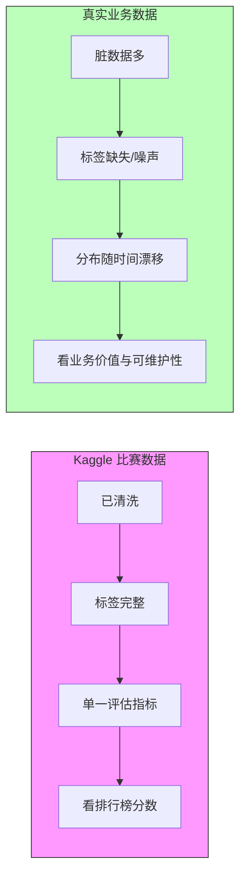
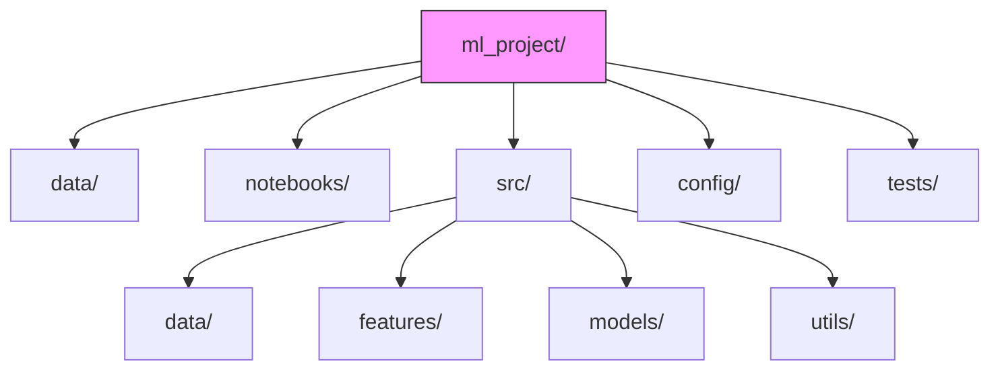
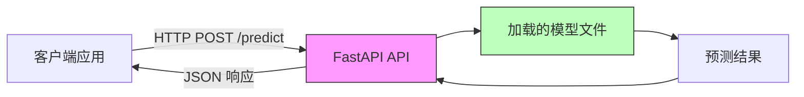
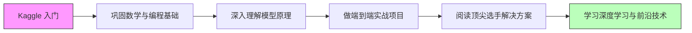

# 第23章 从 Kaggle 到实际机器学习项目

参加了几场 Kaggle 比赛、跑通了不少模型后，你可能会想：这些技能能不能用到实际工作中？答案是能，但比赛数据和真实业务数据有明显区别，比赛 Notebook 也不能直接当成项目代码用。本章我们讲如何把 Kaggle 经验迁移到实际机器学习项目：比赛数据与真实业务数据的区别、把竞赛 Notebook 变成可维护的项目代码、模型部署基础，以及继续学习的路径。

---

## 23.1 比赛数据与真实业务数据的区别

Kaggle 比赛数据通常已经经过一定的清洗，标签完整，评价指标单一，而且只关心排行榜分数。真实业务数据则截然不同。

| 方面 | Kaggle 比赛数据 | 真实业务数据 |
|------|----------------|-------------|
| 数据质量 | 通常已清洗、缺失值少、格式统一 | 脏数据多、缺失值多、格式不统一 |
| 标签 | 完整、人工标注或已有答案 | 缺失、噪声大、可能需要人工标注 |
| 分布 | 训练集和测试集来自同一分布 | 数据分布会随时间漂移（概念漂移） |
| 目标 | 看排行榜分数，分数越高越好 | 看可解释性、稳定性、维护成本、业务价值 |
| 外部数据 | 通常限制使用 | 可以接入多种数据源 |
| 评估 | 离线排行榜分数 | 线上 A/B 测试、业务指标（转化率、留存率等） |

> **Mermaid 图表：比赛 vs 业务数据对比图**



这意味着：在 Kaggle 上拿到前 10%，不代表在实际项目中就能直接部署。实际项目更看重模型的稳定性、可解释性、维护成本，以及是否真的解决了业务问题。

---

## 23.2 把竞赛 Notebook 变成可维护的项目代码

Kaggle Notebook 通常是一个单文件，代码、注释、输出全混在一起，适合快速实验，但不适合长期维护。实际项目需要把代码拆成模块，加入日志、配置文件和测试。

### 从单文件 Notebook 到模块化项目

一个典型的机器学习项目目录结构如下：

```
ml_project/
├── data/              # 原始数据和处理后数据
│   ├── raw/
│   └── processed/
├── notebooks/         # 探索性分析 Notebook
├── src/               # 源代码
│   ├── data/          # 数据处理模块
│   │   ├── __init__.py
│   │   ├── load.py    # 数据加载
│   │   └── clean.py   # 数据清洗
│   ├── features/      # 特征工程模块
│   │   ├── __init__.py
│   │   └── build.py   # 特征构造
│   ├── models/        # 模型模块
│   │   ├── __init__.py
│   │   ├── train.py   # 模型训练
│   │   └── predict.py # 模型预测
│   └── utils/         # 工具模块
│       ├── __init__.py
│       └── helpers.py
├── config/            # 配置文件
│   └── config.yaml
├── tests/             # 单元测试
├── requirements.txt   # 依赖包
├── README.md          # 说明文档
└── main.py            # 入口脚本
```

### 模块化代码示例

**数据加载模块**（`src/data/load.py`）：

```python
import pandas as pd
from pathlib import Path
import logging

logger = logging.getLogger(__name__)

def load_data(data_path: str) -> pd.DataFrame:
    """加载 CSV 数据文件"""
    path = Path(data_path)
    if not path.exists():
        raise FileNotFoundError(f"Data file not found: {data_path}")
    logger.info(f"Loading data from {data_path}")
    return pd.read_csv(path)
```

**特征工程模块**（`src/features/build.py`）：

```python
import pandas as pd
import numpy as np
import logging

logger = logging.getLogger(__name__)

def build_features(df: pd.DataFrame) -> pd.DataFrame:
    """构造特征"""
    df = df.copy()
    # 示例：日期特征拆分
    if 'date' in df.columns:
        df['date'] = pd.to_datetime(df['date'])
        df['year'] = df['date'].dt.year
        df['month'] = df['date'].dt.month
        df['day'] = df['date'].dt.day
    logger.info(f"Built features, shape: {df.shape}")
    return df
```

**模型训练模块**（`src/models/train.py`）：

```python
import pandas as pd
import numpy as np
from sklearn.model_selection import train_test_split
from sklearn.ensemble import RandomForestRegressor
from sklearn.metrics import mean_squared_error
import joblib
import logging

logger = logging.getLogger(__name__)

def train_model(X: pd.DataFrame, y: pd.Series, model_path: str):
    """训练模型并保存"""
    X_train, X_valid, y_train, y_valid = train_test_split(
        X, y, test_size=0.2, random_state=42
    )
    
    model = RandomForestRegressor(n_estimators=100, random_state=42)
    model.fit(X_train, y_train)
    
    # 验证
    y_pred = model.predict(X_valid)
    rmse = np.sqrt(mean_squared_error(y_valid, y_pred))
    logger.info(f"Validation RMSE: {rmse:.4f}")
    
    # 保存模型
    joblib.dump(model, model_path)
    logger.info(f"Model saved to {model_path}")
    return model
```

**入口脚本**（`main.py`）：

```python
from src.data.load import load_data
from src.features.build import build_features
from src.models.train import train_model
import logging

logging.basicConfig(level=logging.INFO)

def main():
    # 1. 加载数据
    df = load_data('data/raw/train.csv')
    
    # 2. 特征工程
    df = build_features(df)
    
    # 3. 训练模型
    X = df.drop('target', axis=1)
    y = df['target']
    train_model(X, y, 'models/model.pkl')

if __name__ == '__main__':
    main()
```

> **Mermaid 图表：机器学习项目目录结构图**



---

## 23.3 模型部署基础：从 Notebook 到简单 API

训练好模型后，如果要让其他系统使用，需要把模型封装成 API 接口。最常见的做法是用 Flask 或 FastAPI 把模型封装成 HTTP 接口，接收数据返回预测。

### FastAPI 预测接口简例

```python
from fastapi import FastAPI
from pydantic import BaseModel
import joblib
import pandas as pd
import logging

logging.basicConfig(level=logging.INFO)
logger = logging.getLogger(__name__)

app = FastAPI(title="ML Model API")

# 加载模型
model = joblib.load('models/model.pkl')

# 定义输入数据格式
class PredictionRequest(BaseModel):
    feature1: float
    feature2: float
    feature3: str

# 定义输出格式
class PredictionResponse(BaseModel):
    prediction: float

@app.post("/predict", response_model=PredictionResponse)
def predict(request: PredictionRequest):
    """接收数据，返回预测结果"""
    logger.info(f"Received prediction request: {request}")
    
    # 构造 DataFrame
    input_df = pd.DataFrame([{
        'feature1': request.feature1,
        'feature2': request.feature2,
        'feature3': request.feature3
    }])
    
    # 预测
    prediction = model.predict(input_df)[0]
    
    return PredictionResponse(prediction=float(prediction))

@app.get("/health")
def health():
    """健康检查接口"""
    return {"status": "healthy"}
```

运行 API：

```bash
uvicorn main:app --reload
```

然后就可以用 `curl` 或浏览器访问 `http://localhost:8000/predict` 发送预测请求了。

> **Mermaid 图表：模型部署请求响应图**



---

## 23.4 继续学习的路径与社区资源

Kaggle 只是机器学习入门的一个起点，想要深入，还需要继续学习。

### 推荐学习路径

1. **巩固基础**：线性代数、概率统计、Python 编程、pandas/NumPy/scikit-learn。
2. **深入模型**：理解各种算法的原理（不仅仅是会调用），如梯度下降、决策树、神经网络。
3. **实战项目**：除了 Kaggle，可以在 GitHub 上找开源数据集，做完整的端到端项目（数据清洗 → 特征工程 → 模型训练 → 部署）。
4. **阅读顶尖方案**：Kaggle 比赛结束后，顶尖选手会发布解决方案报告，阅读这些报告能学到很多调参和特征工程的技巧。
5. **学习深度学习**：PyTorch 或 TensorFlow，了解 CNN、RNN、Transformer 等架构。

### 社区资源

- **Kaggle 论坛和代码笔记本**：学习他人解题思路，是最好的免费教材。
- **GitHub**：搜索比赛名称 + "solution"，能找到很多开源代码。
- **课程**：Coursera、fast.ai、吴恩达的机器学习课程等。
- **论文**：arXiv 上的机器学习论文，了解前沿技术。

> **Mermaid 图表：学习路径建议图**



---

## 23.5 小结

本章我们学习了从 Kaggle 到实际机器学习项目的迁移：

1. **比赛数据与真实业务数据的区别**：比赛数据已清洗、标签完整、看排行榜分数；真实业务数据脏、标签缺失、分布漂移、看业务价值与可维护性。
2. **把竞赛 Notebook 变成可维护的项目代码**：从单文件 Notebook 拆分为数据处理、特征工程、模型训练、预测四个模块；加入日志、配置文件和单元测试。
3. **模型部署基础**：用 Flask/FastAPI 把模型封装成 HTTP 接口，接收数据返回预测。
4. **继续学习的路径**：巩固基础、深入模型原理、做端到端项目、阅读顶尖方案、学习深度学习。

恭喜你！到这里，这本书的所有内容就讲完了。从 Kaggle 平台的初体验，到表格、时序、图像、文本四种数据格式的通用方法与代表比赛详解，再到模型评估、调优、集成、比赛策略，最后到从比赛迁移到实际项目，你已经拥有了参加 Kaggle 比赛和做机器学习项目的完整知识体系。

机器学习是一门需要不断实践的技能，书本和视频只能给你指路，真正的成长来自于亲手写代码、跑模型、踩坑、调参。祝你在 Kaggle 的旅程中收获满满，早日跻身前 1%！
